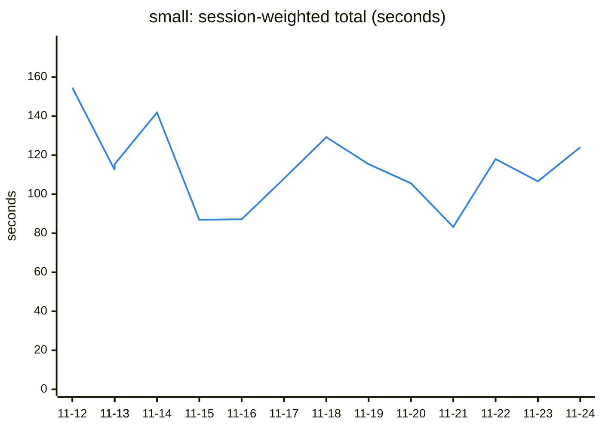
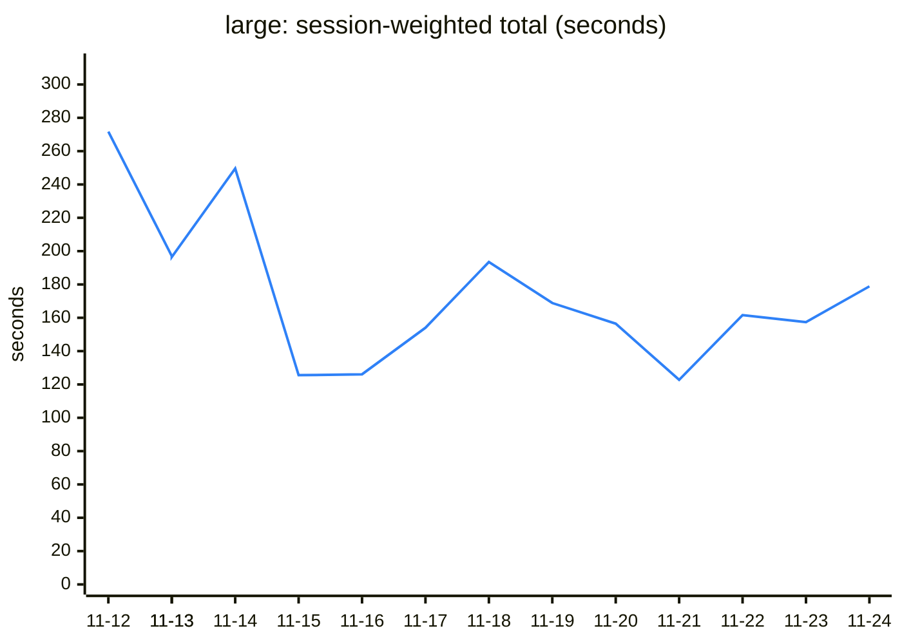
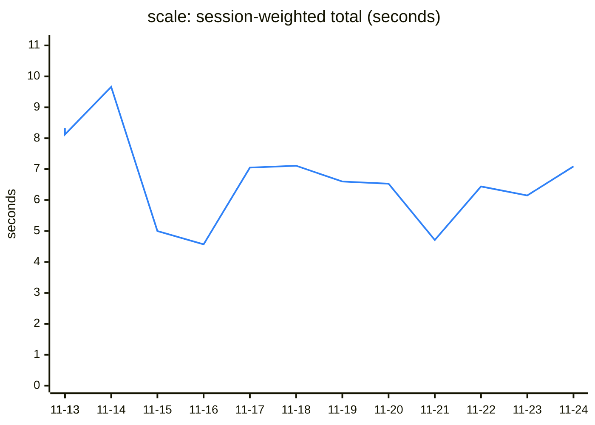
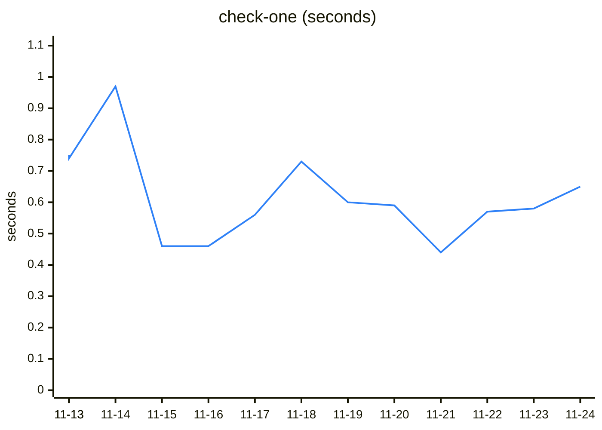
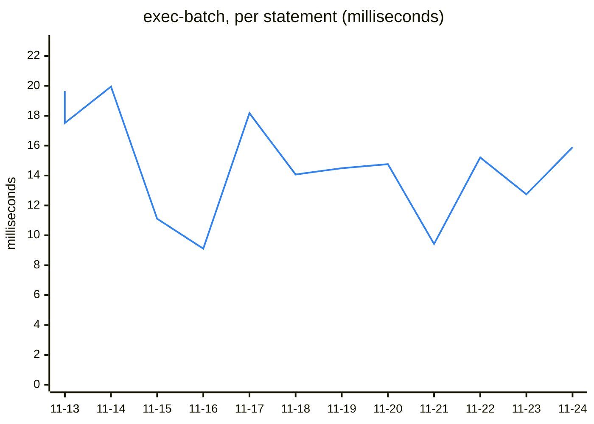
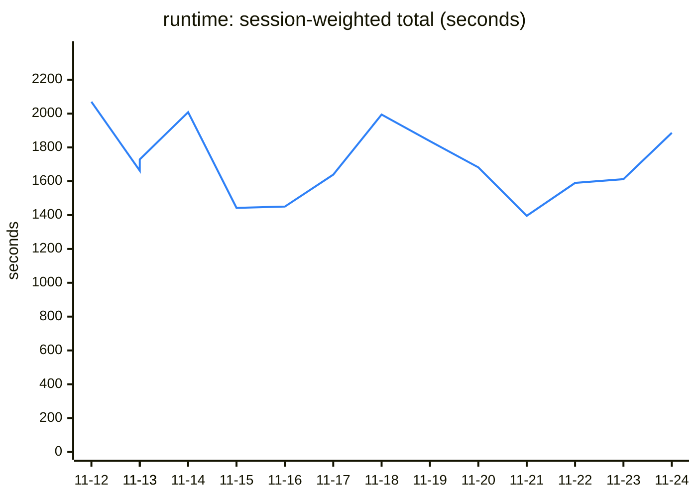

# Agent dev-loop benchmark — trend

14 runs, 2026-11-12 to 2026-11-24. Latest: `mxcli version 2e845ff (2026-11-24T12:02:13Z)` against `mxcli version nightly-20261123-a3fb30ffd (2026-11-23T11:19:56Z)`.

Generated by `scripts/agentbench/trend` after each run; do not edit. Times are the candidate's median wall time on that night's runner, so two nights differ by the machine as well as by the code: read a level that stays, not one night's step. How to read it: `docs-site/src/internals/agent-benchmark.md` on `main`.

## Alerts

- **counts-increased**, runtime session, step `apply-entity`: units read from a file or the unit store: 108, the baseline 107

## small project — 370 units

| step | latest | run before | median of the 7 before | against that median | against its baseline, latest | last runs |
|---|---:|---:|---:|---:|---:|---|
| (session-weighted total) | 124.1 s | 106.6 s | 108.0 s | × 1.15 | × 1.00 | █▄▄▇▁▁▃▆▄▃▁▄▃▅ |
| open-cold | 222 ms | 184 ms | 188 ms | × 1.18 | × 1.13 | ▆▆▇▆▃▁▅▆▇▆▃▅▅█ |
| open | 64 ms | 57 ms | 57 ms | × 1.12 | × 1.07 | █▃▅█▂▁▅█▇▄▂▄▅▇ |
| domain | 849 ms | 690 ms | 697 ms | × 1.22 | × 1.00 | █▁▁▂▁▁▁▂▂▁▁▁▁▂ |
| microflows | 664 ms | 532 ms | 598 ms | × 1.11 | × 1.01 | █▃▅▄▂▁▃▄▄▄▂▃▂▄ |
| pages | 2.05 s | 1.75 s | 1.75 s | × 1.17 | × 1.00 | █▂▄▄▁▁▃▄▃▂▁▄▃▄ |
| describe | 152 ms | 124 ms | 124 ms | × 1.22 | × 1.03 | █▃▃▆▁▁▂▆▄▃▁▃▃▆ |
| catalog | 250 ms | 221 ms | 223 ms | × 1.12 | × 1.03 | █▄▄█▂▁▄█▆▄▁▄▄▆ |
| catalog-full | 1.29 s | 1.07 s | 1.11 s | × 1.16 | × 1.00 | █▃▄█▁▁▄█▆▅▁▄▃▆ |
| query | 91 ms | 78 ms | 82 ms | × 1.12 | × 0.97 | █▄▃█▁▁▄▇▆▄▁▄▃▆ |
| check | 393 ms | 336 ms | 336 ms | × 1.17 | × 1.01 | █▅▅█▁▁▂▄▃▂▁▂▂▄ |
| single-edit | 414 ms | 359 ms | 363 ms | × 1.14 | × 1.00 | █▄▄█▁▁▅█▆▄▁█▅▇ |
| catalog-after-edit | 267 ms | 232 ms | 244 ms | × 1.10 | × 1.01 | █▄▅█▁▁▅█▆▇▂▇▅█ |
| bulk-alter | 1.48 s | 1.33 s | 1.38 s | × 1.07 | × 1.00 | █▁▂▂▁▁▃▂▂▃▁▂▂▃ |
| re-exec | 703 ms | 588 ms | 589 ms | × 1.19 | × 1.00 | █▁▁▂▁▁▁▂▂▁▁▁▁▂ |
| rename | 592 ms | 487 ms | 509 ms | × 1.16 | × 0.98 | █▃▃▆▁▁▃▇▅▄▁█▃▆ |

## large project — 910 units

| step | latest | run before | median of the 7 before | against that median | against its baseline, latest | last runs |
|---|---:|---:|---:|---:|---:|---|
| (session-weighted total) | 178.9 s | 157.4 s | 157.4 s | × 1.14 | × 1.00 | █▄▄▇▁▁▂▄▃▂▁▃▂▄ |
| open-cold | 430 ms | 355 ms | 366 ms | × 1.18 | × 1.13 | ▄▆▄▄▂▁█▄▅▄▂▄▄▆ |
| open | 82 ms | 71 ms | 71 ms | × 1.16 | × 1.05 | █▄▃█▁▁▃▇▆▄▁▄▄▆ |
| domain | 992 ms | 837 ms | 837 ms | × 1.19 | × 0.99 | █▁▁▂▁▁▁▂▂▁▁▁▁▂ |
| microflows | 1.39 s | 1.25 s | 1.25 s | × 1.11 | × 1.00 | █▃▃▅▁▁▃▅▃▃▁▄▃▄ |
| pages | 2.50 s | 2.09 s | 2.09 s | × 1.19 | × 1.00 | █▂▂▄▁▁▂▄▃▂▁▅▂▄ |
| describe | 178 ms | 149 ms | 153 ms | × 1.16 | × 1.03 | █▃▃▆▁▁▃▆▄▃▁▃▃▅ |
| catalog | 384 ms | 332 ms | 336 ms | × 1.14 | × 1.01 | █▄▄█▁▁▄█▅▄▁▄▄▆ |
| catalog-full | 4.07 s | 3.36 s | 3.36 s | × 1.21 | × 0.99 | █▃▃█▁▁▃█▆▃▁▃▃▆ |
| query | 96 ms | 81 ms | 82 ms | × 1.18 | × 0.99 | █▃▄█▂▁▃█▆▄▁▄▄▇ |
| check | 598 ms | 528 ms | 521 ms | × 1.15 | × 1.00 | █▅▅▇▁▁▁▂▂▁▁▁▁▂ |
| single-edit | 589 ms | 525 ms | 525 ms | × 1.12 | × 1.00 | █▄▄█▁▁▄█▅▄▁▅▄▆ |
| catalog-after-edit | 406 ms | 354 ms | 361 ms | × 1.12 | × 1.03 | ▇▆▄▇▃▁▄▇▆█▃▆▅█ |
| bulk-alter | 1.77 s | 1.43 s | 1.65 s | × 1.07 | × 1.00 | █▂▁▂▁▁▂▃▂▂▁▃▁▃ |
| re-exec | 956 ms | 815 ms | 815 ms | × 1.17 | × 1.00 | █▁▁▂▁▁▁▂▂▁▁▁▁▂ |
| rename | 1.15 s | 950 ms | 1.02 s | × 1.13 | × 0.99 | █▄▄▇▁▁▆█▆▃▁▄▃▆ |

## scale project — 4374 units

| step | latest | run before | median of the 7 before | against that median | against its baseline, latest | last runs |
|---|---:|---:|---:|---:|---:|---|
| (session-weighted total) | 7.09 s | 6.15 s | 6.53 s | × 1.09 | × 1.01 | ▆▆█▁▁▄▄▄▄▁▃▃▄ |
| check-cold | 1.90 s | 1.73 s | 1.77 s | × 1.07 | × 1.04 | ▆▆█▁▁▅▅▄▄▁▄▄▅ |
| check-one | 646 ms | 583 ms | 583 ms | × 1.11 | × 1.01 | ▅▅█▁▁▂▅▃▃▁▃▃▄ |
| check-batch | 1.22 s | 1.01 s | 1.02 s | × 1.20 | × 1.00 | ▅▅█▁▁▂▅▄▃▁▃▃▄ |
| exec-batch | 1.59 s | 1.27 s | 1.45 s | × 1.10 | × 1.02 | █▇█▂▁▇▄▄▅▁▅▃▆ |
| re-exec-batch | 704 ms | 628 ms | 638 ms | × 1.10 | × 1.00 | ▆▆█▁▁▂▃▂▂▁▂▂▃ |
| new-batch | 1.04 s | 928 ms | 959 ms | × 1.08 | × 0.99 | ███▂▁▇▅▄▅▂▅▄▆ |

## running app — 476 units

| step | latest | run before | median of the 7 before | against that median | against its baseline, latest | last runs |
|---|---:|---:|---:|---:|---:|---|
| (session-weighted total) | 1886.3 s | 1612.5 s | 1639.0 s | × 1.15 | × 0.99 | █▄▄█▁▁▃█▆▄▁▃▃▆ |
| mx-check | 7.49 s | 5.95 s | 6.04 s | × 1.24 | × 0.98 | █▄▅█▂▂▄█▇▄▁▄▄▇ |
| build | 58.4 s | 50.0 s | 50.2 s | × 1.16 | × 1.00 | █▅▅█▂▁▄██▅▁▄▄█ |
| boot | 27.9 s | 24.6 s | 23.8 s | × 1.17 | × 1.00 | █▃▅▇▁▂▂▇▅▃▁▃▃▆ |
| page-check | 3.31 s | 2.84 s | 2.84 s | × 1.16 | × 0.97 | █▄▅█▁▃▄█▇▄▁▂▄█ |
| hot-apply | 5.01 s | 4.67 s | 4.91 s | × 1.02 | × 1.00 | █▄▅▇▂▁▃▇▄▄▁▂▂▄ |
| test-attach | 123 ms | 115 ms | 115 ms | × 1.06 | × 0.91 | █▃▄▇▃▁▃█▅▄▃▂▄▅ |
| apply-entity | 17.7 s | 15.6 s | 16.3 s | × 1.08 | × 1.01 | █▃▄▇▂▁▄▇▅▅▂▂▃▆ |
| stop | 739 ms | 736 ms | 737 ms | × 1.00 | × 1.00 | ▇▅▅▇▄▁▅▇▅▇▃█▅▅ |
| test-cold | 25.6 s | 20.5 s | 21.1 s | × 1.21 | × 1.04 | █▃▄█▁▁▄█▆▄▁▃▃█ |
