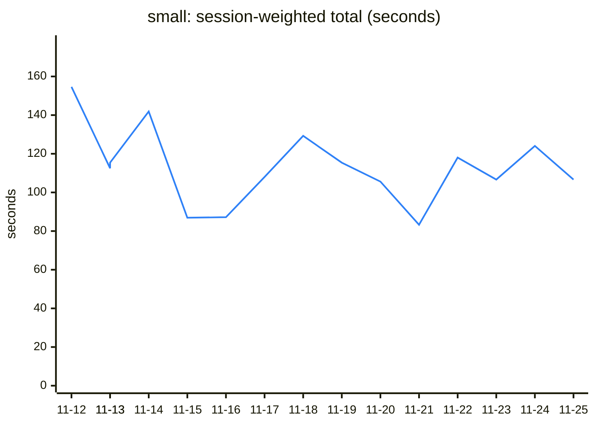
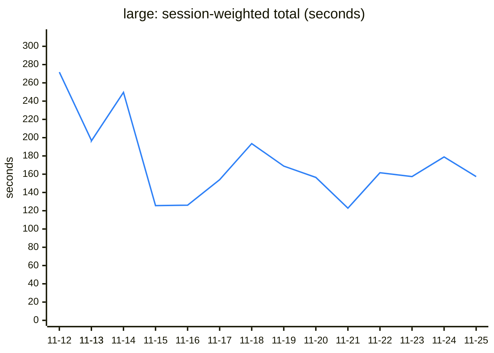
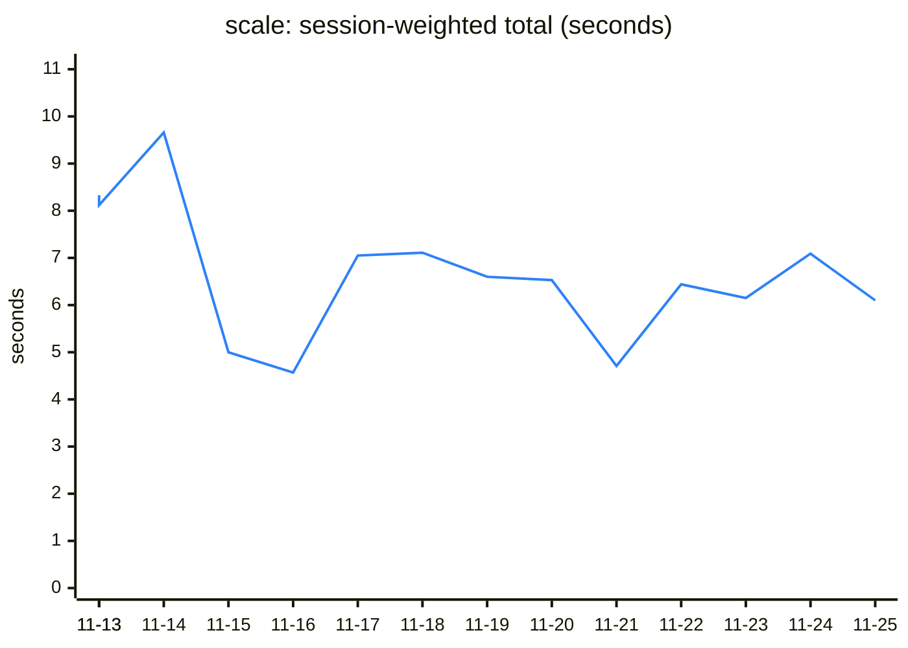
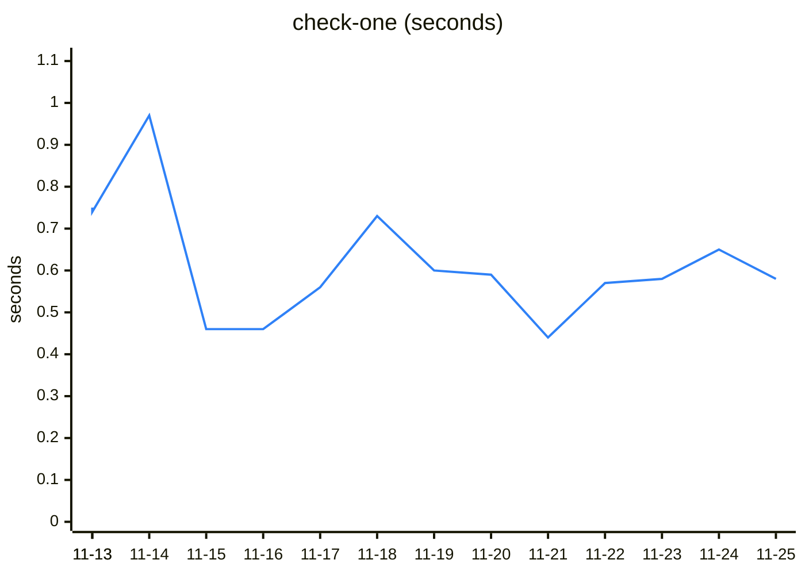
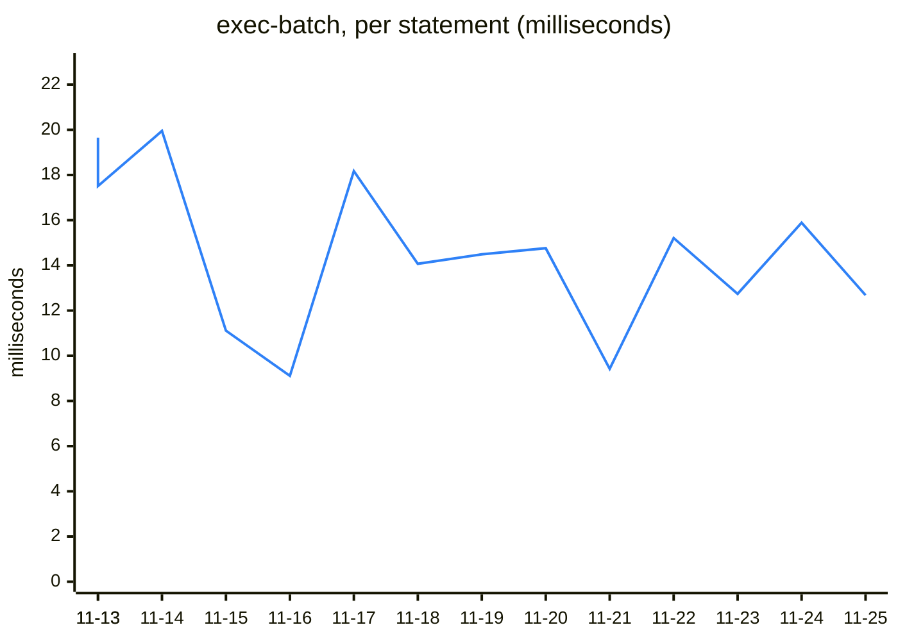
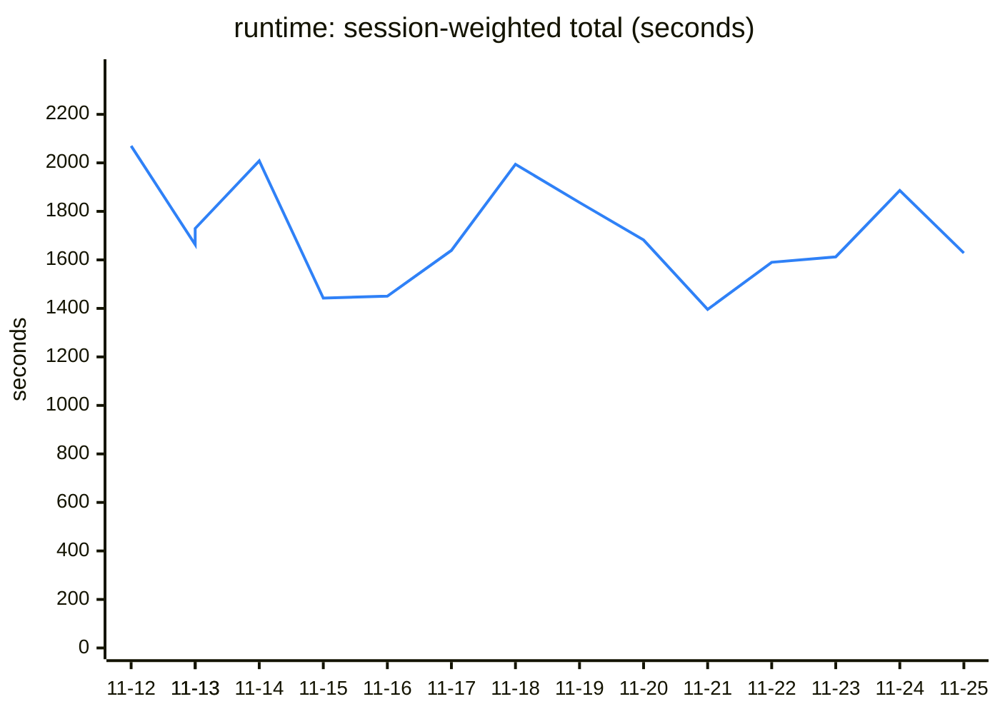

# Agent dev-loop benchmark — trend

15 runs, 2026-11-12 to 2026-11-25. Latest: `mxcli version 0ecca5c (2026-11-25T10:54:14Z)` against `mxcli version nightly-20261124-2e845ff13 (2026-11-24T12:58:25Z)`.

Generated by `scripts/agentbench/trend` after each run; do not edit. Times are the candidate's median wall time on that night's runner, so two nights differ by the machine as well as by the code: read a level that stays, not one night's step. How to read it: `docs-site/src/internals/agent-benchmark.md` on `main`.

## Alerts

None.

## small project — 370 units

| step | latest | run before | median of the 7 before | against that median | against its baseline, latest | last runs |
|---|---:|---:|---:|---:|---:|---|
| (session-weighted total) | 106.6 s | 124.1 s | 115.4 s | × 0.92 | × 1.01 | ▄▅█▁▁▄▇▅▄▁▅▄▆▄ |
| open-cold | 199 ms | 222 ms | 189 ms | × 1.05 | × 1.00 | ▆▇▆▃▁▅▆▇▆▃▅▅█▆ |
| open | 59 ms | 64 ms | 57 ms | × 1.04 | × 1.05 | ▃▅█▂▁▅█▇▄▂▄▅▇▅ |
| domain | 691 ms | 849 ms | 708 ms | × 0.98 | × 1.00 | ▄▄█▁▂▄█▇▅▁▅▄█▄ |
| microflows | 532 ms | 664 ms | 613 ms | × 0.87 | × 1.01 | ▄█▆▃▁▅▇▆▇▄▆▄▇▄ |
| pages | 1.68 s | 2.05 s | 1.91 s | × 0.88 | × 0.98 | ▄█▇▃▁▅█▇▄▁█▅█▄ |
| describe | 125 ms | 152 ms | 126 ms | × 0.99 | × 1.04 | ▄▄█▁▁▃█▆▄▁▃▃▇▃ |
| catalog | 230 ms | 250 ms | 225 ms | × 1.02 | × 1.05 | ▄▄█▂▁▄█▆▄▁▅▄▆▅ |
| catalog-full | 1.06 s | 1.29 s | 1.16 s | × 0.91 | × 1.00 | ▄▄█▂▁▄█▆▅▁▄▃▇▃ |
| query | 82 ms | 91 ms | 82 ms | × 1.00 | × 1.01 | ▄▄█▂▁▅█▆▅▁▅▄▇▅ |
| check | 339 ms | 393 ms | 336 ms | × 1.01 | × 1.00 | ▅▅█▁▁▃▄▃▂▁▂▂▄▂ |
| single-edit | 356 ms | 414 ms | 384 ms | × 0.93 | × 1.02 | ▄▄█▁▁▅█▆▄▁█▅▇▄ |
| catalog-after-edit | 235 ms | 267 ms | 247 ms | × 0.95 | × 1.00 | ▅▅█▁▁▅█▇▇▂▇▆█▆ |
| bulk-alter | 1.24 s | 1.48 s | 1.38 s | × 0.89 | × 1.03 | ▃▄▆▂▁▇▆▆█▁▅▅▇▄ |
| re-exec | 599 ms | 703 ms | 592 ms | × 1.01 | × 1.01 | ▃▅▇▁▂▄█▇▄▁▄▄█▅ |
| rename | 492 ms | 592 ms | 581 ms | × 0.85 | × 0.99 | ▃▃▆▁▁▃▇▅▄▁█▃▆▃ |

## large project — 910 units

| step | latest | run before | median of the 7 before | against that median | against its baseline, latest | last runs |
|---|---:|---:|---:|---:|---:|---|
| (session-weighted total) | 157.4 s | 178.9 s | 161.6 s | × 0.97 | × 1.00 | ▅▅█▁▁▂▅▃▃▁▃▃▄▃ |
| open-cold | 370 ms | 430 ms | 366 ms | × 1.01 | × 1.09 | ▆▄▄▂▁█▄▅▄▂▄▄▆▄ |
| open | 73 ms | 82 ms | 71 ms | × 1.03 | × 1.03 | ▅▄█▁▁▄█▆▄▁▄▅▇▅ |
| domain | 836 ms | 992 ms | 845 ms | × 0.99 | × 1.00 | ▄▄█▁▂▄█▇▄▁▅▅█▅ |
| microflows | 1.28 s | 1.39 s | 1.28 s | × 1.00 | × 1.02 | ▅▅█▂▁▅█▅▅▂▇▅▆▅ |
| pages | 2.08 s | 2.50 s | 2.32 s | × 0.90 | × 1.00 | ▃▃▅▁▁▃▆▅▃▁█▃▆▃ |
| describe | 155 ms | 178 ms | 155 ms | × 1.00 | × 1.01 | ▄▄█▁▁▄█▅▄▁▄▄▇▄ |
| catalog | 345 ms | 384 ms | 342 ms | × 1.01 | × 1.01 | ▄▄█▁▁▄█▅▄▁▄▄▆▅ |
| catalog-full | 3.28 s | 4.07 s | 3.36 s | × 0.98 | × 1.01 | ▃▃█▁▁▃█▆▃▁▃▃▇▃ |
| query | 81 ms | 96 ms | 83 ms | × 0.98 | × 0.96 | ▃▄█▂▁▃█▆▄▁▄▄▇▄ |
| check | 519 ms | 598 ms | 528 ms | × 0.98 | × 1.00 | ▆▆█▁▁▁▃▂▂▁▂▂▂▂ |
| single-edit | 525 ms | 589 ms | 546 ms | × 0.96 | × 0.99 | ▄▄█▁▁▄█▆▄▁▅▄▇▄ |
| catalog-after-edit | 368 ms | 406 ms | 371 ms | × 0.99 | × 1.00 | ▆▄▇▃▁▄▇▆█▃▆▅█▆ |
| bulk-alter | 1.53 s | 1.77 s | 1.65 s | × 0.93 | × 1.03 | ▄▄▇▁▁▆▇▆▆▁█▄█▅ |
| re-exec | 827 ms | 956 ms | 856 ms | × 0.97 | × 1.01 | ▄▄█▁▁▄█▆▄▁▅▄▇▄ |
| rename | 936 ms | 1.15 s | 1.02 s | × 0.92 | × 0.99 | ▄▄█▁▁▆█▆▃▁▅▄▇▃ |

## scale project — 4374 units

| step | latest | run before | median of the 7 before | against that median | against its baseline, latest | last runs |
|---|---:|---:|---:|---:|---:|---|
| (session-weighted total) | 6.10 s | 7.09 s | 6.53 s | × 0.93 | × 1.01 | ▆▆█▁▁▄▄▄▄▁▃▃▄▃ |
| check-cold | 1.74 s | 1.90 s | 1.77 s | × 0.98 | × 1.01 | ▆▆█▁▁▅▅▄▄▁▄▄▅▄ |
| check-one | 578 ms | 646 ms | 588 ms | × 0.98 | × 0.99 | ▅▅█▁▁▂▅▃▃▁▃▃▄▃ |
| check-batch | 1.03 s | 1.22 s | 1.06 s | × 0.97 | × 1.00 | ▅▅█▁▁▂▅▄▃▁▃▃▄▃ |
| exec-batch | 1.27 s | 1.59 s | 1.45 s | × 0.88 | × 0.99 | █▇█▂▁▇▄▄▅▁▅▃▆▃ |
| re-exec-batch | 639 ms | 704 ms | 657 ms | × 0.97 | × 0.99 | ▆▆█▁▁▂▃▂▂▁▂▂▃▂ |
| new-batch | 848 ms | 1.04 s | 959 ms | × 0.88 | × 1.05 | ███▂▁▇▅▄▅▂▅▄▆▃ |

## running app — 476 units

| step | latest | run before | median of the 7 before | against that median | against its baseline, latest | last runs |
|---|---:|---:|---:|---:|---:|---|
| (session-weighted total) | 1628.5 s | 1886.3 s | 1682.0 s | × 0.97 | × 1.00 | ▄▅█▁▁▄█▆▄▁▃▃▇▄ |
| mx-check | 6.19 s | 7.49 s | 6.09 s | × 1.02 | × 1.03 | ▄▅█▂▂▄█▇▄▁▄▄▇▄ |
| build | 50.5 s | 58.4 s | 51.4 s | × 0.98 | × 1.02 | ▅▆█▂▁▅██▅▁▅▅█▅ |
| boot | 24.1 s | 27.9 s | 24.6 s | × 0.98 | × 1.05 | ▃▆█▁▂▃█▆▃▂▃▄▇▃ |
| page-check | 3.01 s | 3.31 s | 2.92 s | × 1.03 | × 1.07 | ▄▅█▁▃▄██▅▁▂▄█▆ |
| hot-apply | 4.68 s | 5.01 s | 5.01 s | × 0.93 | × 1.00 | ▅▆█▂▁▄█▄▅▁▂▂▄▂ |
| test-attach | 116 ms | 123 ms | 118 ms | × 0.99 | × 1.01 | ▃▄▇▃▁▃█▅▄▃▂▄▅▄ |
| apply-entity | 15.4 s | 17.7 s | 16.9 s | × 0.91 | × 0.94 | ▄▅█▂▁▅█▆▆▂▃▃▇▃ |
| stop | 736 ms | 739 ms | 739 ms | × 1.00 | × 1.00 | ▅▅▇▄▁▅▇▅▇▃█▅▅▅ |
| test-cold | 20.5 s | 25.6 s | 21.5 s | × 0.95 | × 0.98 | ▃▄█▂▁▄█▆▄▁▃▃█▄ |
