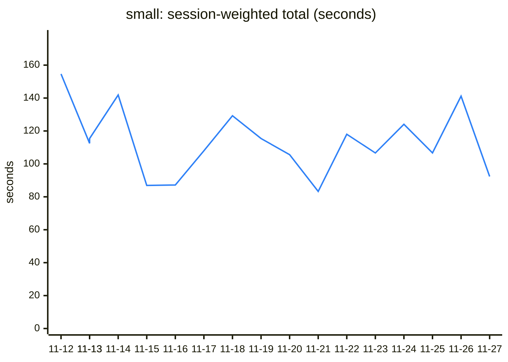
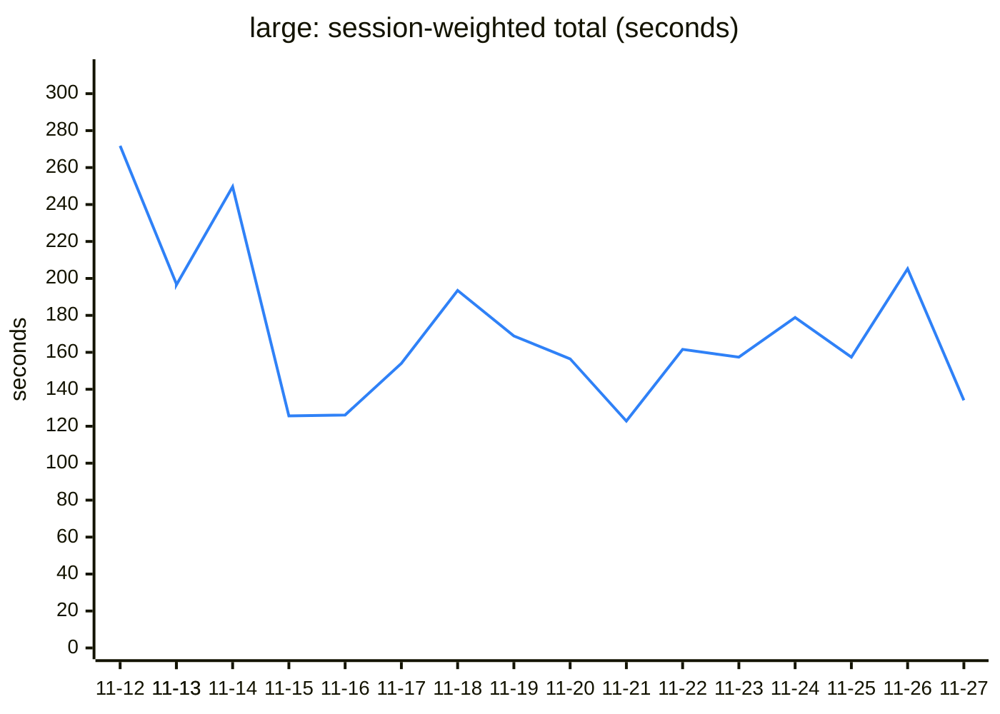
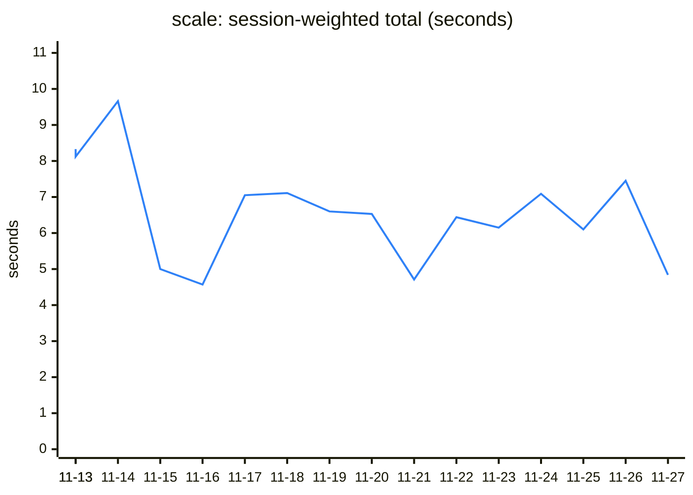
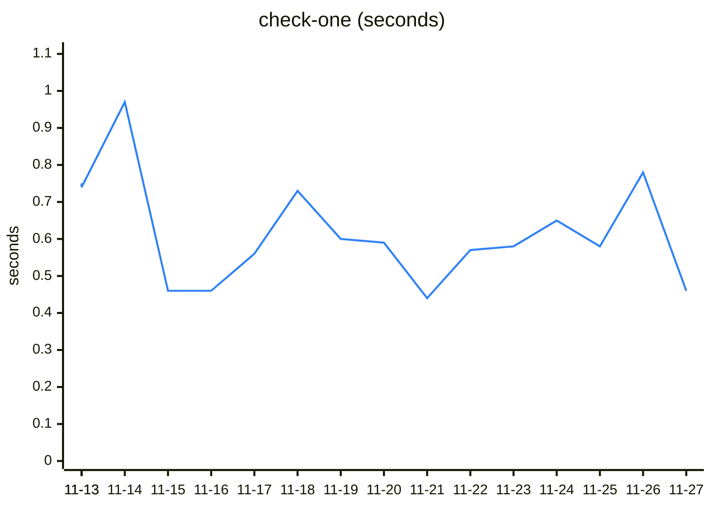
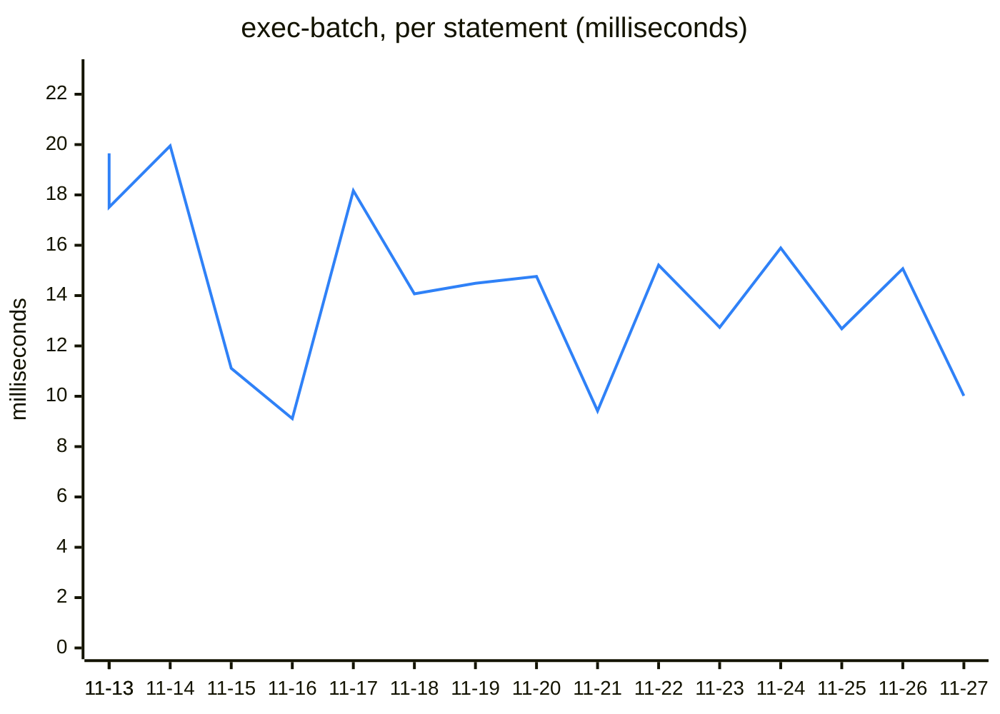
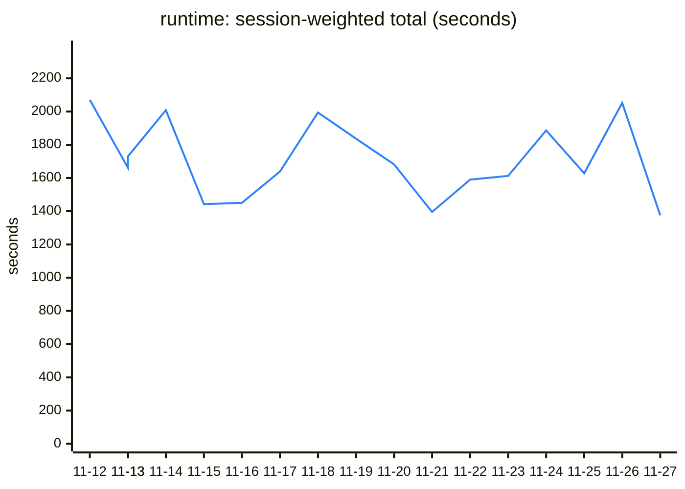

# Agent dev-loop benchmark — trend

17 runs, 2026-11-12 to 2026-11-27. Latest: `mxcli version 3b8ba4a (2026-11-27T10:33:42Z)` against `mxcli version nightly-20261126-a360cfa2e (2026-11-26T11:26:42Z)`.

Generated by `scripts/agentbench/trend` after each run; do not edit. Times are the candidate's median wall time on that night's runner, so two nights differ by the machine as well as by the code: read a level that stays, not one night's step. How to read it: `docs-site/src/internals/agent-benchmark.md` on `main`.

## Alerts

None.

## small project — 370 units

| step | latest | run before | median of the 7 before | against that median | against its baseline, latest | last runs |
|---|---:|---:|---:|---:|---:|---|
| (session-weighted total) | 92.4 s | 141.2 s | 106.6 s | × 0.87 | × 1.01 | █▁▁▄▇▅▄▁▅▄▆▄█▂ |
| open-cold | 156 ms | 197 ms | 193 ms | × 0.81 | × 1.01 | ▆▃▁▅▆▇▆▃▅▅█▆▆▃ |
| open | 50 ms | 73 ms | 57 ms | × 0.89 | × 1.00 | ▇▂▁▄▇▆▃▁▃▄▆▅█▂ |
| domain | 582 ms | 938 ms | 697 ms | × 0.83 | × 1.02 | ▇▁▁▃▇▆▄▁▄▄▇▄█▁ |
| microflows | 443 ms | 689 ms | 598 ms | × 0.74 | × 1.00 | ▆▃▁▅▇▆█▄▆▄█▄█▂ |
| pages | 1.37 s | 2.17 s | 1.75 s | × 0.78 | × 1.00 | ▇▂▁▅▇▆▃▁▇▅▇▄█▁ |
| describe | 111 ms | 169 ms | 125 ms | × 0.89 | × 1.01 | ▇▁▁▃▇▅▃▁▃▃▆▃█▁ |
| catalog | 181 ms | 300 ms | 225 ms | × 0.80 | × 1.00 | ▇▂▁▄▇▅▄▁▄▄▅▄█▁ |
| catalog-full | 878 ms | 1.49 s | 1.11 s | × 0.79 | × 1.01 | █▁▁▄█▅▄▁▄▃▆▃█▁ |
| query | 70 ms | 111 ms | 82 ms | × 0.85 | × 0.98 | ▆▁▁▃▆▅▃▁▃▃▅▃█▁ |
| check | 295 ms | 451 ms | 336 ms | × 0.88 | × 1.03 | █▁▁▃▄▃▂▁▂▂▄▂▅▁ |
| single-edit | 309 ms | 472 ms | 359 ms | × 0.86 | × 0.99 | ▆▁▁▄▇▅▄▁▇▄▆▄█▂ |
| catalog-after-edit | 206 ms | 301 ms | 247 ms | × 0.84 | × 1.11 | ▆▁▁▄▆▅▅▂▅▄▇▅█▃ |
| bulk-alter | 1.09 s | 1.55 s | 1.33 s | × 0.82 | × 0.99 | ▆▂▁▇▆▆█▁▅▅▇▄█▃ |
| re-exec | 529 ms | 791 ms | 592 ms | × 0.89 | × 1.00 | ▆▁▁▄▇▆▄▁▄▄▆▄█▂ |
| rename | 410 ms | 662 ms | 509 ms | × 0.81 | × 0.98 | ▆▁▁▃▇▅▄▁█▃▆▃▇▁ |

## large project — 910 units

| step | latest | run before | median of the 7 before | against that median | against its baseline, latest | last runs |
|---|---:|---:|---:|---:|---:|---|
| (session-weighted total) | 134.0 s | 205.2 s | 157.4 s | × 0.85 | × 1.00 | █▁▁▂▅▃▃▁▃▃▄▃▆▁ |
| open-cold | 326 ms | 369 ms | 369 ms | × 0.88 | × 1.12 | ▄▂▁█▄▅▄▂▄▄▆▄▄▃ |
| open | 62 ms | 96 ms | 71 ms | × 0.87 | × 0.99 | ▇▁▁▃▆▅▃▁▃▄▆▄█▂ |
| domain | 700 ms | 1.09 s | 837 ms | × 0.84 | × 1.00 | ▇▁▁▃▇▆▄▁▄▄▇▄█▂ |
| microflows | 1.07 s | 1.72 s | 1.28 s | × 0.84 | × 1.00 | ▇▁▁▄▇▄▄▁▆▄▅▄█▂ |
| pages | 1.78 s | 2.60 s | 2.09 s | × 0.85 | × 0.99 | ▅▁▁▃▆▅▃▁█▃▆▃▆▁ |
| describe | 135 ms | 204 ms | 155 ms | × 0.87 | × 0.99 | ▇▁▁▃▇▅▄▁▄▃▆▄█▂ |
| catalog | 283 ms | 451 ms | 342 ms | × 0.83 | × 1.00 | █▁▁▃█▅▄▁▄▄▆▄█▂ |
| catalog-full | 2.80 s | 4.61 s | 3.36 s | × 0.83 | × 0.98 | █▁▁▃█▆▃▁▃▃▆▃█▁ |
| query | 73 ms | 108 ms | 82 ms | × 0.89 | × 0.97 | ▇▂▁▃▇▅▃▁▄▃▆▃█▂ |
| check | 440 ms | 689 ms | 521 ms | × 0.85 | × 1.01 | █▁▁▁▃▂▂▁▂▂▂▂▃▁ |
| single-edit | 448 ms | 679 ms | 525 ms | × 0.85 | × 1.02 | ▇▁▁▄▇▅▄▁▅▄▆▄█▂ |
| catalog-after-edit | 321 ms | 434 ms | 371 ms | × 0.87 | × 1.04 | ▆▃▁▄▆▅█▂▆▅▇▆█▄ |
| bulk-alter | 1.22 s | 1.88 s | 1.65 s | × 0.74 | × 1.02 | ▇▁▁▅▇▆▆▁█▄▇▅█▁ |
| re-exec | 699 ms | 1.06 s | 827 ms | × 0.85 | × 1.03 | ▇▁▁▃█▆▄▁▅▄▇▄█▂ |
| rename | 777 ms | 1.29 s | 950 ms | × 0.82 | × 1.00 | █▁▁▆█▆▃▁▄▃▆▃█▁ |

## scale project — 4374 units

| step | latest | run before | median of the 7 before | against that median | against its baseline, latest | last runs |
|---|---:|---:|---:|---:|---:|---|
| (session-weighted total) | 4.84 s | 7.45 s | 6.44 s | × 0.75 | × 1.00 | █▁▁▄▄▄▄▁▃▃▄▃▅▁ |
| check-cold | 1.37 s | 1.99 s | 1.74 s | × 0.79 | × 1.00 | █▁▁▅▅▄▄▁▄▄▅▄▆▁ |
| check-one | 456 ms | 777 ms | 583 ms | × 0.78 | × 0.98 | █▁▁▂▅▃▃▁▃▃▄▃▆▁ |
| check-batch | 796 ms | 1.38 s | 1.03 s | × 0.77 | × 1.02 | █▁▁▂▅▄▃▁▃▃▄▃▆▁ |
| exec-batch | 1.00 s | 1.51 s | 1.48 s | × 0.68 | × 1.00 | █▂▁▇▄▄▅▁▅▃▆▃▅▁ |
| re-exec-batch | 527 ms | 790 ms | 639 ms | × 0.82 | × 1.04 | █▁▁▂▃▂▂▁▂▂▃▂▄▁ |
| new-batch | 691 ms | 1.00 s | 975 ms | × 0.71 | × 1.01 | █▂▁▇▅▄▅▂▅▄▆▃▅▂ |

## running app — 476 units

| step | latest | run before | median of the 7 before | against that median | against its baseline, latest | last runs |
|---|---:|---:|---:|---:|---:|---|
| (session-weighted total) | 1375.4 s | 2052.0 s | 1628.5 s | × 0.84 | × 1.02 | █▁▁▄█▆▄▁▃▃▇▃█▁ |
| mx-check | 4.72 s | 8.65 s | 6.09 s | × 0.78 | × 1.02 | ▇▁▂▃▇▆▃▁▃▃▆▄█▁ |
| build | 42.2 s | 58.8 s | 50.5 s | × 0.84 | × 1.02 | █▂▁▅██▅▁▄▄█▅█▁ |
| boot | 21.6 s | 30.1 s | 24.1 s | × 0.90 | × 1.13 | █▁▂▃▇▅▃▂▃▄▇▃█▁ |
| page-check | 2.46 s | 3.23 s | 2.92 s | × 0.84 | × 1.00 | █▁▃▄██▅▁▂▄█▆█▁ |
| hot-apply | 4.34 s | 5.55 s | 4.68 s | × 0.93 | × 1.06 | █▂▁▄█▄▅▁▂▂▄▂▇▁ |
| test-attach | 111 ms | 140 ms | 116 ms | × 0.95 | × 1.03 | ▇▃▁▃█▅▄▃▂▄▅▄▇▃ |
| apply-entity | 13.4 s | 18.7 s | 15.6 s | × 0.86 | × 0.95 | █▂▁▅█▆▆▂▃▄▇▃█▁ |
| stop | 731 ms | 845 ms | 739 ms | × 0.99 | × 1.00 | ▇▄▁▅▇▅▇▃█▅▅▅▇▄ |
| test-cold | 16.9 s | 24.9 s | 20.5 s | × 0.82 | × 1.01 | █▂▂▄█▆▅▁▄▄█▄█▁ |
