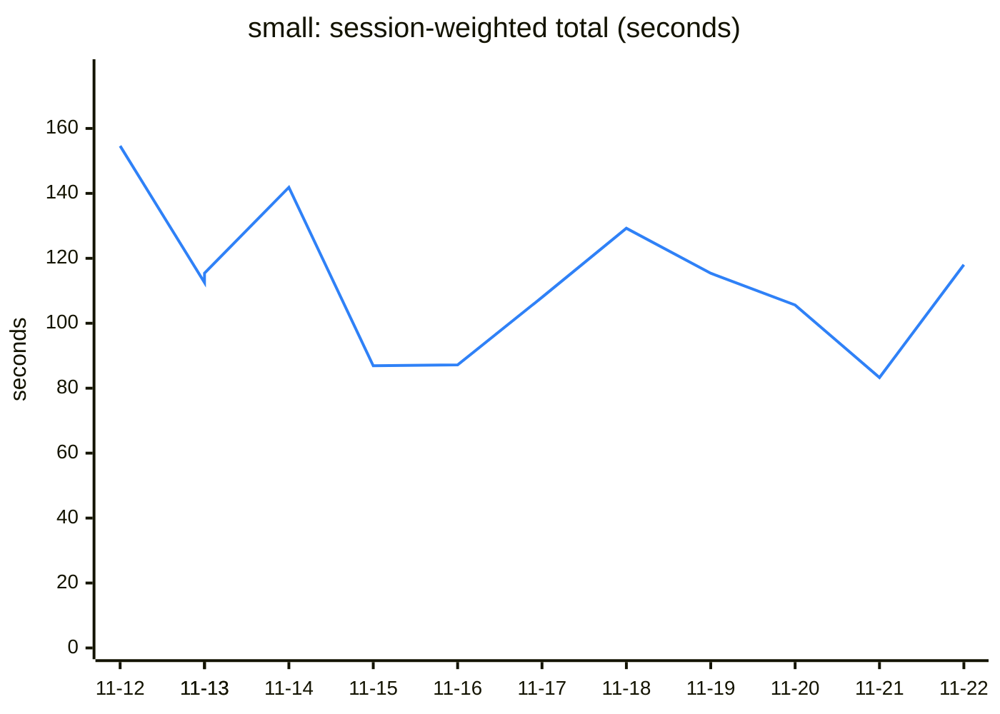
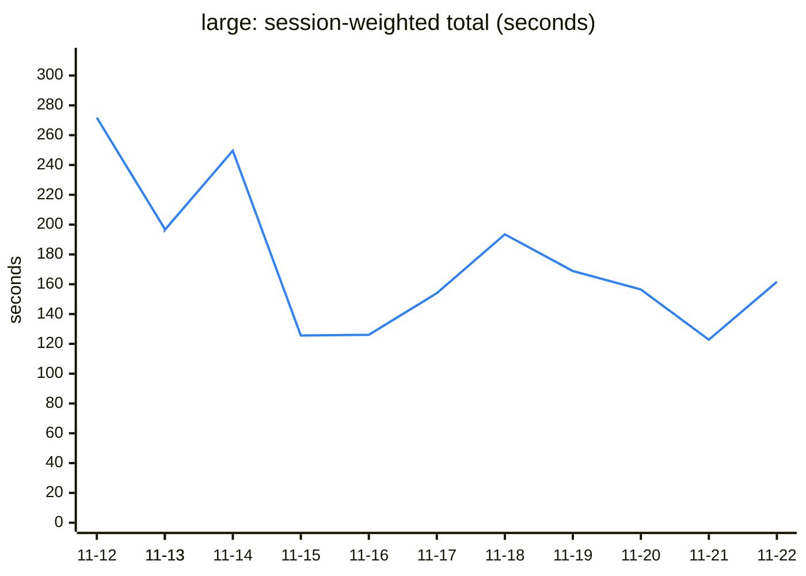
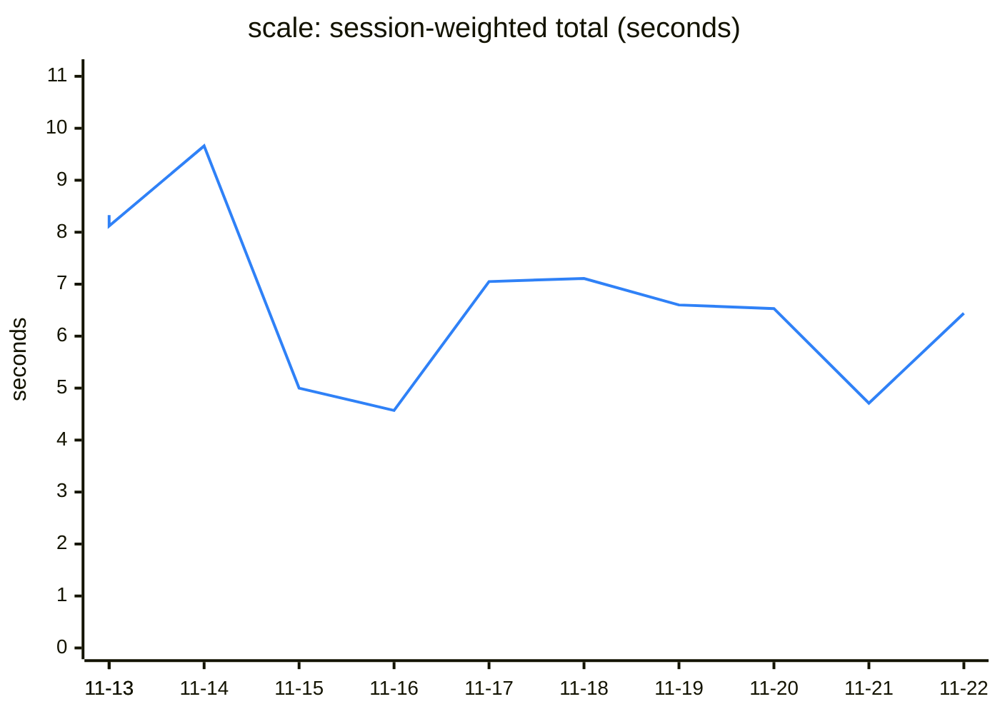
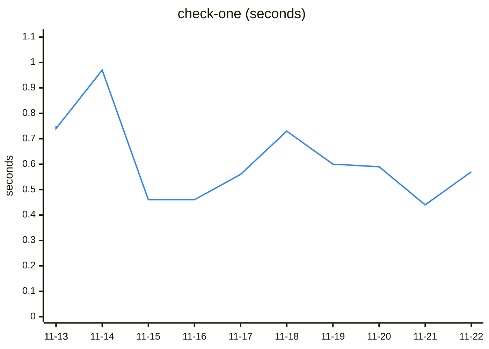
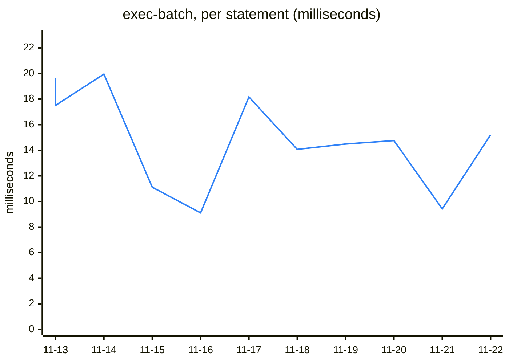
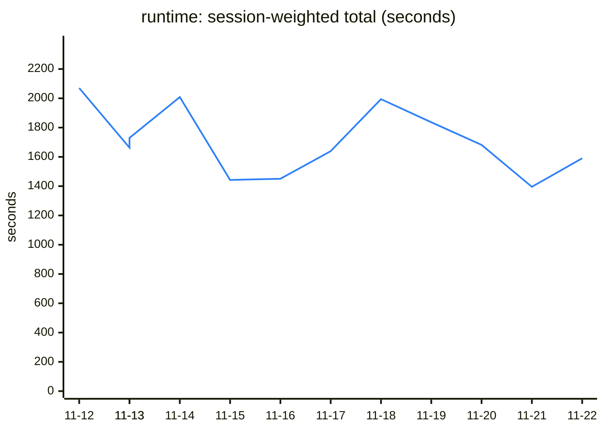

# Agent dev-loop benchmark — trend

12 runs, 2026-11-12 to 2026-11-22. Latest: `mxcli version 6176c66 (2026-11-22T09:27:42Z)` against `mxcli version nightly-20261121-77a4e1a83 (2026-11-21T10:08:50Z)`.

Generated by `scripts/agentbench/trend` after each run; do not edit. Times are the candidate's median wall time on that night's runner, so two nights differ by the machine as well as by the code: read a level that stays, not one night's step. How to read it: `docs-site/src/internals/agent-benchmark.md` on `main`.

## Alerts

None.

## small project — 370 units

| step | latest | run before | median of the 7 before | against that median | against its baseline, latest | last runs |
|---|---:|---:|---:|---:|---:|---|
| (session-weighted total) | 118.0 s | 83.3 s | 105.6 s | × 1.12 | × 1.08 | █▄▄▇▁▁▃▆▄▃▁▄ |
| open-cold | 188 ms | 156 ms | 187 ms | × 1.00 | × 0.91 | ▆▆█▇▄▁▆▆█▇▃▆ |
| open | 55 ms | 48 ms | 54 ms | × 1.01 | × 0.99 | █▃▅█▂▁▅█▇▄▂▄ |
| domain | 708 ms | 533 ms | 678 ms | × 1.05 | × 0.99 | █▁▁▂▁▁▁▂▂▁▁▁ |
| microflows | 598 ms | 511 ms | 573 ms | × 1.04 | × 0.99 | █▃▅▄▂▁▃▄▄▄▂▃ |
| pages | 2.01 s | 1.30 s | 1.61 s | × 1.25 | × 0.88 | █▂▄▄▁▁▃▄▃▂▁▄ |
| describe | 124 ms | 104 ms | 123 ms | × 1.01 | × 0.96 | █▃▃▆▁▁▂▆▄▃▁▃ |
| catalog | 225 ms | 169 ms | 220 ms | × 1.02 | × 0.93 | █▄▄█▂▁▄█▆▄▁▄ |
| catalog-full | 1.11 s | 859 ms | 1.11 s | × 0.99 | × 1.01 | █▃▄█▁▁▄█▆▅▁▄ |
| query | 81 ms | 65 ms | 82 ms | × 1.00 | × 1.00 | █▄▃█▁▁▄▇▆▄▁▄ |
| check | 324 ms | 262 ms | 332 ms | × 0.98 | × 1.01 | █▅▅█▁▁▂▄▃▂▁▂ |
| single-edit | 438 ms | 276 ms | 352 ms | × 1.25 | × 1.04 | █▄▄█▁▁▅█▆▄▁█ |
| catalog-after-edit | 247 ms | 184 ms | 226 ms | × 1.09 | × 0.96 | █▄▅█▁▁▅█▆▇▂▇ |
| bulk-alter | 1.30 s | 910 ms | 1.38 s | × 0.94 | × 0.64 | █▁▂▂▁▁▃▂▂▃▁▂ |
| re-exec | 588 ms | 463 ms | 589 ms | × 1.00 | × 0.91 | █▁▁▂▁▁▁▂▂▁▁▁ |
| rename | 705 ms | 392 ms | 497 ms | × 1.42 | × 0.94 | █▃▃▆▁▁▃▇▅▄▁█ |

## large project — 910 units

| step | latest | run before | median of the 7 before | against that median | against its baseline, latest | last runs |
|---|---:|---:|---:|---:|---:|---|
| (session-weighted total) | 161.6 s | 122.8 s | 154.0 s | × 1.05 | × 1.01 | █▄▄▇▁▁▂▄▃▂▁▃ |
| open-cold | 371 ms | 308 ms | 362 ms | × 1.03 | × 1.13 | ▄▆▄▄▂▁█▄▅▄▂▄ |
| open | 69 ms | 56 ms | 68 ms | × 1.01 | × 0.98 | █▄▃█▁▁▃▇▆▄▁▄ |
| domain | 845 ms | 631 ms | 785 ms | × 1.08 | × 0.94 | █▁▁▂▁▁▁▂▂▁▁▁ |
| microflows | 1.42 s | 984 ms | 1.24 s | × 1.14 | × 0.99 | █▃▃▅▁▁▃▅▃▃▁▄ |
| pages | 2.94 s | 1.63 s | 2.06 s | × 1.43 | × 0.84 | █▂▂▄▁▁▂▄▃▂▁▅ |
| describe | 155 ms | 119 ms | 148 ms | × 1.04 | × 1.00 | █▃▃▆▁▁▃▆▄▃▁▃ |
| catalog | 336 ms | 258 ms | 325 ms | × 1.03 | × 0.82 | █▄▄█▁▁▄█▅▄▁▄ |
| catalog-full | 3.36 s | 2.71 s | 3.29 s | × 1.02 | × 1.00 | █▃▃█▁▁▃█▆▃▁▃ |
| query | 83 ms | 67 ms | 79 ms | × 1.05 | × 1.03 | █▃▄█▂▁▃█▆▄▁▄ |
| check | 517 ms | 409 ms | 514 ms | × 1.01 | × 1.00 | █▅▅▇▁▁▁▂▂▁▁▁ |
| single-edit | 546 ms | 408 ms | 512 ms | × 1.07 | × 1.00 | █▄▄█▁▁▄█▅▄▁▅ |
| catalog-after-edit | 371 ms | 290 ms | 333 ms | × 1.11 | × 0.82 | ▇▆▄▇▃▁▄▇▆█▃▆ |
| bulk-alter | 1.84 s | 1.16 s | 1.59 s | × 1.16 | × 1.07 | █▂▁▂▁▁▂▃▂▂▁▃ |
| re-exec | 856 ms | 642 ms | 789 ms | × 1.08 | × 1.00 | █▁▁▂▁▁▁▂▂▁▁▁ |
| rename | 1.02 s | 765 ms | 938 ms | × 1.09 | × 1.05 | █▄▄▇▁▁▆█▆▃▁▄ |

## scale project — 4374 units

| step | latest | run before | median of the 7 before | against that median | against its baseline, latest | last runs |
|---|---:|---:|---:|---:|---:|---|
| (session-weighted total) | 6.44 s | 4.71 s | 6.53 s | × 0.99 | × 0.99 | ▆▆█▁▁▄▄▄▄▁▃ |
| check-cold | 1.70 s | 1.36 s | 1.77 s | × 0.96 | × 1.00 | ▆▆█▁▁▅▅▄▄▁▄ |
| check-one | 571 ms | 437 ms | 559 ms | × 1.02 | × 1.00 | ▅▅█▁▁▂▅▃▃▁▃ |
| check-batch | 1.02 s | 776 ms | 983 ms | × 1.03 | × 1.00 | ▅▅█▁▁▂▅▄▃▁▃ |
| exec-batch | 1.52 s | 942 ms | 1.41 s | × 1.08 | × 1.07 | █▇█▂▁▇▄▄▅▁▅ |
| re-exec-batch | 638 ms | 491 ms | 626 ms | × 1.02 | × 1.00 | ▆▆█▁▁▂▃▂▂▁▂ |
| new-batch | 987 ms | 704 ms | 940 ms | × 1.05 | × 0.88 | ███▂▁▇▅▄▅▂▅ |

## running app — 476 units

| step | latest | run before | median of the 7 before | against that median | against its baseline, latest | last runs |
|---|---:|---:|---:|---:|---:|---|
| (session-weighted total) | 1590.2 s | 1395.5 s | 1639.0 s | × 0.97 | × 0.97 | █▄▄█▁▁▃█▆▄▁▃ |
| mx-check | 5.99 s | 4.57 s | 6.04 s | × 0.99 | × 0.98 | █▄▅█▂▂▄█▇▄▁▄ |
| build | 49.9 s | 43.0 s | 50.2 s | × 0.99 | × 0.99 | █▅▅█▂▁▄██▅▁▄ |
| boot | 23.8 s | 22.1 s | 23.3 s | × 1.02 | × 1.05 | █▃▅▇▁▂▂▇▅▃▁▃ |
| page-check | 2.64 s | 2.48 s | 2.83 s | × 0.93 | × 0.97 | █▄▅█▁▃▄█▇▄▁▂ |
| hot-apply | 4.64 s | 4.36 s | 4.91 s | × 0.95 | × 0.94 | █▄▅▇▂▁▃▇▄▄▁▂ |
| test-attach | 105 ms | 107 ms | 112 ms | × 0.94 | × 0.89 | █▃▄▇▃▁▃█▅▄▃▂ |
| apply-entity | 15.1 s | 14.5 s | 16.3 s | × 0.92 | × 0.93 | █▃▄▇▂▁▄▇▅▅▂▂ |
| stop | 936 ms | 632 ms | 734 ms | × 1.28 | × 1.27 | ▇▅▅▇▄▁▅▇▅▇▃█ |
| test-cold | 20.2 s | 17.4 s | 21.1 s | × 0.96 | × 0.97 | █▃▄█▁▁▄█▆▄▁▃ |
