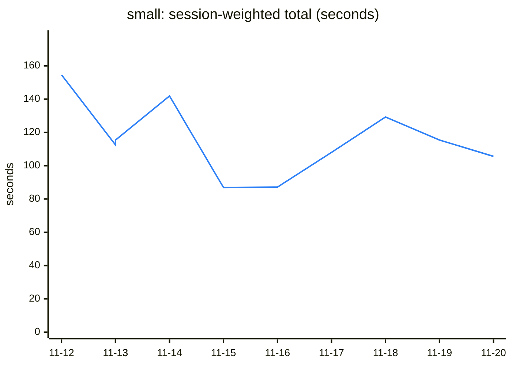
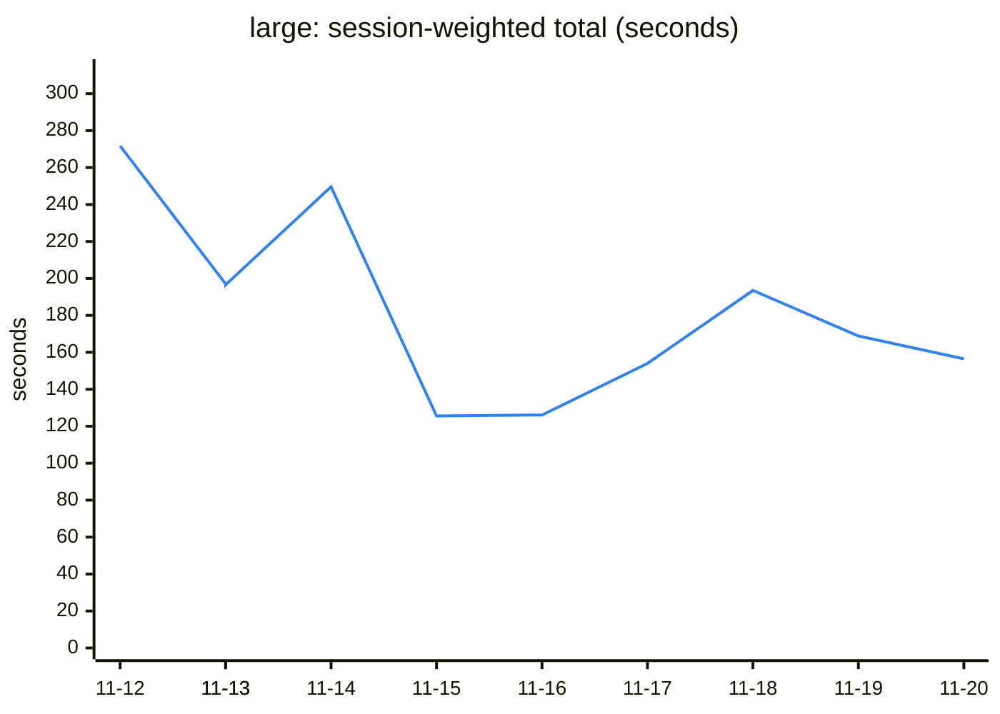
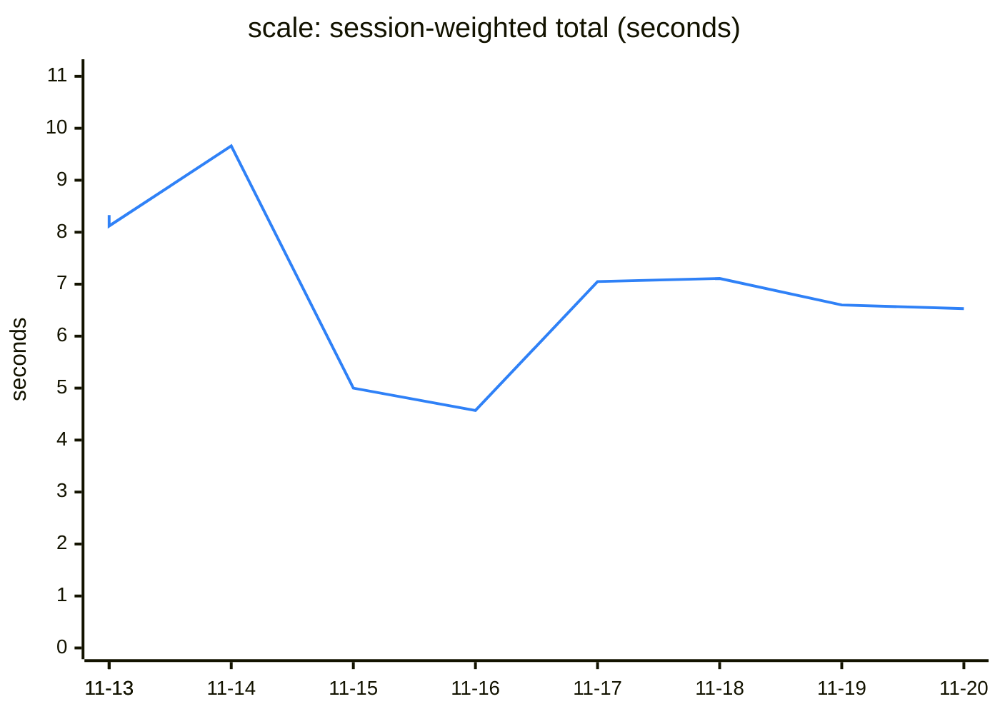
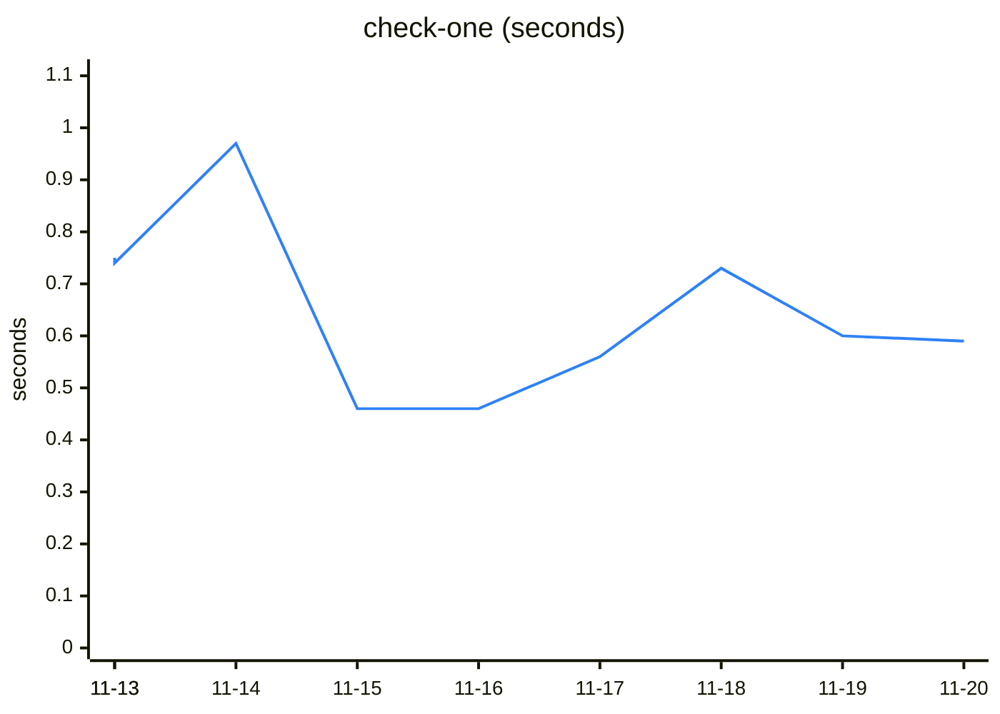
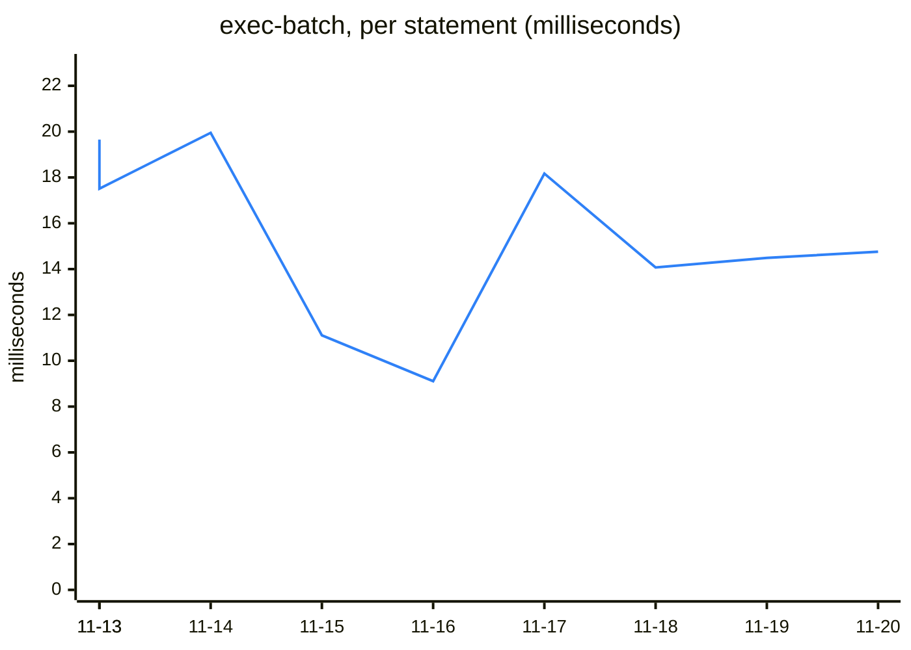
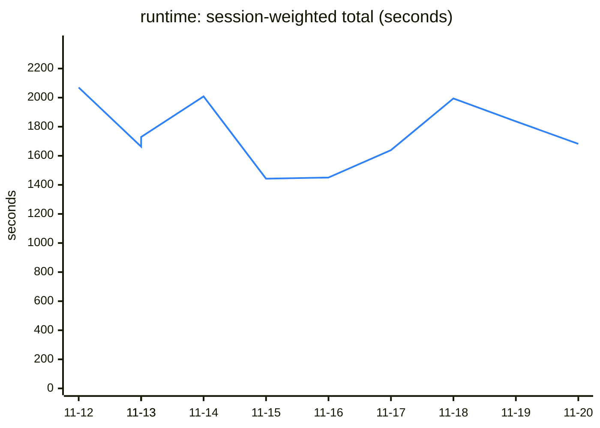

# Agent dev-loop benchmark — trend

10 runs, 2026-11-12 to 2026-11-20. Latest: `mxcli version 21287b6 (2026-11-20T09:43:46Z)` against `mxcli version nightly-20261119-0dd5a31cb (2026-11-19T10:54:46Z)`.

Generated by `scripts/agentbench/trend` after each run; do not edit. Times are the candidate's median wall time on that night's runner, so two nights differ by the machine as well as by the code: read a level that stays, not one night's step. How to read it: `docs-site/src/internals/agent-benchmark.md` on `main`.

## Alerts

None.

## small project — 370 units

| step | latest | run before | median of the 7 before | against that median | against its baseline, latest | last runs |
|---|---:|---:|---:|---:|---:|---|
| (session-weighted total) | 105.6 s | 115.4 s | 115.4 s | × 0.92 | × 1.00 | █▄▄▇▁▁▃▆▄▃ |
| open-cold | 193 ms | 209 ms | 189 ms | × 1.02 | × 1.06 | ▆▆█▇▄▁▆▆█▇ |
| open | 54 ms | 63 ms | 58 ms | × 0.93 | × 1.04 | █▃▅█▂▁▅█▇▄ |
| domain | 697 ms | 794 ms | 691 ms | × 1.01 | × 1.01 | █▁▁▂▁▁▁▂▂▁ |
| microflows | 653 ms | 613 ms | 609 ms | × 1.07 | × 0.98 | █▃▅▄▂▁▃▄▄▄ |
| pages | 1.61 s | 1.91 s | 1.91 s | × 0.84 | × 0.75 | █▂▄▄▁▁▂▄▃▂ |
| describe | 126 ms | 141 ms | 128 ms | × 0.98 | × 0.95 | █▃▃▆▁▁▂▆▄▃ |
| catalog | 220 ms | 244 ms | 223 ms | × 0.99 | × 0.97 | █▄▄█▂▁▄█▆▄ |
| catalog-full | 1.16 s | 1.25 s | 1.11 s | × 1.04 | × 1.08 | █▃▃█▁▁▃█▅▄ |
| query | 82 ms | 88 ms | 82 ms | × 1.00 | × 1.01 | █▄▃█▁▁▄▇▆▄ |
| check | 332 ms | 364 ms | 364 ms | × 0.91 | × 1.00 | █▄▅█▁▁▂▄▃▂ |
| single-edit | 352 ms | 384 ms | 363 ms | × 0.97 | × 0.99 | █▃▄█▁▁▄█▆▄ |
| catalog-after-edit | 247 ms | 244 ms | 226 ms | × 1.09 | × 1.02 | █▄▅█▁▁▅█▆▇ |
| bulk-alter | 1.61 s | 1.38 s | 1.37 s | × 1.17 | × 1.17 | █▁▂▂▁▁▃▂▂▃ |
| re-exec | 592 ms | 670 ms | 610 ms | × 0.97 | × 1.03 | █▁▁▂▁▁▁▂▁▁ |
| rename | 509 ms | 581 ms | 497 ms | × 1.02 | × 0.97 | █▃▃▆▁▁▃▇▆▄ |

## large project — 910 units

| step | latest | run before | median of the 7 before | against that median | against its baseline, latest | last runs |
|---|---:|---:|---:|---:|---:|---|
| (session-weighted total) | 156.5 s | 168.9 s | 168.9 s | × 0.93 | × 1.01 | █▄▄▇▁▁▂▄▃▂ |
| open-cold | 366 ms | 408 ms | 362 ms | × 1.01 | × 1.13 | ▄▆▄▄▂▁█▄▅▄ |
| open | 71 ms | 79 ms | 68 ms | × 1.03 | × 1.02 | █▄▃█▁▁▃▇▆▄ |
| domain | 807 ms | 930 ms | 807 ms | × 1.00 | × 1.00 | █▁▁▂▁▁▁▂▂▁ |
| microflows | 1.25 s | 1.28 s | 1.28 s | × 0.98 | × 0.99 | █▃▃▅▁▁▃▅▃▃ |
| pages | 2.07 s | 2.32 s | 2.06 s | × 1.01 | × 0.94 | █▂▂▄▁▁▂▄▃▂ |
| describe | 153 ms | 164 ms | 154 ms | × 1.00 | × 0.99 | █▃▃▆▁▁▃▆▄▃ |
| catalog | 342 ms | 362 ms | 340 ms | × 1.01 | × 1.00 | █▄▄█▁▁▄█▅▄ |
| catalog-full | 3.29 s | 3.95 s | 3.36 s | × 0.98 | × 0.99 | █▃▃█▁▁▃█▆▃ |
| query | 82 ms | 91 ms | 81 ms | × 1.00 | × 0.97 | █▃▄█▂▁▃█▆▄ |
| check | 521 ms | 564 ms | 564 ms | × 0.92 | × 1.00 | █▅▅▇▁▁▁▂▂▁ |
| single-edit | 516 ms | 558 ms | 515 ms | × 1.00 | × 0.98 | █▄▄█▁▁▄█▅▄ |
| catalog-after-edit | 420 ms | 361 ms | 333 ms | × 1.26 | × 1.12 | ▇▆▄▇▃▁▄▇▆█ |
| bulk-alter | 1.65 s | 1.65 s | 1.59 s | × 1.03 | × 0.96 | █▁▁▂▁▁▂▃▂▂ |
| re-exec | 813 ms | 911 ms | 804 ms | × 1.01 | × 1.00 | █▁▁▂▁▁▁▂▂▁ |
| rename | 938 ms | 1.12 s | 1.11 s | × 0.84 | × 0.99 | █▄▄▇▁▁▆█▆▃ |

## scale project — 4374 units

| step | latest | run before | median of the 7 before | against that median | against its baseline, latest | last runs |
|---|---:|---:|---:|---:|---:|---|
| (session-weighted total) | 6.53 s | 6.60 s | 7.05 s | × 0.93 | × 0.98 | ▆▆█▁▁▄▄▄▄ |
| check-cold | 1.77 s | 1.78 s | 1.94 s | × 0.91 | × 1.00 | ▆▆█▁▁▅▅▄▄ |
| check-one | 588 ms | 604 ms | 604 ms | × 0.97 | × 1.01 | ▅▅█▁▁▂▅▃▃ |
| check-batch | 1.06 s | 1.14 s | 1.14 s | × 0.93 | × 1.00 | ▅▅█▁▁▂▅▄▃ |
| exec-batch | 1.48 s | 1.45 s | 1.45 s | × 1.02 | × 0.93 | █▇█▂▁▇▄▄▅ |
| re-exec-batch | 657 ms | 688 ms | 688 ms | × 0.96 | × 0.98 | ▆▆█▁▁▂▃▂▂ |
| new-batch | 975 ms | 940 ms | 959 ms | × 1.02 | × 1.00 | ███▂▁▇▅▄▅ |

## running app — 476 units

| step | latest | run before | median of the 7 before | against that median | against its baseline, latest | last runs |
|---|---:|---:|---:|---:|---:|---|
| (session-weighted total) | 1682.0 s | 1836.6 s | 1729.5 s | × 0.97 | × 1.01 | █▃▄█▁▁▃█▆▄ |
| mx-check | 6.09 s | 7.35 s | 6.36 s | × 0.96 | × 0.98 | █▄▄█▁▁▃█▇▃ |
| build | 51.4 s | 57.4 s | 52.7 s | × 0.97 | × 1.00 | █▅▅█▂▁▄██▅ |
| boot | 23.8 s | 26.6 s | 26.6 s | × 0.90 | × 1.04 | █▃▅▇▁▂▂▇▅▃ |
| page-check | 2.92 s | 3.28 s | 2.96 s | × 0.98 | × 1.00 | █▄▅█▁▃▄█▇▄ |
| hot-apply | 5.16 s | 5.03 s | 5.03 s | × 1.03 | × 1.05 | █▄▅▇▂▁▃▇▄▄ |
| test-attach | 118 ms | 128 ms | 117 ms | × 1.01 | × 1.01 | █▃▄▇▃▁▃█▅▄ |
| apply-entity | 16.9 s | 17.1 s | 16.6 s | × 1.02 | × 1.05 | █▃▄▇▂▁▄▇▅▅ |
| stop | 836 ms | 737 ms | 735 ms | × 1.14 | × 1.00 | █▆▆█▆▁▆█▆█ |
| test-cold | 21.5 s | 22.8 s | 21.1 s | × 1.02 | × 1.01 | █▃▃█▁▁▄█▅▄ |
