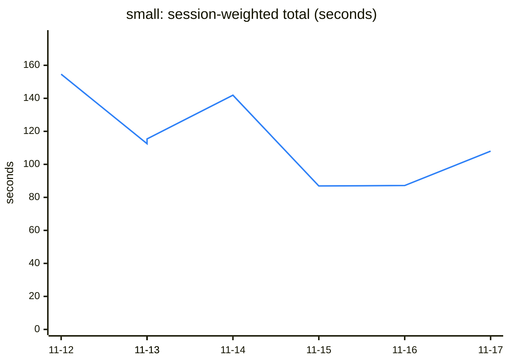
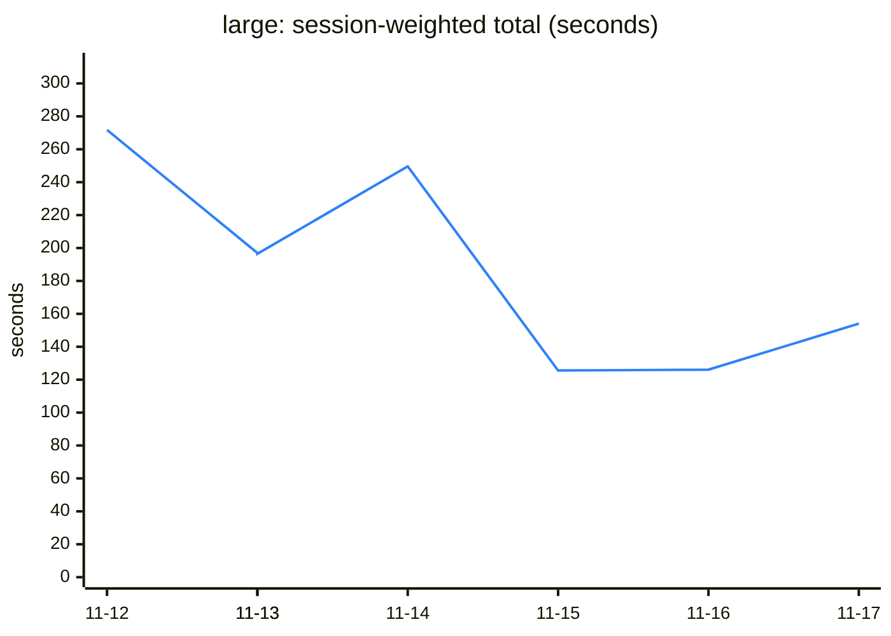
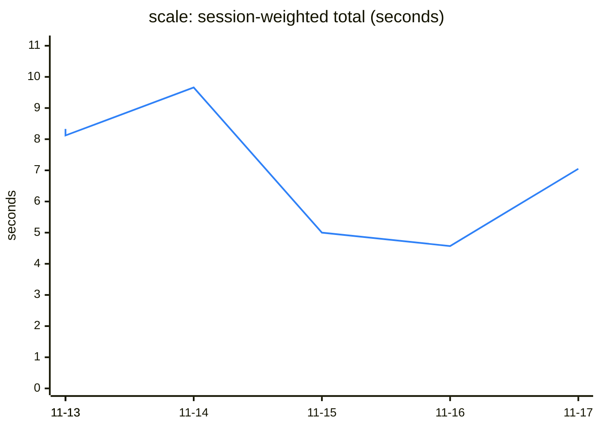
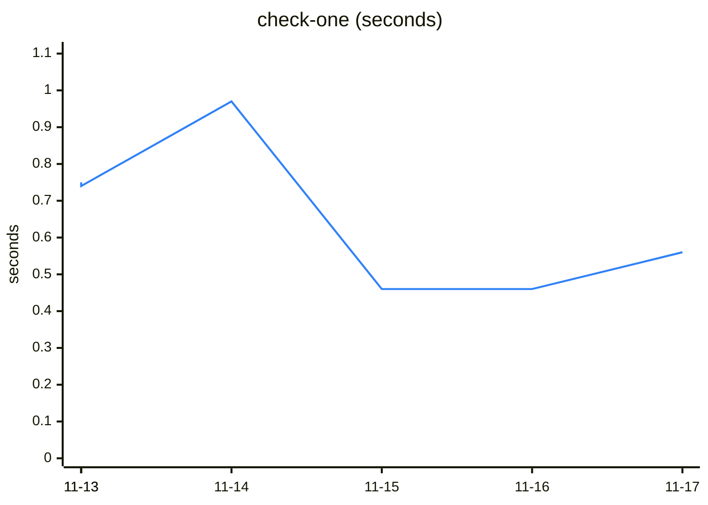
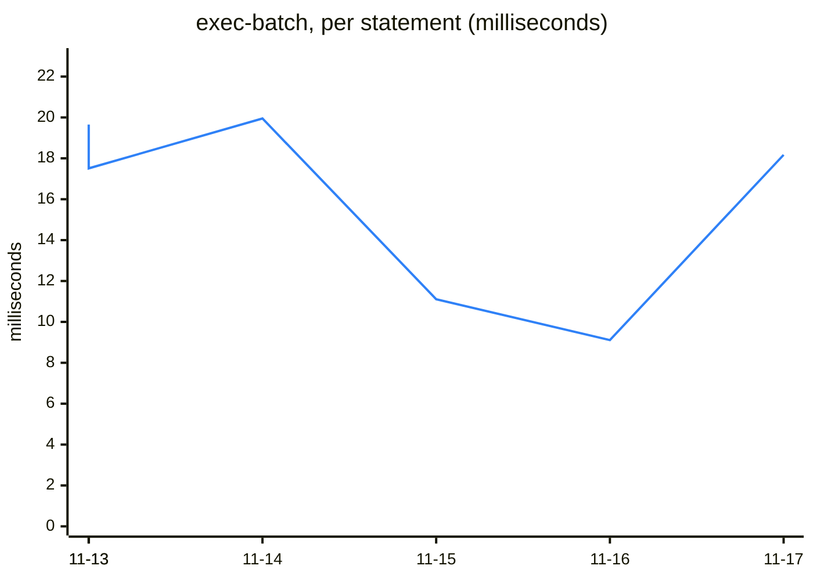
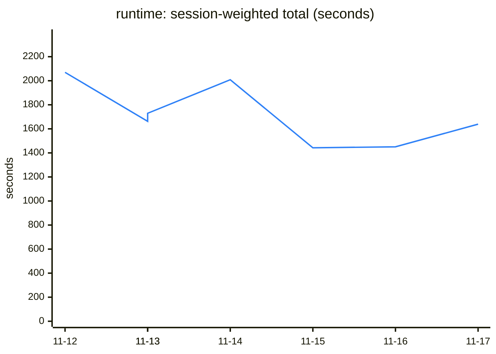

# Agent dev-loop benchmark — trend

7 runs, 2026-11-12 to 2026-11-17. Latest: `mxcli version ec45c7b (2026-11-17T10:15:03Z)` against `mxcli version nightly-20261113-df9084d41 (2026-11-13T10:08:50Z)`.

Generated by `scripts/agentbench/trend` after each run; do not edit. Times are the candidate's median wall time on that night's runner, so two nights differ by the machine as well as by the code: read a level that stays, not one night's step. How to read it: `docs-site/src/internals/agent-benchmark.md` on `main`.

## Alerts

None.

## small project — 370 units

| step | latest | run before | median of the 7 before | against that median | against its baseline, latest | last runs |
|---|---:|---:|---:|---:|---:|---|
| (session-weighted total) | 108.0 s | 87.2 s | 114.0 s | × 0.95 | × 0.92 | █▄▄▇▁▁▃ |
| open-cold | 187 ms | 133 ms | 189 ms | × 0.99 | × 1.02 | ▆▆█▇▄▁▆ |
| open | 58 ms | 45 ms | 55 ms | × 1.07 | × 1.05 | █▃▅█▂▁▅ |
| domain | 678 ms | 583 ms | 675 ms | × 1.00 | × 0.98 | █▁▁▂▁▁▁ |
| microflows | 573 ms | 391 ms | 579 ms | × 0.99 | × 1.01 | █▃▅▄▂▁▃ |
| pages | 1.73 s | 1.35 s | 1.80 s | × 0.97 | × 0.93 | █▂▄▄▁▁▂ |
| describe | 123 ms | 105 ms | 127 ms | × 0.97 | × 0.98 | █▃▃▆▁▁▂ |
| catalog | 223 ms | 171 ms | 219 ms | × 1.01 | × 0.96 | █▄▄█▂▁▄ |
| catalog-full | 1.11 s | 920 ms | 1.08 s | × 1.03 | × 1.04 | █▃▃█▁▁▃ |
| query | 82 ms | 64 ms | 78 ms | × 1.04 | × 1.04 | █▄▃█▁▁▄ |
| check | 343 ms | 278 ms | 443 ms | × 0.77 | × 0.75 | █▄▅█▁▁▂ |
| single-edit | 363 ms | 294 ms | 344 ms | × 1.05 | × 1.03 | █▃▄█▁▁▄ |
| catalog-after-edit | 226 ms | 167 ms | 221 ms | × 1.02 | × 0.97 | █▄▅█▁▁▅ |
| bulk-alter | 1.48 s | 964 ms | 1.19 s | × 1.25 | × 1.21 | █▁▂▂▁▁▃ |
| re-exec | 589 ms | 503 ms | 578 ms | × 1.02 | × 1.05 | █▁▁▂▁▁▁ |
| rename | 497 ms | 403 ms | 474 ms | × 1.05 | × 1.03 | █▃▃▆▁▁▃ |

## large project — 910 units

| step | latest | run before | median of the 7 before | against that median | against its baseline, latest | last runs |
|---|---:|---:|---:|---:|---:|---|
| (session-weighted total) | 154.0 s | 126.1 s | 196.8 s | × 0.78 | × 0.79 | █▄▄▇▁▁▂ |
| open-cold | 510 ms | 255 ms | 358 ms | × 1.42 | × 1.14 | ▄▆▄▄▂▁█ |
| open | 68 ms | 58 ms | 70 ms | × 0.97 | × 1.01 | █▄▃█▁▁▃ |
| domain | 785 ms | 676 ms | 809 ms | × 0.97 | × 0.97 | █▁▁▂▁▁▁ |
| microflows | 1.24 s | 897 ms | 1.26 s | × 0.98 | × 0.96 | █▃▃▅▁▁▃ |
| pages | 2.06 s | 1.64 s | 2.07 s | × 0.99 | × 0.99 | █▂▂▄▁▁▂ |
| describe | 148 ms | 124 ms | 153 ms | × 0.97 | × 0.98 | █▃▃▆▁▁▃ |
| catalog | 325 ms | 257 ms | 333 ms | × 0.97 | × 0.93 | █▄▄█▁▁▄ |
| catalog-full | 3.31 s | 2.90 s | 3.34 s | × 0.99 | × 1.01 | █▃▃█▁▁▃ |
| query | 79 ms | 67 ms | 80 ms | × 0.98 | × 0.96 | █▃▄█▂▁▃ |
| check | 514 ms | 425 ms | 975 ms | × 0.53 | × 0.53 | █▅▅▇▁▁▁ |
| single-edit | 512 ms | 419 ms | 518 ms | × 0.99 | × 1.00 | █▄▄█▁▁▄ |
| catalog-after-edit | 333 ms | 246 ms | 344 ms | × 0.97 | × 0.99 | █▇▅█▃▁▅ |
| bulk-alter | 1.59 s | 1.17 s | 1.43 s | × 1.11 | × 0.87 | █▁▁▂▁▁▂ |
| re-exec | 789 ms | 682 ms | 800 ms | × 0.99 | × 1.02 | █▁▁▂▁▁▁ |
| rename | 1.11 s | 808 ms | 969 ms | × 1.15 | × 1.13 | █▄▄▇▁▁▆ |

## scale project — 4374 units

| step | latest | run before | median of the 7 before | against that median | against its baseline, latest | last runs |
|---|---:|---:|---:|---:|---:|---|
| (session-weighted total) | 7.05 s | 4.57 s | 8.12 s | × 0.87 | × 0.79 | ▆▆█▁▁▄ |
| check-cold | 1.94 s | 1.25 s | 2.03 s | × 0.95 | × 0.91 | ▆▆█▁▁▅ |
| check-one | 559 ms | 456 ms | 737 ms | × 0.76 | × 0.78 | ▅▅█▁▁▂ |
| check-batch | 983 ms | 865 ms | 1.30 s | × 0.76 | × 0.78 | ▅▅█▁▁▂ |
| exec-batch | 1.82 s | 911 ms | 1.75 s | × 1.04 | × 0.72 | █▇█▂▁▇ |
| re-exec-batch | 626 ms | 505 ms | 1.02 s | × 0.61 | × 0.64 | ▆▆█▁▁▂ |
| new-batch | 1.12 s | 583 ms | 1.22 s | × 0.92 | × 0.79 | ███▂▁▇ |

## running app — 476 units

| step | latest | run before | median of the 7 before | against that median | against its baseline, latest | last runs |
|---|---:|---:|---:|---:|---:|---|
| (session-weighted total) | 1639.0 s | 1450.5 s | 1696.1 s | × 0.97 | × 1.00 | █▃▄█▁▁▃ |
| mx-check | 6.04 s | 5.37 s | 6.31 s | × 0.96 | × 1.00 | █▄▄█▁▁▃ |
| build | 50.2 s | 41.3 s | 51.9 s | × 0.97 | × 1.02 | █▅▅█▂▁▄ |
| boot | 23.3 s | 22.3 s | 25.1 s | × 0.93 | × 1.01 | █▃▅▇▁▂▂ |
| page-check | 2.83 s | 2.71 s | 2.91 s | × 0.97 | × 1.06 | █▄▅█▁▃▄ |
| hot-apply | 4.91 s | 4.33 s | 5.19 s | × 0.94 | × 0.95 | █▄▅▇▂▁▃ |
| test-attach | 112 ms | 92 ms | 114 ms | × 0.99 | × 0.92 | █▃▄▇▃▁▃ |
| apply-entity | 16.3 s | 13.8 s | 16.2 s | × 1.01 | × 1.05 | █▃▄▇▂▁▄ |
| stop | 734 ms | 528 ms | 735 ms | × 1.00 | × 0.88 | █▆▆█▆▁▆ |
| test-cold | 21.1 s | 18.1 s | 20.5 s | × 1.03 | × 1.02 | █▃▃█▁▁▄ |
