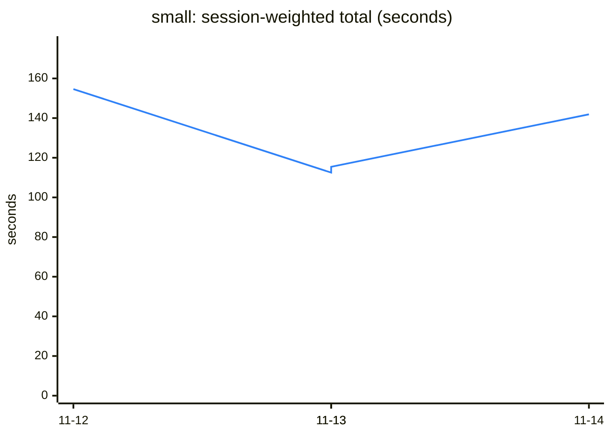
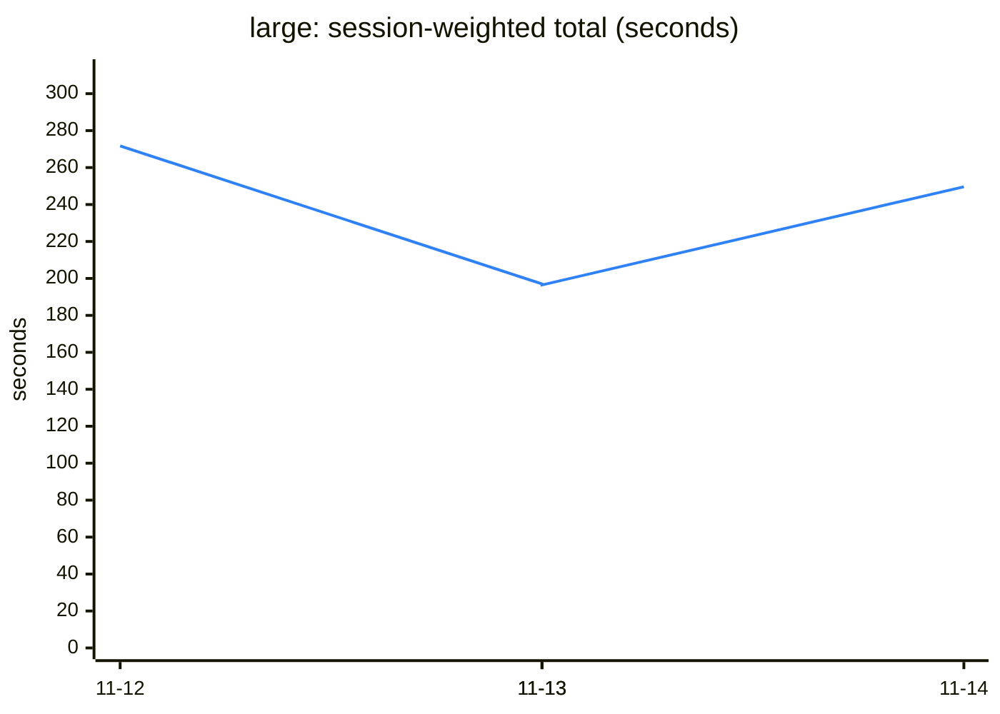
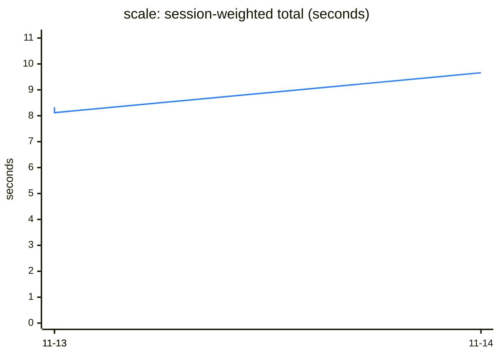
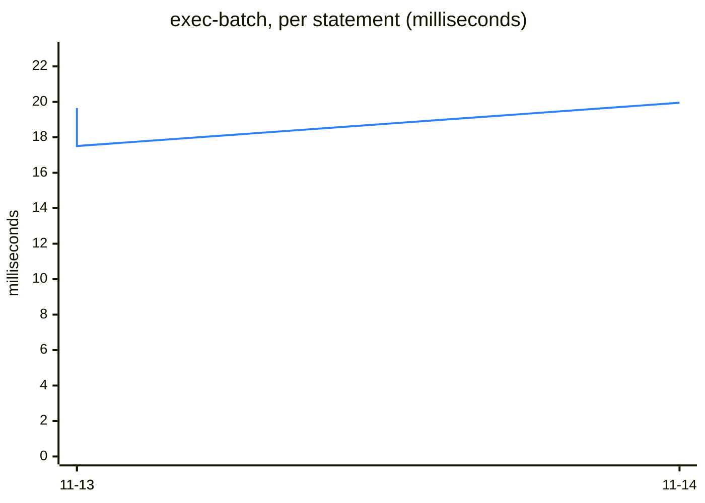
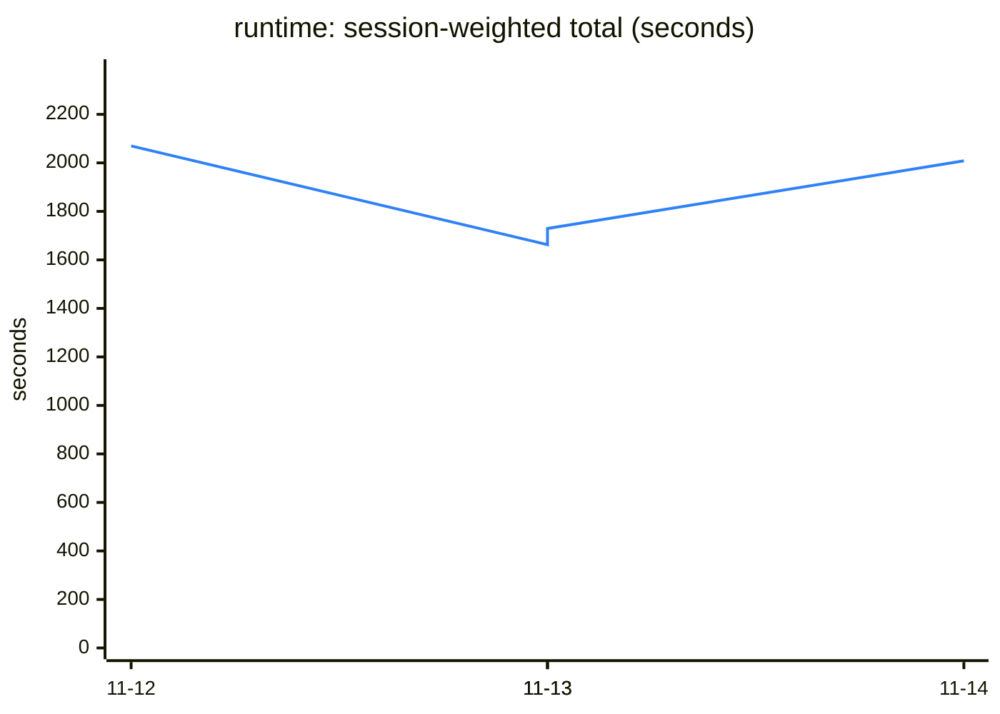

# Agent dev-loop benchmark — trend

4 runs, 2026-11-12 to 2026-11-14. Latest: `mxcli version 43995e1 (2026-11-14T08:38:49Z)` against `mxcli version nightly-20261113-df9084d41 (2026-11-13T10:08:50Z)`.

Generated by `scripts/agentbench/trend` after each run; do not edit. Times are the candidate's median wall time on that night's runner, so two nights differ by the machine as well as by the code: read a level that stays, not one night's step. How to read it: `docs-site/src/internals/agent-benchmark.md` on `main`.

## Alerts

None.

## small project — 370 units



| step | latest | run before | median of the 7 before | against that median | against its baseline, latest | last runs |
|---|---:|---:|---:|---:|---:|---|
| (session-weighted total) | 141.9 s | 115.4 s | 115.4 s | × 1.23 | × 1.01 | █▁▁▆ |
| open-cold | 193 ms | 209 ms | 190 ms | × 1.01 | × 1.04 | ▁▁█▂ |
| open | 68 ms | 56 ms | 56 ms | × 1.20 | × 1.00 | █▁▂█ |
| domain | 842 ms | 691 ms | 691 ms | × 1.22 | × 0.99 | █▁▁▁ |
| microflows | 609 ms | 709 ms | 709 ms | × 0.86 | × 1.00 | █▁▄▂ |
| pages | 1.95 s | 2.02 s | 2.02 s | × 0.97 | × 1.01 | █▁▃▂ |
| describe | 157 ms | 128 ms | 128 ms | × 1.23 | × 0.99 | █▁▁▅ |
| catalog | 277 ms | 223 ms | 223 ms | × 1.24 | × 0.98 | █▁▁█ |
| catalog-full | 1.41 s | 1.09 s | 1.09 s | × 1.29 | × 1.00 | █▁▁█ |
| query | 98 ms | 78 ms | 79 ms | × 1.25 | × 0.97 | █▁▁▇ |
| check | 574 ms | 447 ms | 447 ms | × 1.28 | × 1.02 | █▁▁▇ |
| single-edit | 420 ms | 347 ms | 347 ms | × 1.21 | × 1.00 | █▁▁▇ |
| catalog-after-edit | 264 ms | 225 ms | 225 ms | × 1.18 | × 0.99 | █▁▂█ |
| bulk-alter | 1.37 s | 1.25 s | 1.25 s | × 1.10 | × 1.00 | █▁▁▂ |
| re-exec | 695 ms | 610 ms | 610 ms | × 1.14 | × 1.00 | █▁▁▁ |
| rename | 612 ms | 475 ms | 475 ms | × 1.29 | × 0.99 | █▁▁▆ |

## large project — 910 units



| step | latest | run before | median of the 7 before | against that median | against its baseline, latest | last runs |
|---|---:|---:|---:|---:|---:|---|
| (session-weighted total) | 249.6 s | 196.5 s | 197.0 s | × 1.27 | × 1.01 | █▁▁▆ |
| open-cold | 355 ms | 371 ms | 371 ms | × 0.96 | × 1.01 | ▁█▃▁ |
| open | 87 ms | 68 ms | 73 ms | × 1.20 | × 1.00 | █▂▁▇ |
| domain | 1.01 s | 807 ms | 811 ms | × 1.25 | × 1.00 | █▁▁▁ |
| microflows | 1.57 s | 1.29 s | 1.29 s | × 1.22 | × 1.01 | █▁▁▃ |
| pages | 2.43 s | 2.06 s | 2.09 s | × 1.16 | × 1.00 | █▁▁▂ |
| describe | 188 ms | 154 ms | 154 ms | × 1.22 | × 1.02 | █▁▁▅ |
| catalog | 428 ms | 340 ms | 340 ms | × 1.26 | × 0.98 | █▁▁█ |
| catalog-full | 4.46 s | 3.36 s | 3.36 s | × 1.33 | × 1.00 | █▁▁█ |
| query | 100 ms | 81 ms | 81 ms | × 1.23 | × 0.98 | █▁▁█ |
| check | 1.28 s | 979 ms | 979 ms | × 1.30 | × 0.99 | █▁▁▆ |
| single-edit | 644 ms | 515 ms | 521 ms | × 1.23 | × 1.01 | █▁▁█ |
| catalog-after-edit | 378 ms | 330 ms | 359 ms | × 1.05 | × 0.99 | █▄▁▇ |
| bulk-alter | 1.71 s | 1.42 s | 1.45 s | × 1.18 | × 0.98 | █▁▁▂ |
| re-exec | 1.00 s | 804 ms | 804 ms | × 1.25 | × 0.99 | █▁▁▂ |
| rename | 1.24 s | 969 ms | 969 ms | × 1.28 | × 0.99 | █▁▁▇ |

## scale project — 4374 units



```mermaid
---
config:
  themeVariables:
    xyChart:
      plotColorPalette: "#2f81f7"
---
xychart-beta
    title "check-one (seconds)"
    x-axis ["11-13", "11-13", "11-14"]
    y-axis "seconds" 0 --> 1.11
    line [0.75, 0.74, 0.97]
```



| step | latest | run before | median of the 7 before | against that median | against its baseline, latest | last runs |
|---|---:|---:|---:|---:|---:|---|
| (session-weighted total) | 9.66 s | 8.12 s | 8.22 s | × 1.17 | × 0.99 | ▂▁█ |
| check-cold | 2.41 s | 2.08 s | 2.06 s | × 1.17 | × 1.01 | ▁▁█ |
| check-one | 968 ms | 737 ms | 742 ms | × 1.31 | × 0.99 | ▁▁█ |
| check-batch | 1.70 s | 1.30 s | 1.31 s | × 1.30 | × 0.99 | ▁▁█ |
| exec-batch | 1.99 s | 1.75 s | 1.86 s | × 1.07 | × 0.99 | █▁█ |
| re-exec-batch | 1.29 s | 1.02 s | 1.03 s | × 1.25 | × 0.99 | ▁▁█ |
| new-batch | 1.30 s | 1.24 s | 1.23 s | × 1.06 | × 0.99 | ▁▃█ |

## running app — 476 units



| step | latest | run before | median of the 7 before | against that median | against its baseline, latest | last runs |
|---|---:|---:|---:|---:|---:|---|
| (session-weighted total) | 2008.3 s | 1729.5 s | 1729.5 s | × 1.16 | × 1.01 | █▁▂▇ |
| mx-check | 8.03 s | 6.36 s | 6.36 s | × 1.26 | × 1.02 | █▁▁█ |
| build | 57.3 s | 52.7 s | 52.7 s | × 1.09 | × 1.00 | █▁▂▆ |
| boot | 29.6 s | 26.6 s | 26.6 s | × 1.11 | × 1.04 | █▁▄▇ |
| page-check | 3.31 s | 2.96 s | 2.96 s | × 1.12 | × 1.05 | █▁▂▇ |
| hot-apply | 5.75 s | 5.23 s | 5.23 s | × 1.10 | × 1.00 | █▁▁▆ |
| test-attach | 137 ms | 117 ms | 117 ms | × 1.18 | × 1.07 | █▁▂▆ |
| apply-entity | 18.7 s | 16.6 s | 16.6 s | × 1.12 | × 1.01 | █▁▂▇ |
| stop | 841 ms | 735 ms | 736 ms | × 1.14 | × 1.00 | █▁▁█ |
| test-cold | 25.1 s | 20.7 s | 20.7 s | × 1.21 | × 0.97 | █▁▁▇ |
