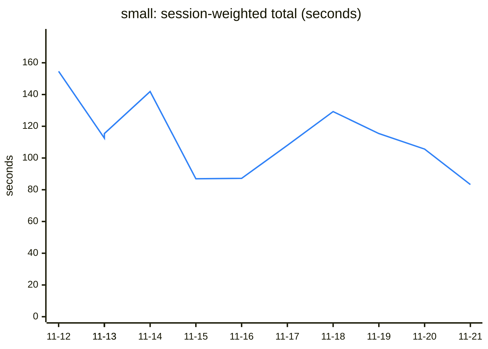
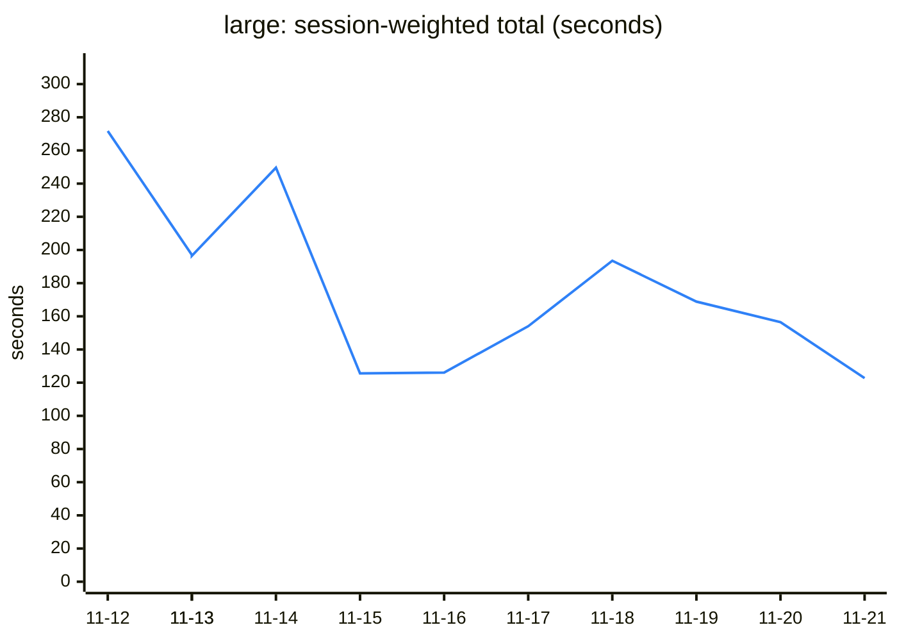
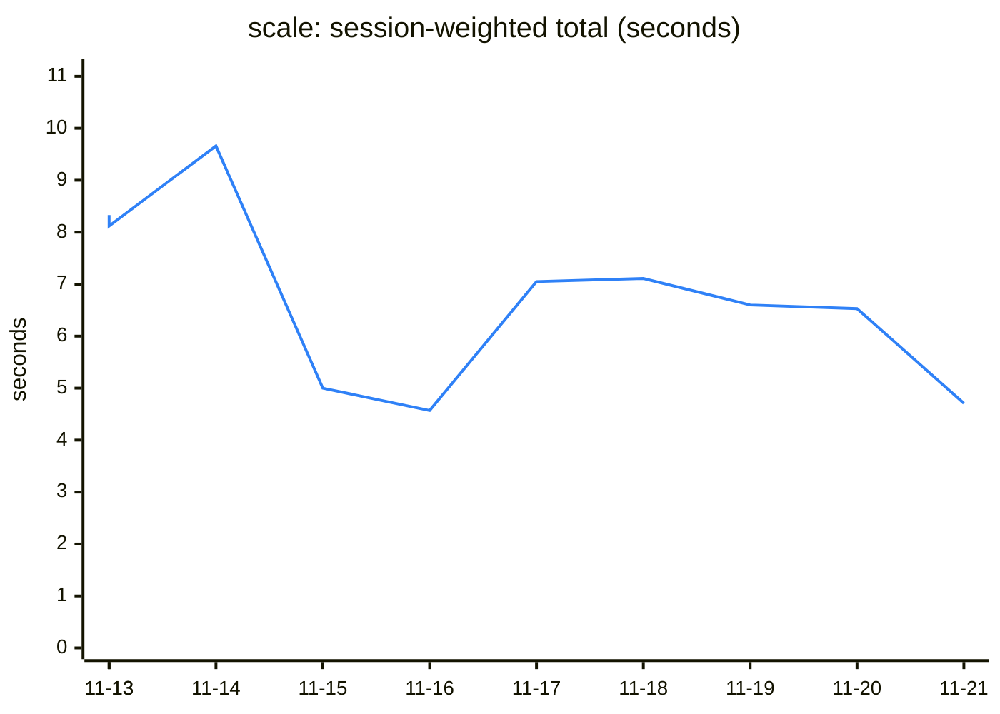
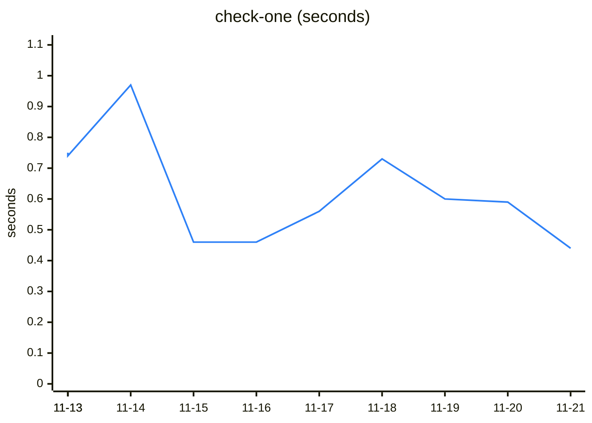
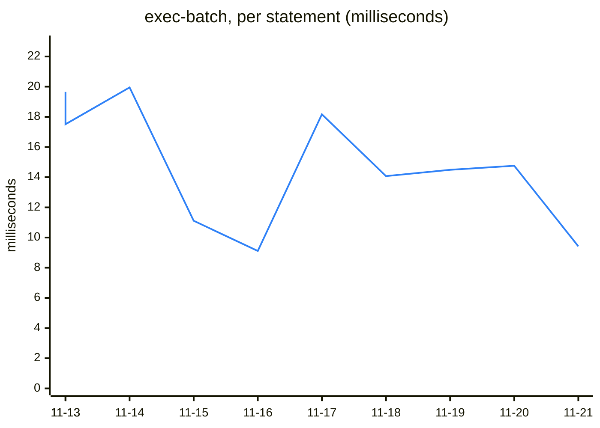
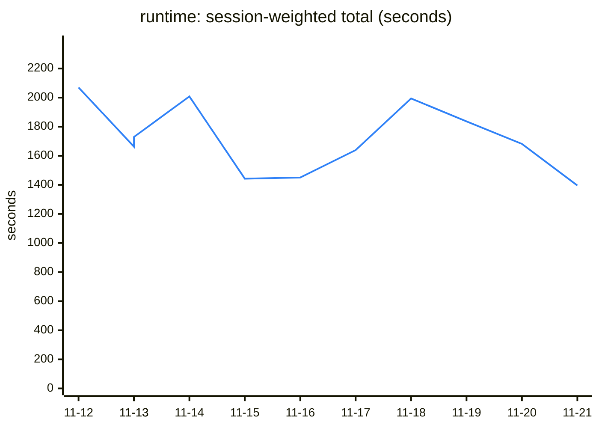

# Agent dev-loop benchmark — trend

11 runs, 2026-11-12 to 2026-11-21. Latest: `mxcli version 77a4e1a (2026-11-21T09:14:43Z)` against `mxcli version nightly-20261120-21287b6c6 (2026-11-20T10:40:00Z)`.

Generated by `scripts/agentbench/trend` after each run; do not edit. Times are the candidate's median wall time on that night's runner, so two nights differ by the machine as well as by the code: read a level that stays, not one night's step. How to read it: `docs-site/src/internals/agent-benchmark.md` on `main`.

## Alerts

None.

## small project — 370 units

| step | latest | run before | median of the 7 before | against that median | against its baseline, latest | last runs |
|---|---:|---:|---:|---:|---:|---|
| (session-weighted total) | 83.3 s | 105.6 s | 108.0 s | × 0.77 | × 1.00 | █▄▄▇▁▁▃▆▄▃▁ |
| open-cold | 156 ms | 193 ms | 189 ms | × 0.83 | × 1.07 | ▆▆█▇▄▁▆▆█▇▃ |
| open | 48 ms | 54 ms | 58 ms | × 0.82 | × 0.98 | █▃▅█▂▁▅█▇▄▂ |
| domain | 533 ms | 697 ms | 697 ms | × 0.76 | × 1.03 | █▁▁▂▁▁▁▂▂▁▁ |
| microflows | 511 ms | 653 ms | 609 ms | × 0.84 | × 1.03 | █▃▅▄▂▁▃▄▄▄▂ |
| pages | 1.30 s | 1.61 s | 1.73 s | × 0.75 | × 1.02 | █▂▄▄▁▁▃▄▃▂▁ |
| describe | 104 ms | 126 ms | 126 ms | × 0.83 | × 1.00 | █▃▃▆▁▁▂▆▄▃▁ |
| catalog | 169 ms | 220 ms | 223 ms | × 0.76 | × 0.99 | █▄▄█▂▁▄█▆▄▁ |
| catalog-full | 859 ms | 1.16 s | 1.16 s | × 0.74 | × 1.01 | █▃▄█▁▁▄█▆▅▁ |
| query | 65 ms | 82 ms | 82 ms | × 0.79 | × 1.02 | █▄▃█▁▁▄▇▆▄▁ |
| check | 262 ms | 332 ms | 343 ms | × 0.77 | × 0.98 | █▅▅█▁▁▂▄▃▂▁ |
| single-edit | 276 ms | 352 ms | 363 ms | × 0.76 | × 0.99 | █▄▄█▁▁▅█▆▄▁ |
| catalog-after-edit | 184 ms | 247 ms | 244 ms | × 0.76 | × 1.01 | █▄▅█▁▁▅█▆▇▂ |
| bulk-alter | 910 ms | 1.61 s | 1.38 s | × 0.66 | × 1.00 | █▁▂▂▁▁▃▂▂▃▁ |
| re-exec | 463 ms | 592 ms | 592 ms | × 0.78 | × 1.00 | █▁▁▂▁▁▁▂▂▁▁ |
| rename | 392 ms | 509 ms | 509 ms | × 0.77 | × 0.99 | █▃▃▆▁▁▃▇▆▄▁ |

## large project — 910 units

| step | latest | run before | median of the 7 before | against that median | against its baseline, latest | last runs |
|---|---:|---:|---:|---:|---:|---|
| (session-weighted total) | 122.8 s | 156.5 s | 156.5 s | × 0.78 | × 0.98 | █▄▄▇▁▁▂▄▃▂▁ |
| open-cold | 308 ms | 366 ms | 362 ms | × 0.85 | × 1.09 | ▄▆▄▄▂▁█▄▅▄▂ |
| open | 56 ms | 71 ms | 71 ms | × 0.80 | × 0.97 | █▄▃█▁▁▃▇▆▄▁ |
| domain | 631 ms | 807 ms | 807 ms | × 0.78 | × 1.02 | █▁▁▂▁▁▁▂▂▁▁ |
| microflows | 984 ms | 1.25 s | 1.25 s | × 0.79 | × 1.02 | █▃▃▅▁▁▃▅▃▃▁ |
| pages | 1.63 s | 2.07 s | 2.07 s | × 0.79 | × 1.02 | █▂▂▄▁▁▂▄▃▂▁ |
| describe | 119 ms | 153 ms | 153 ms | × 0.77 | × 0.98 | █▃▃▆▁▁▃▆▄▃▁ |
| catalog | 258 ms | 342 ms | 342 ms | × 0.75 | × 1.00 | █▄▄█▁▁▄█▅▄▁ |
| catalog-full | 2.71 s | 3.29 s | 3.31 s | × 0.82 | × 1.00 | █▃▃█▁▁▃█▆▃▁ |
| query | 67 ms | 82 ms | 82 ms | × 0.83 | × 1.04 | █▃▄█▂▁▃█▆▄▁ |
| check | 409 ms | 521 ms | 521 ms | × 0.78 | × 1.00 | █▅▅▇▁▁▁▂▂▁▁ |
| single-edit | 408 ms | 516 ms | 516 ms | × 0.79 | × 0.99 | █▄▄█▁▁▄█▅▄▁ |
| catalog-after-edit | 290 ms | 420 ms | 361 ms | × 0.80 | × 0.96 | ▇▆▄▇▃▁▄▇▆█▃ |
| bulk-alter | 1.16 s | 1.65 s | 1.65 s | × 0.70 | × 1.02 | █▂▁▂▁▁▂▃▂▂▁ |
| re-exec | 642 ms | 813 ms | 813 ms | × 0.79 | × 1.00 | █▁▁▂▁▁▁▂▂▁▁ |
| rename | 765 ms | 938 ms | 1.11 s | × 0.69 | × 1.02 | █▄▄▇▁▁▆█▆▃▁ |

## scale project — 4374 units

| step | latest | run before | median of the 7 before | against that median | against its baseline, latest | last runs |
|---|---:|---:|---:|---:|---:|---|
| (session-weighted total) | 4.71 s | 6.53 s | 6.60 s | × 0.71 | × 1.02 | ▆▆█▁▁▄▄▄▄▁ |
| check-cold | 1.36 s | 1.77 s | 1.78 s | × 0.77 | × 1.04 | ▆▆█▁▁▅▅▄▄▁ |
| check-one | 437 ms | 588 ms | 588 ms | × 0.74 | × 0.99 | ▅▅█▁▁▂▅▃▃▁ |
| check-batch | 776 ms | 1.06 s | 1.06 s | × 0.73 | × 1.00 | ▅▅█▁▁▂▅▄▃▁ |
| exec-batch | 942 ms | 1.48 s | 1.45 s | × 0.65 | × 0.95 | █▇█▂▁▇▄▄▅▁ |
| re-exec-batch | 491 ms | 657 ms | 657 ms | × 0.75 | × 0.98 | ▆▆█▁▁▂▃▂▂▁ |
| new-batch | 704 ms | 975 ms | 959 ms | × 0.73 | × 1.10 | ███▂▁▇▅▄▅▂ |

## running app — 476 units

| step | latest | run before | median of the 7 before | against that median | against its baseline, latest | last runs |
|---|---:|---:|---:|---:|---:|---|
| (session-weighted total) | 1395.5 s | 1682.0 s | 1682.0 s | × 0.83 | × 1.05 | █▄▄█▁▁▃█▆▄▁ |
| mx-check | 4.57 s | 6.09 s | 6.09 s | × 0.75 | × 0.98 | █▄▅█▂▂▄█▇▄▁ |
| build | 43.0 s | 51.4 s | 51.4 s | × 0.84 | × 1.03 | █▅▅█▂▁▄██▅▁ |
| boot | 22.1 s | 23.8 s | 23.8 s | × 0.93 | × 1.22 | █▃▅▇▁▂▂▇▅▃▁ |
| page-check | 2.48 s | 2.92 s | 2.92 s | × 0.85 | × 1.03 | █▄▅█▁▃▄█▇▄▁ |
| hot-apply | 4.36 s | 5.16 s | 5.03 s | × 0.87 | × 1.01 | █▄▅▇▂▁▃▇▄▄▁ |
| test-attach | 107 ms | 118 ms | 118 ms | × 0.91 | × 1.03 | █▃▄▇▃▁▃█▅▄▃ |
| apply-entity | 14.5 s | 16.9 s | 16.9 s | × 0.86 | × 1.05 | █▃▄▇▂▁▄▇▅▅▂ |
| stop | 632 ms | 836 ms | 737 ms | × 0.86 | × 1.00 | █▆▆█▆▁▆█▆█▃ |
| test-cold | 17.4 s | 21.5 s | 21.5 s | × 0.81 | × 1.07 | █▃▄█▁▁▄█▆▄▁ |
