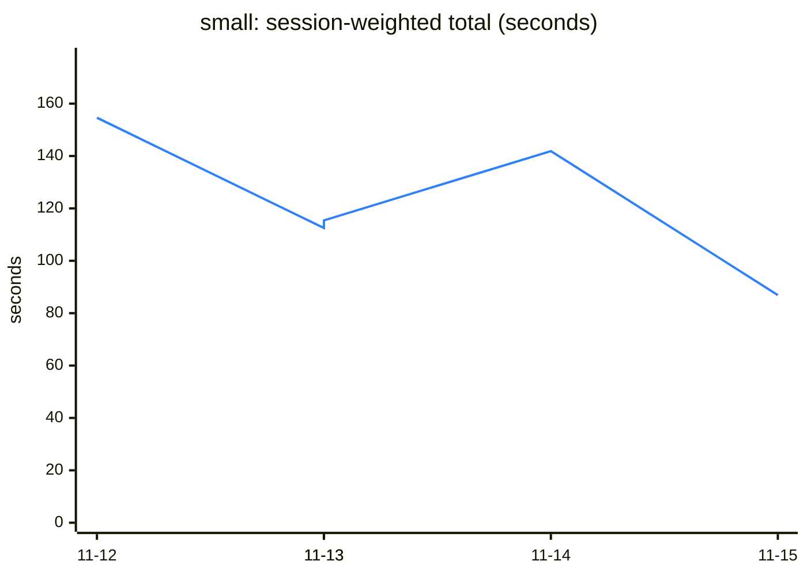
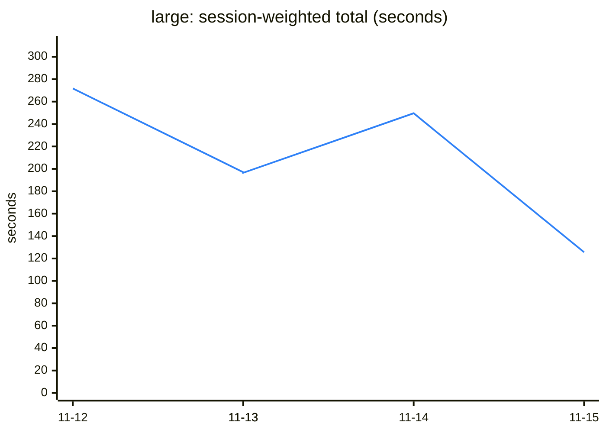
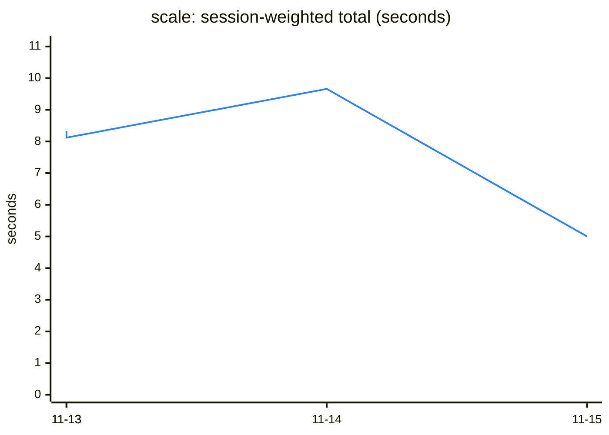
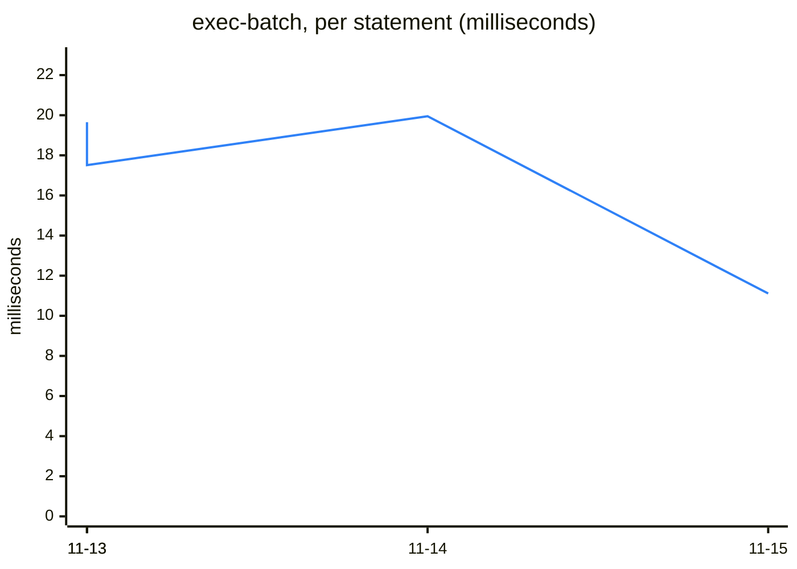
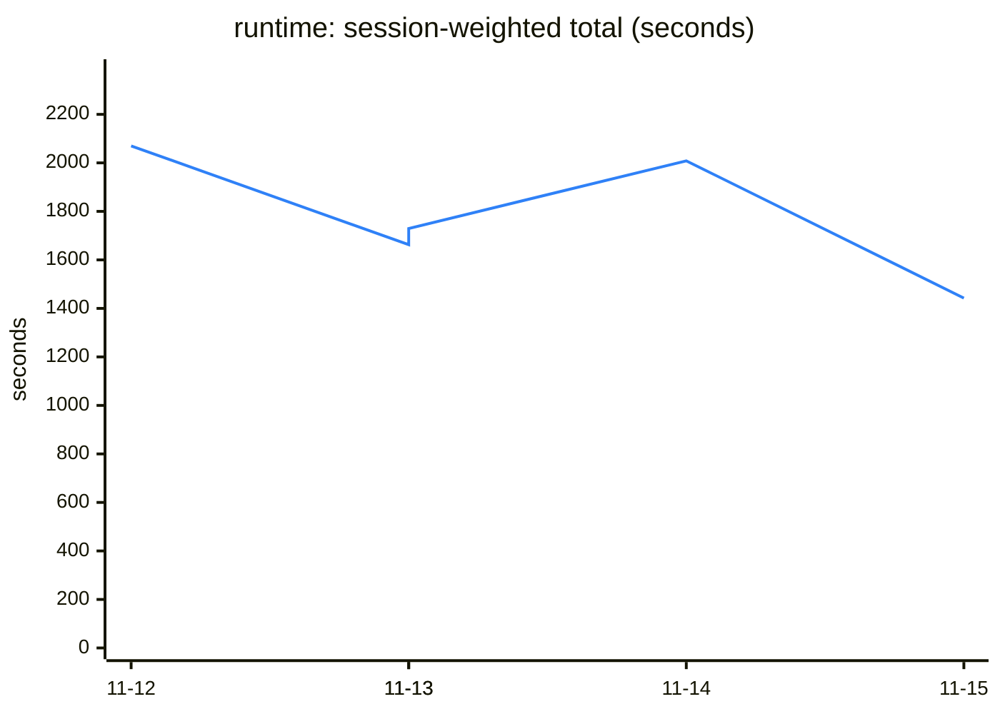

# Agent dev-loop benchmark — trend

5 runs, 2026-11-12 to 2026-11-15. Latest: `mxcli version 72f8d53 (2026-11-15T08:51:54Z)` against `mxcli version nightly-20261113-df9084d41 (2026-11-13T10:08:50Z)`.

Generated by `scripts/agentbench/trend` after each run; do not edit. Times are the candidate's median wall time on that night's runner, so two nights differ by the machine as well as by the code: read a level that stays, not one night's step. How to read it: `docs-site/src/internals/agent-benchmark.md` on `main`.

## Alerts

None.

## small project — 370 units



| step | latest | run before | median of the 7 before | against that median | against its baseline, latest | last runs |
|---|---:|---:|---:|---:|---:|---|
| (session-weighted total) | 86.9 s | 141.9 s | 128.6 s | × 0.68 | × 0.89 | █▄▄▇▁ |
| open-cold | 166 ms | 193 ms | 191 ms | × 0.87 | × 1.10 | ▅▅█▅▁ |
| open | 48 ms | 68 ms | 61 ms | × 0.79 | × 1.00 | █▂▄█▁ |
| domain | 560 ms | 842 ms | 767 ms | × 0.73 | × 0.99 | █▁▁▂▁ |
| microflows | 499 ms | 609 ms | 659 ms | × 0.76 | × 1.00 | █▁▄▂▁ |
| pages | 1.50 s | 1.95 s | 1.99 s | × 0.76 | × 1.09 | █▁▃▃▁ |
| describe | 106 ms | 157 ms | 142 ms | × 0.74 | × 0.95 | █▃▃▆▁ |
| catalog | 189 ms | 277 ms | 250 ms | × 0.75 | × 0.99 | █▃▃█▁ |
| catalog-full | 932 ms | 1.41 s | 1.25 s | × 0.74 | × 0.99 | █▃▃█▁ |
| query | 69 ms | 98 ms | 88 ms | × 0.78 | × 0.99 | █▃▃█▁ |
| check | 274 ms | 574 ms | 511 ms | × 0.54 | × 0.72 | █▄▅█▁ |
| single-edit | 289 ms | 420 ms | 384 ms | × 0.75 | × 0.98 | █▃▄█▁ |
| catalog-after-edit | 179 ms | 264 ms | 245 ms | × 0.73 | × 0.98 | █▄▅█▁ |
| bulk-alter | 997 ms | 1.37 s | 1.31 s | × 0.76 | × 0.96 | █▁▁▂▁ |
| re-exec | 474 ms | 695 ms | 652 ms | × 0.73 | × 1.00 | █▁▁▂▁ |
| rename | 388 ms | 612 ms | 544 ms | × 0.71 | × 0.99 | █▃▃▆▁ |

## large project — 910 units



| step | latest | run before | median of the 7 before | against that median | against its baseline, latest | last runs |
|---|---:|---:|---:|---:|---:|---|
| (session-weighted total) | 125.6 s | 249.6 s | 223.3 s | × 0.56 | × 0.78 | █▄▄▇▁ |
| open-cold | 306 ms | 355 ms | 366 ms | × 0.84 | × 1.16 | ▄█▅▄▁ |
| open | 55 ms | 87 ms | 80 ms | × 0.69 | × 1.00 | █▄▃█▁ |
| domain | 623 ms | 1.01 s | 913 ms | × 0.68 | × 0.97 | █▁▁▂▁ |
| microflows | 991 ms | 1.57 s | 1.43 s | × 0.69 | × 1.01 | █▂▃▅▁ |
| pages | 1.61 s | 2.43 s | 2.26 s | × 0.71 | × 0.99 | █▂▂▄▁ |
| describe | 125 ms | 188 ms | 171 ms | × 0.73 | × 1.01 | █▃▃▆▁ |
| catalog | 274 ms | 428 ms | 384 ms | × 0.71 | × 1.00 | █▃▄█▁ |
| catalog-full | 2.73 s | 4.46 s | 3.91 s | × 0.70 | × 0.99 | █▃▃█▁ |
| query | 72 ms | 100 ms | 91 ms | × 0.79 | × 1.04 | █▂▃█▁ |
| check | 418 ms | 1.28 s | 1.13 s | × 0.37 | × 0.53 | █▅▅▇▁ |
| single-edit | 417 ms | 644 ms | 582 ms | × 0.72 | × 1.00 | █▄▄█▁ |
| catalog-after-edit | 299 ms | 378 ms | 369 ms | × 0.81 | × 1.04 | █▆▃▇▁ |
| bulk-alter | 1.17 s | 1.71 s | 1.58 s | × 0.74 | × 1.02 | █▁▁▂▁ |
| re-exec | 650 ms | 1.00 s | 903 ms | × 0.72 | × 1.01 | █▁▁▂▁ |
| rename | 756 ms | 1.24 s | 1.11 s | × 0.68 | × 1.00 | █▄▄▇▁ |

## scale project — 4374 units



```mermaid
---
config:
  themeVariables:
    xyChart:
      plotColorPalette: "#2f81f7"
---
xychart-beta
    title "check-one (seconds)"
    x-axis ["11-13", "11-13", "11-14", "11-15"]
    y-axis "seconds" 0 --> 1.11
    line [0.75, 0.74, 0.97, 0.46]
```



| step | latest | run before | median of the 7 before | against that median | against its baseline, latest | last runs |
|---|---:|---:|---:|---:|---:|---|
| (session-weighted total) | 5.00 s | 9.66 s | 8.33 s | × 0.60 | × 0.75 | ▆▆█▁ |
| check-cold | 1.39 s | 2.41 s | 2.08 s | × 0.67 | × 0.85 | ▆▆█▁ |
| check-one | 456 ms | 968 ms | 747 ms | × 0.61 | × 0.78 | ▅▅█▁ |
| check-batch | 800 ms | 1.70 s | 1.32 s | × 0.60 | × 0.77 | ▅▅█▁ |
| exec-batch | 1.11 s | 1.99 s | 1.96 s | × 0.57 | × 0.73 | █▆█▁ |
| re-exec-batch | 513 ms | 1.29 s | 1.04 s | × 0.49 | × 0.60 | ▆▆█▁ |
| new-batch | 729 ms | 1.30 s | 1.24 s | × 0.59 | × 0.77 | ▇██▁ |

## running app — 476 units



| step | latest | run before | median of the 7 before | against that median | against its baseline, latest | last runs |
|---|---:|---:|---:|---:|---:|---|
| (session-weighted total) | 1442.5 s | 2008.3 s | 1868.9 s | × 0.77 | × 0.99 | █▃▄█▁ |
| mx-check | 5.03 s | 8.03 s | 7.20 s | × 0.70 | × 1.02 | █▄▄█▁ |
| build | 44.2 s | 57.3 s | 55.0 s | × 0.80 | × 0.99 | █▄▅▇▁ |
| boot | 20.8 s | 29.6 s | 28.1 s | × 0.74 | × 0.93 | █▃▅▇▁ |
| page-check | 2.46 s | 3.31 s | 3.14 s | × 0.78 | × 1.00 | █▄▅█▁ |
| hot-apply | 4.61 s | 5.75 s | 5.49 s | × 0.84 | × 1.00 | █▄▄▇▁ |
| test-attach | 109 ms | 137 ms | 127 ms | × 0.86 | × 0.91 | █▁▂▆▁ |
| apply-entity | 14.5 s | 18.7 s | 17.6 s | × 0.82 | × 0.98 | █▃▄▇▁ |
| stop | 729 ms | 841 ms | 788 ms | × 0.93 | × 1.00 | █▁▁█▁ |
| test-cold | 18.4 s | 25.1 s | 22.9 s | × 0.81 | × 0.98 | █▂▃█▁ |
