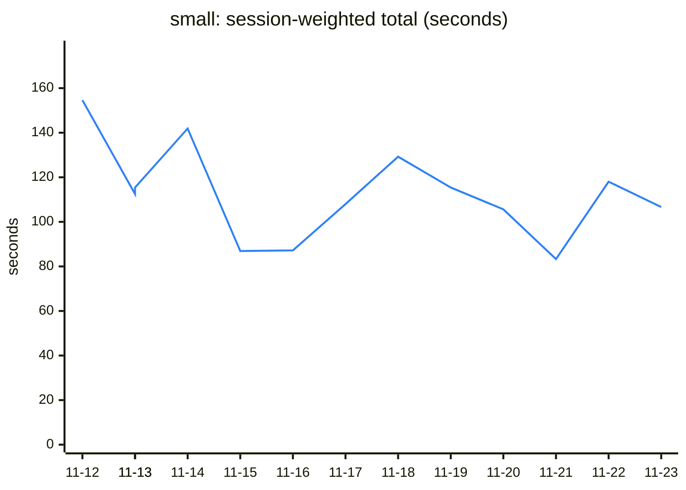
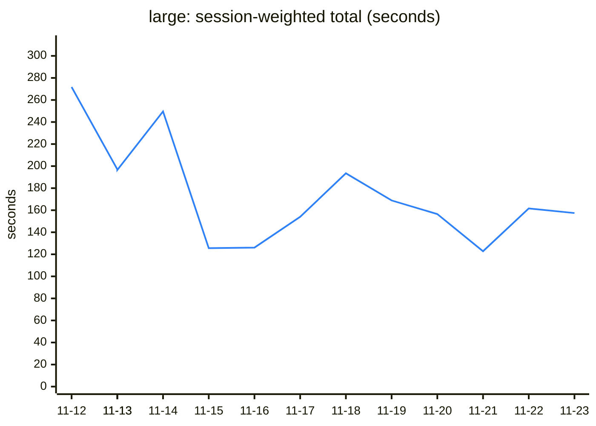
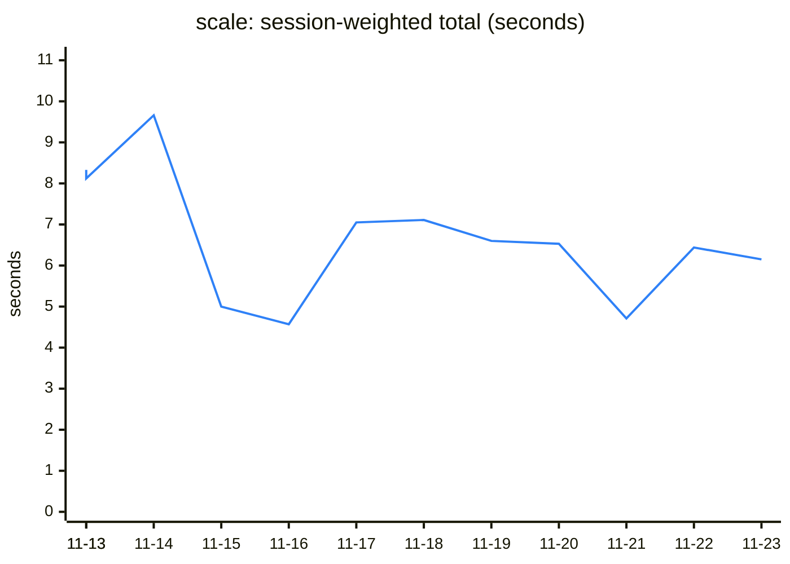
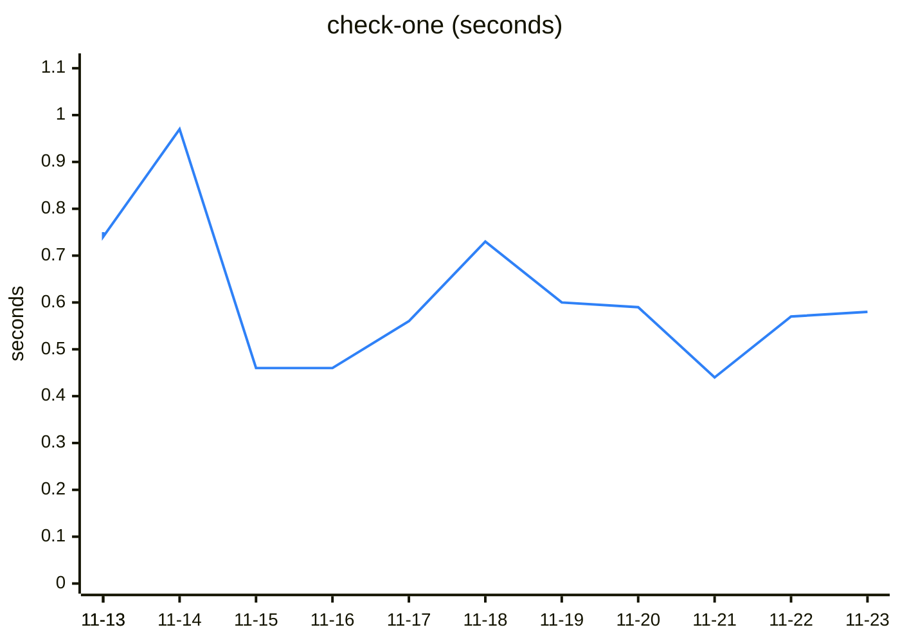
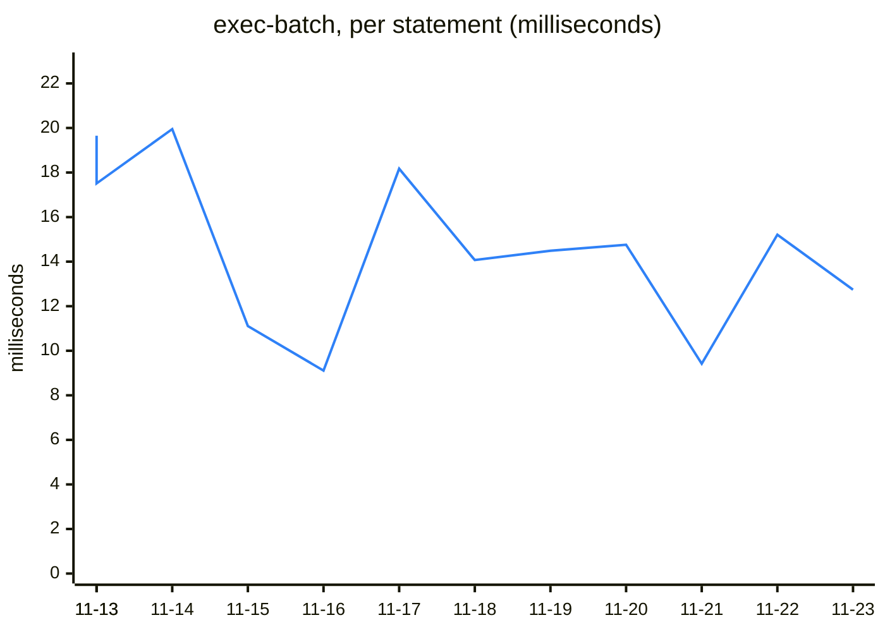
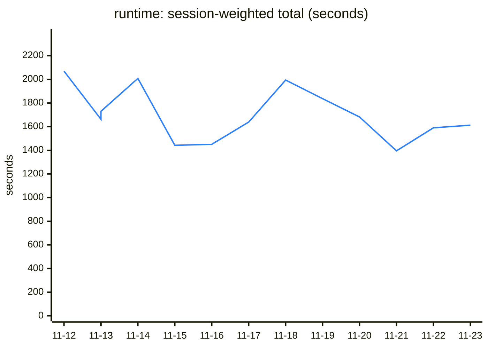

# Agent dev-loop benchmark — trend

13 runs, 2026-11-12 to 2026-11-23. Latest: `mxcli version a3fb30f (2026-11-23T10:20:17Z)` against `mxcli version nightly-20261122-6176c6661 (2026-11-22T10:26:17Z)`.

Generated by `scripts/agentbench/trend` after each run; do not edit. Times are the candidate's median wall time on that night's runner, so two nights differ by the machine as well as by the code: read a level that stays, not one night's step. How to read it: `docs-site/src/internals/agent-benchmark.md` on `main`.

## Alerts

None.

## small project — 370 units

| step | latest | run before | median of the 7 before | against that median | against its baseline, latest | last runs |
|---|---:|---:|---:|---:|---:|---|
| (session-weighted total) | 106.6 s | 118.0 s | 108.0 s | × 0.99 | × 1.01 | █▄▄▇▁▁▃▆▄▃▁▄▃ |
| open-cold | 184 ms | 188 ms | 188 ms | × 0.98 | × 1.06 | ▆▆█▇▄▁▆▆█▇▃▆▆ |
| open | 57 ms | 55 ms | 55 ms | × 1.04 | × 1.03 | █▃▅█▂▁▅█▇▄▂▄▅ |
| domain | 690 ms | 708 ms | 697 ms | × 0.99 | × 1.02 | █▁▁▂▁▁▁▂▂▁▁▁▁ |
| microflows | 532 ms | 598 ms | 598 ms | × 0.89 | × 1.03 | █▃▅▄▂▁▃▄▄▄▂▃▂ |
| pages | 1.75 s | 2.01 s | 1.73 s | × 1.01 | × 1.01 | █▂▄▄▁▁▃▄▃▂▁▄▃ |
| describe | 124 ms | 124 ms | 124 ms | × 1.00 | × 0.97 | █▃▃▆▁▁▂▆▄▃▁▃▃ |
| catalog | 221 ms | 225 ms | 223 ms | × 0.99 | × 1.02 | █▄▄█▂▁▄█▆▄▁▄▄ |
| catalog-full | 1.07 s | 1.11 s | 1.11 s | × 0.96 | × 1.00 | █▃▄█▁▁▄█▆▅▁▄▃ |
| query | 78 ms | 81 ms | 82 ms | × 0.96 | × 0.99 | █▄▃█▁▁▄▇▆▄▁▄▃ |
| check | 336 ms | 324 ms | 332 ms | × 1.01 | × 1.04 | █▅▅█▁▁▂▄▃▂▁▂▂ |
| single-edit | 359 ms | 438 ms | 363 ms | × 0.99 | × 1.02 | █▄▄█▁▁▅█▆▄▁█▅ |
| catalog-after-edit | 232 ms | 247 ms | 244 ms | × 0.95 | × 1.02 | █▄▅█▁▁▅█▆▇▂▇▅ |
| bulk-alter | 1.33 s | 1.30 s | 1.38 s | × 0.96 | × 1.05 | █▁▂▂▁▁▃▂▂▃▁▂▂ |
| re-exec | 588 ms | 588 ms | 589 ms | × 1.00 | × 1.01 | █▁▁▂▁▁▁▂▂▁▁▁▁ |
| rename | 487 ms | 705 ms | 509 ms | × 0.96 | × 1.01 | █▃▃▆▁▁▃▇▅▄▁█▃ |

## large project — 910 units

| step | latest | run before | median of the 7 before | against that median | against its baseline, latest | last runs |
|---|---:|---:|---:|---:|---:|---|
| (session-weighted total) | 157.4 s | 161.6 s | 156.5 s | × 1.01 | × 1.03 | █▄▄▇▁▁▂▄▃▂▁▃▂ |
| open-cold | 355 ms | 371 ms | 366 ms | × 0.97 | × 1.05 | ▄▆▄▄▂▁█▄▅▄▂▄▄ |
| open | 71 ms | 69 ms | 69 ms | × 1.03 | × 0.99 | █▄▃█▁▁▃▇▆▄▁▄▄ |
| domain | 837 ms | 845 ms | 807 ms | × 1.04 | × 1.04 | █▁▁▂▁▁▁▂▂▁▁▁▁ |
| microflows | 1.25 s | 1.42 s | 1.25 s | × 0.99 | × 0.97 | █▃▃▅▁▁▃▅▃▃▁▄▃ |
| pages | 2.09 s | 2.94 s | 2.07 s | × 1.01 | × 0.97 | █▂▂▄▁▁▂▄▃▂▁▅▂ |
| describe | 149 ms | 155 ms | 153 ms | × 0.97 | × 1.03 | █▃▃▆▁▁▃▆▄▃▁▃▃ |
| catalog | 332 ms | 336 ms | 336 ms | × 0.99 | × 1.00 | █▄▄█▁▁▄█▅▄▁▄▄ |
| catalog-full | 3.36 s | 3.36 s | 3.31 s | × 1.01 | × 1.02 | █▃▃█▁▁▃█▆▃▁▃▃ |
| query | 81 ms | 83 ms | 82 ms | × 0.99 | × 1.00 | █▃▄█▂▁▃█▆▄▁▄▄ |
| check | 528 ms | 517 ms | 517 ms | × 1.02 | × 1.02 | █▅▅▇▁▁▁▂▂▁▁▁▁ |
| single-edit | 525 ms | 546 ms | 516 ms | × 1.02 | × 1.02 | █▄▄█▁▁▄█▅▄▁▅▄ |
| catalog-after-edit | 354 ms | 371 ms | 361 ms | × 0.98 | × 1.02 | ▇▆▄▇▃▁▄▇▆█▃▆▅ |
| bulk-alter | 1.43 s | 1.84 s | 1.65 s | × 0.87 | × 1.03 | █▂▁▂▁▁▂▃▂▂▁▃▁ |
| re-exec | 815 ms | 856 ms | 813 ms | × 1.00 | × 1.02 | █▁▁▂▁▁▁▂▂▁▁▁▁ |
| rename | 950 ms | 1.02 s | 1.02 s | × 0.93 | × 1.02 | █▄▄▇▁▁▆█▆▃▁▄▃ |

## scale project — 4374 units

| step | latest | run before | median of the 7 before | against that median | against its baseline, latest | last runs |
|---|---:|---:|---:|---:|---:|---|
| (session-weighted total) | 6.15 s | 6.44 s | 6.53 s | × 0.94 | × 1.02 | ▆▆█▁▁▄▄▄▄▁▃▃ |
| check-cold | 1.73 s | 1.70 s | 1.77 s | × 0.98 | × 1.02 | ▆▆█▁▁▅▅▄▄▁▄▄ |
| check-one | 583 ms | 571 ms | 571 ms | × 1.02 | × 1.03 | ▅▅█▁▁▂▅▃▃▁▃▃ |
| check-batch | 1.01 s | 1.02 s | 1.02 s | × 0.99 | × 1.02 | ▅▅█▁▁▂▅▄▃▁▃▃ |
| exec-batch | 1.27 s | 1.52 s | 1.45 s | × 0.88 | × 0.98 | █▇█▂▁▇▄▄▅▁▅▃ |
| re-exec-batch | 628 ms | 638 ms | 638 ms | × 0.98 | × 0.99 | ▆▆█▁▁▂▃▂▂▁▂▂ |
| new-batch | 928 ms | 987 ms | 959 ms | × 0.97 | × 1.08 | ███▂▁▇▅▄▅▂▅▄ |

## running app — 476 units

| step | latest | run before | median of the 7 before | against that median | against its baseline, latest | last runs |
|---|---:|---:|---:|---:|---:|---|
| (session-weighted total) | 1612.5 s | 1590.2 s | 1639.0 s | × 0.98 | × 1.00 | █▄▄█▁▁▃█▆▄▁▃▃ |
| mx-check | 5.95 s | 5.99 s | 6.04 s | × 0.99 | × 0.99 | █▄▅█▂▂▄█▇▄▁▄▄ |
| build | 50.0 s | 49.9 s | 50.2 s | × 1.00 | × 1.00 | █▅▅█▂▁▄██▅▁▄▄ |
| boot | 24.6 s | 23.8 s | 23.8 s | × 1.03 | × 1.05 | █▃▅▇▁▂▂▇▅▃▁▃▃ |
| page-check | 2.84 s | 2.64 s | 2.83 s | × 1.00 | × 1.09 | █▄▅█▁▃▄█▇▄▁▂▄ |
| hot-apply | 4.67 s | 4.64 s | 4.91 s | × 0.95 | × 1.00 | █▄▅▇▂▁▃▇▄▄▁▂▂ |
| test-attach | 115 ms | 105 ms | 112 ms | × 1.03 | × 1.00 | █▃▄▇▃▁▃█▅▄▃▂▄ |
| apply-entity | 15.6 s | 15.1 s | 16.3 s | × 0.95 | × 1.02 | █▃▄▇▂▁▄▇▅▅▂▂▃ |
| stop | 736 ms | 936 ms | 737 ms | × 1.00 | × 0.88 | ▇▅▅▇▄▁▅▇▅▇▃█▅ |
| test-cold | 20.5 s | 20.2 s | 21.1 s | × 0.97 | × 0.98 | █▃▄█▁▁▄█▆▄▁▃▃ |
