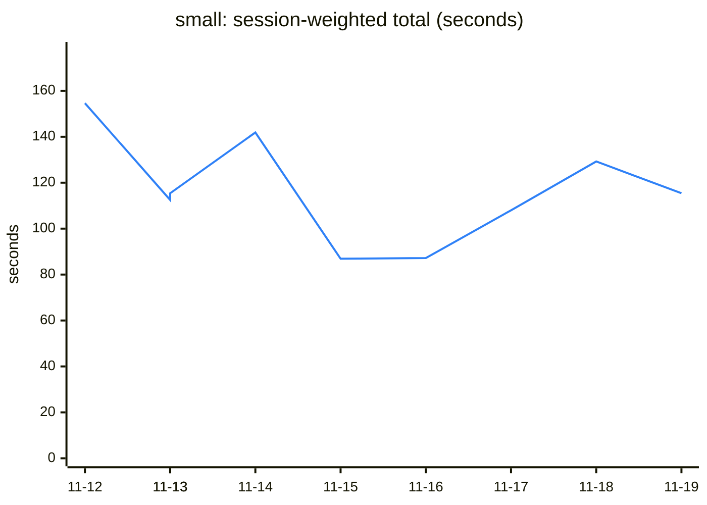
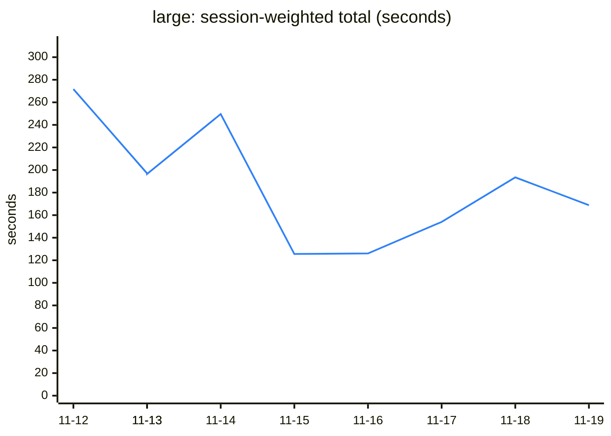
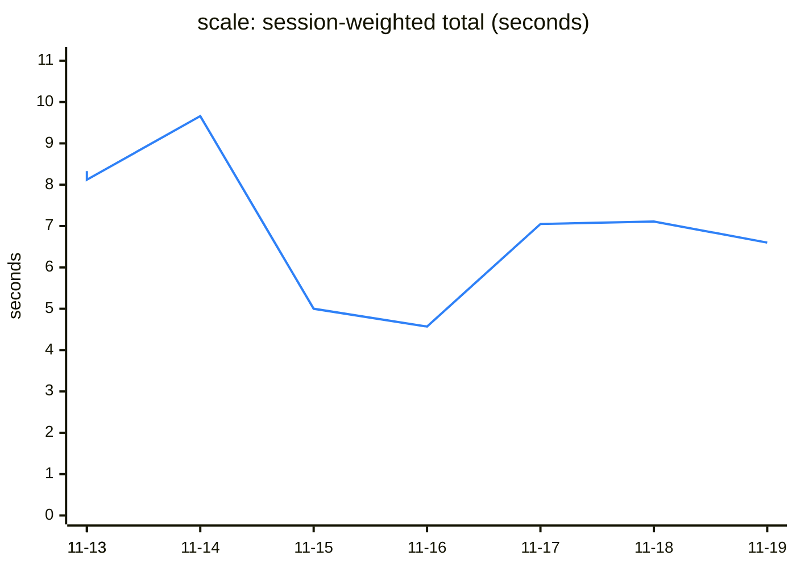
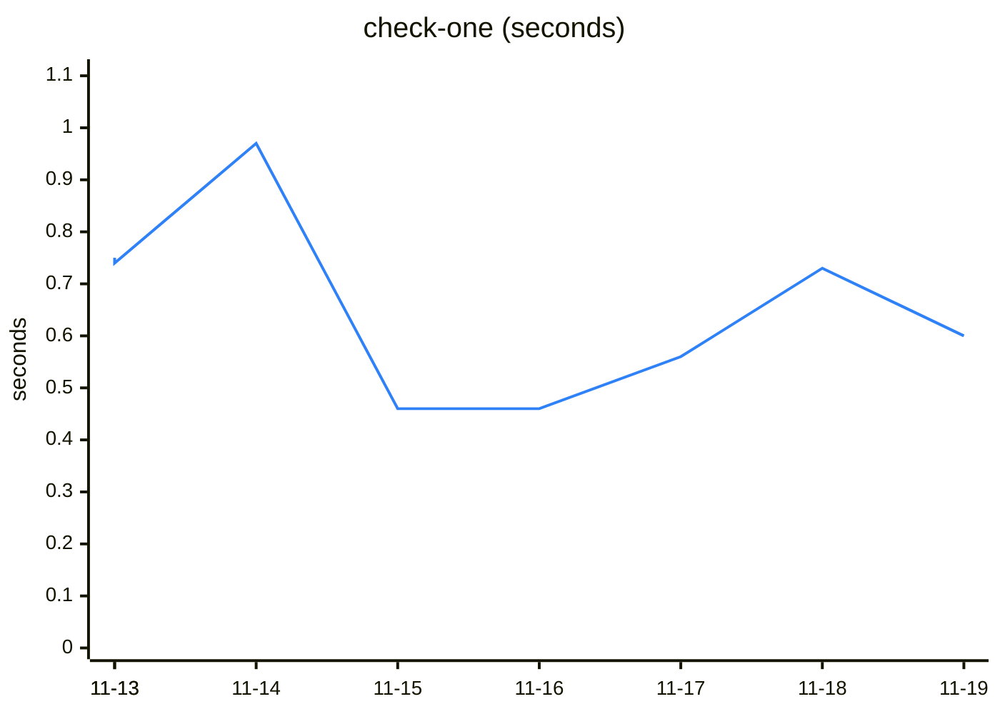
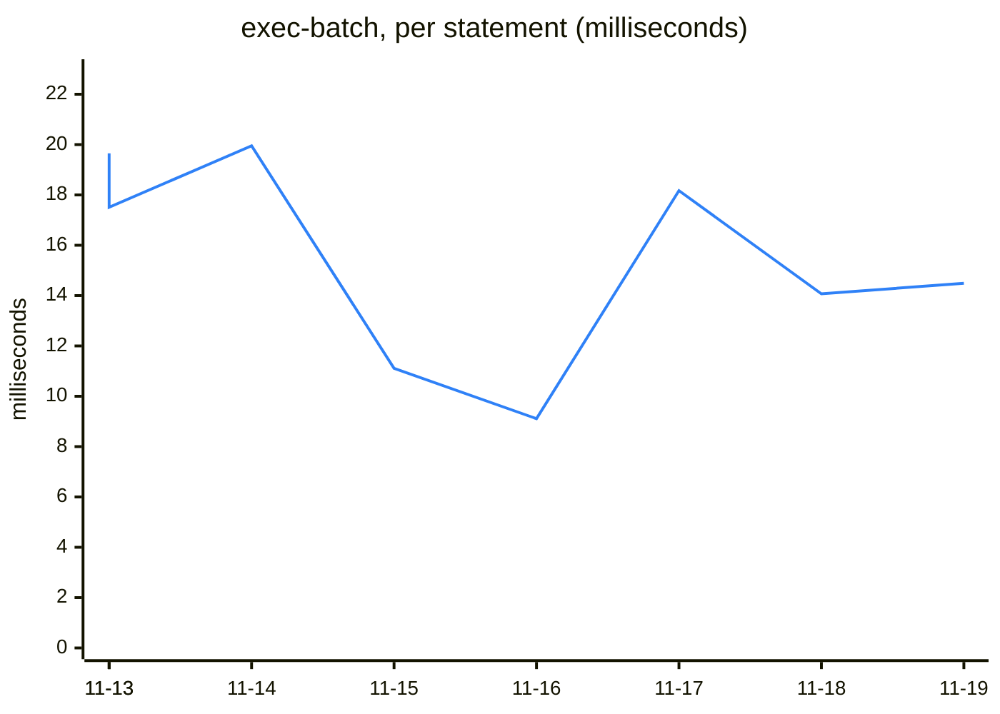
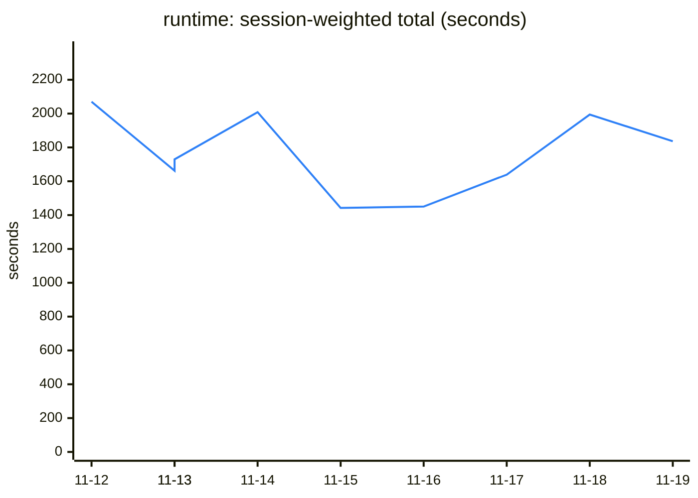

# Agent dev-loop benchmark — trend

9 runs, 2026-11-12 to 2026-11-19. Latest: `mxcli version 0dd5a31 (2026-11-19T09:57:05Z)` against `mxcli version nightly-20261118-43b997f47 (2026-11-18T10:41:53Z)`.

Generated by `scripts/agentbench/trend` after each run; do not edit. Times are the candidate's median wall time on that night's runner, so two nights differ by the machine as well as by the code: read a level that stays, not one night's step. How to read it: `docs-site/src/internals/agent-benchmark.md` on `main`.

## Alerts

None.

## small project — 370 units

| step | latest | run before | median of the 7 before | against that median | against its baseline, latest | last runs |
|---|---:|---:|---:|---:|---:|---|
| (session-weighted total) | 115.4 s | 129.3 s | 112.5 s | × 1.03 | × 0.99 | █▄▄▇▁▁▃▆▄ |
| open-cold | 209 ms | 189 ms | 188 ms | × 1.11 | × 1.07 | ▆▆█▇▄▁▆▆█ |
| open | 63 ms | 67 ms | 56 ms | × 1.12 | × 1.04 | █▃▅█▂▁▅█▇ |
| domain | 794 ms | 856 ms | 678 ms | × 1.17 | × 1.00 | █▁▁▂▁▁▁▂▂ |
| microflows | 613 ms | 638 ms | 573 ms | × 1.07 | × 1.01 | █▃▅▄▂▁▃▄▄ |
| pages | 1.91 s | 2.00 s | 1.73 s | × 1.10 | × 1.00 | █▂▄▄▁▁▂▄▃ |
| describe | 141 ms | 159 ms | 126 ms | × 1.11 | × 0.97 | █▃▃▆▁▁▂▆▄ |
| catalog | 244 ms | 278 ms | 223 ms | × 1.10 | × 1.04 | █▄▄█▂▁▄█▆ |
| catalog-full | 1.25 s | 1.43 s | 1.09 s | × 1.14 | × 1.01 | █▃▃█▁▁▃█▅ |
| query | 88 ms | 96 ms | 79 ms | × 1.12 | × 1.03 | █▄▃█▁▁▄▇▆ |
| check | 364 ms | 418 ms | 418 ms | × 0.87 | × 0.98 | █▄▅█▁▁▂▄▃ |
| single-edit | 384 ms | 428 ms | 347 ms | × 1.11 | × 0.98 | █▃▄█▁▁▄█▆ |
| catalog-after-edit | 244 ms | 267 ms | 225 ms | × 1.08 | × 1.01 | █▄▅█▁▁▅█▆ |
| bulk-alter | 1.38 s | 1.40 s | 1.25 s | × 1.11 | × 1.00 | █▁▂▂▁▁▃▂▂ |
| re-exec | 670 ms | 732 ms | 589 ms | × 1.14 | × 0.99 | █▁▁▂▁▁▁▂▁ |
| rename | 581 ms | 639 ms | 475 ms | × 1.22 | × 1.00 | █▃▃▆▁▁▃▇▆ |

## large project — 910 units

| step | latest | run before | median of the 7 before | against that median | against its baseline, latest | last runs |
|---|---:|---:|---:|---:|---:|---|
| (session-weighted total) | 168.9 s | 193.5 s | 193.5 s | × 0.87 | × 1.00 | █▄▄▇▁▁▂▄▃ |
| open-cold | 408 ms | 362 ms | 362 ms | × 1.13 | × 1.07 | ▄▆▄▄▂▁█▄▅ |
| open | 79 ms | 85 ms | 68 ms | × 1.16 | × 0.98 | █▄▃█▁▁▃▇▆ |
| domain | 930 ms | 1.02 s | 807 ms | × 1.15 | × 1.00 | █▁▁▂▁▁▁▂▂ |
| microflows | 1.28 s | 1.55 s | 1.24 s | × 1.03 | × 0.99 | █▃▃▅▁▁▃▅▃ |
| pages | 2.32 s | 2.46 s | 2.06 s | × 1.13 | × 1.00 | █▂▂▄▁▁▂▄▃ |
| describe | 164 ms | 192 ms | 153 ms | × 1.08 | × 0.97 | █▃▃▆▁▁▃▆▄ |
| catalog | 362 ms | 429 ms | 327 ms | × 1.10 | × 1.01 | █▄▄█▁▁▄█▅ |
| catalog-full | 3.95 s | 4.49 s | 3.32 s | × 1.19 | × 1.00 | █▃▃█▁▁▃█▆ |
| query | 91 ms | 102 ms | 79 ms | × 1.15 | × 1.03 | █▃▄█▂▁▃█▆ |
| check | 564 ms | 655 ms | 655 ms | × 0.86 | × 1.00 | █▅▅▇▁▁▁▂▂ |
| single-edit | 558 ms | 640 ms | 515 ms | × 1.08 | × 1.01 | █▄▄█▁▁▄█▅ |
| catalog-after-edit | 361 ms | 386 ms | 333 ms | × 1.09 | × 0.98 | █▇▅█▃▁▅█▇ |
| bulk-alter | 1.65 s | 1.75 s | 1.45 s | × 1.14 | × 1.00 | █▁▁▂▁▁▂▃▂ |
| re-exec | 911 ms | 1.01 s | 796 ms | × 1.15 | × 1.01 | █▁▁▂▁▁▁▂▂ |
| rename | 1.12 s | 1.26 s | 969 ms | × 1.16 | × 0.99 | █▄▄▇▁▁▆█▆ |

## scale project — 4374 units

| step | latest | run before | median of the 7 before | against that median | against its baseline, latest | last runs |
|---|---:|---:|---:|---:|---:|---|
| (session-weighted total) | 6.60 s | 7.11 s | 7.11 s | × 0.93 | × 0.99 | ▆▆█▁▁▄▄▄ |
| check-cold | 1.78 s | 1.94 s | 1.94 s | × 0.92 | × 1.00 | ▆▆█▁▁▅▅▄ |
| check-one | 604 ms | 731 ms | 731 ms | × 0.83 | × 0.99 | ▅▅█▁▁▂▅▃ |
| check-batch | 1.14 s | 1.31 s | 1.30 s | × 0.88 | × 1.00 | ▅▅█▁▁▂▅▄ |
| exec-batch | 1.45 s | 1.41 s | 1.75 s | × 0.83 | × 0.95 | █▇█▂▁▇▄▄ |
| re-exec-batch | 688 ms | 768 ms | 768 ms | × 0.90 | × 1.00 | ▆▆█▁▁▂▃▂ |
| new-batch | 940 ms | 959 ms | 1.12 s | × 0.84 | × 0.94 | ███▂▁▇▅▄ |

## running app — 476 units

| step | latest | run before | median of the 7 before | against that median | against its baseline, latest | last runs |
|---|---:|---:|---:|---:|---:|---|
| (session-weighted total) | 1836.6 s | 1994.3 s | 1662.7 s | × 1.10 | × 1.01 | █▃▄█▁▁▃█▆ |
| mx-check | 7.35 s | 7.96 s | 6.27 s | × 1.17 | × 1.04 | █▄▄█▁▁▃█▇ |
| build | 57.4 s | 57.4 s | 51.1 s | × 1.12 | × 1.02 | █▅▅█▂▁▄██ |
| boot | 26.6 s | 28.6 s | 23.6 s | × 1.13 | × 0.96 | █▃▅▇▁▂▂▇▅ |
| page-check | 3.28 s | 3.31 s | 2.86 s | × 1.15 | × 1.05 | █▄▅█▁▃▄█▇ |
| hot-apply | 5.03 s | 5.75 s | 5.15 s | × 0.98 | × 1.00 | █▄▅▇▂▁▃▇▄ |
| test-attach | 128 ms | 150 ms | 112 ms | × 1.14 | × 0.99 | █▃▄▇▃▁▃█▅ |
| apply-entity | 17.1 s | 18.7 s | 16.3 s | × 1.05 | × 1.00 | █▃▄▇▂▁▄▇▅ |
| stop | 737 ms | 842 ms | 735 ms | × 1.00 | × 0.99 | █▆▆█▆▁▆█▆ |
| test-cold | 22.8 s | 25.1 s | 20.7 s | × 1.10 | × 1.00 | █▃▃█▁▁▄█▅ |
