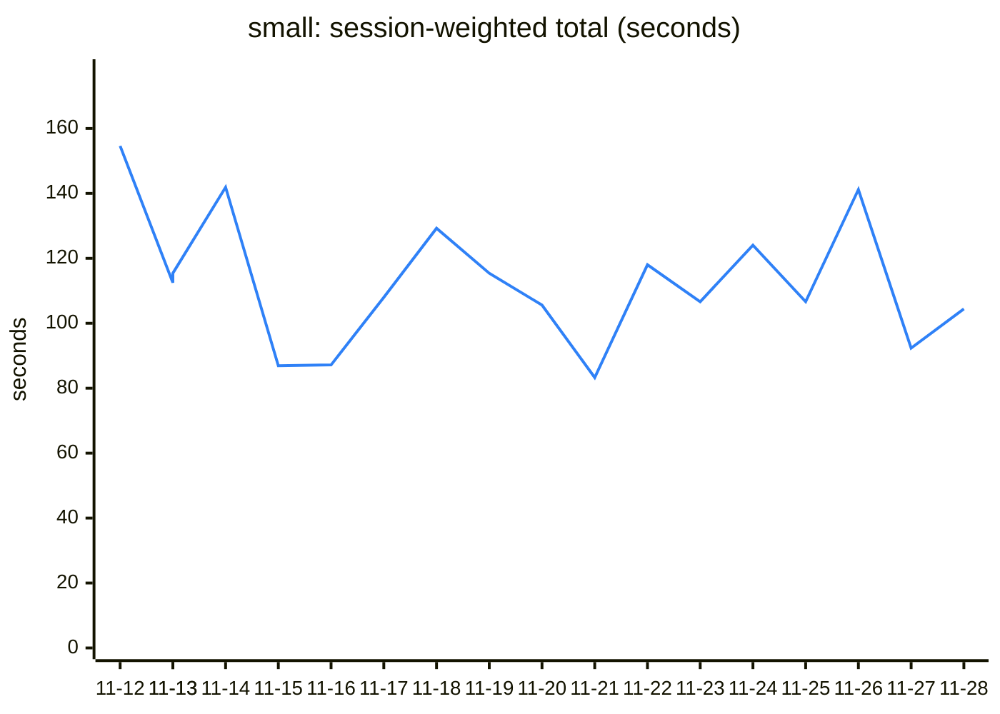
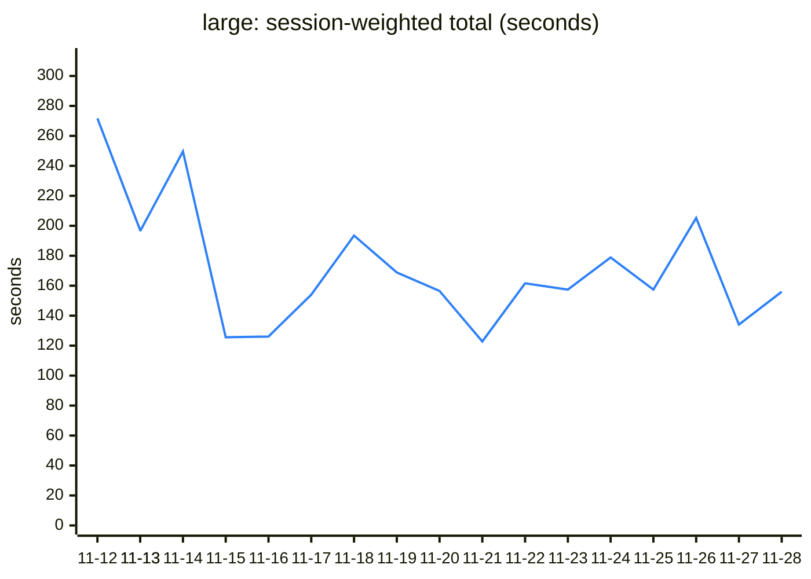
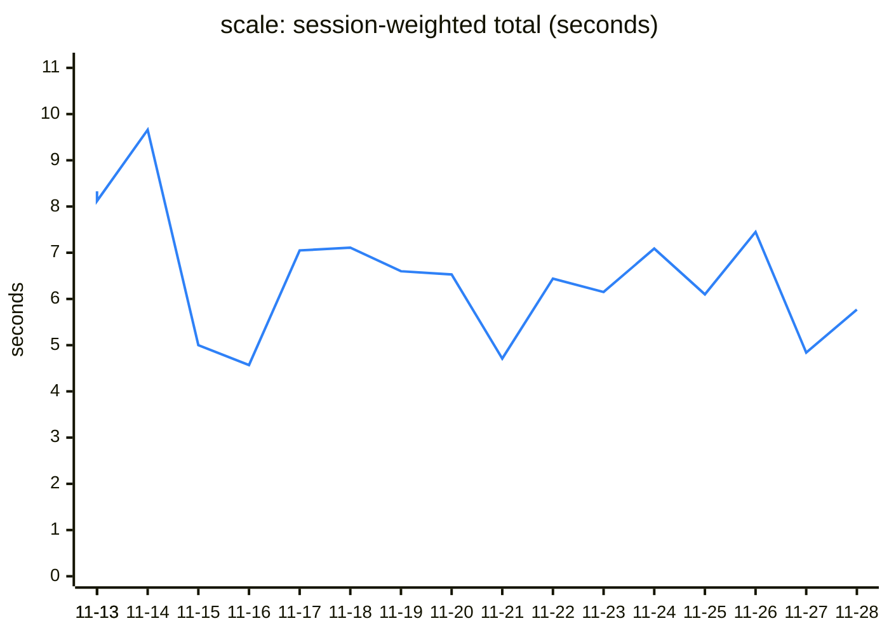
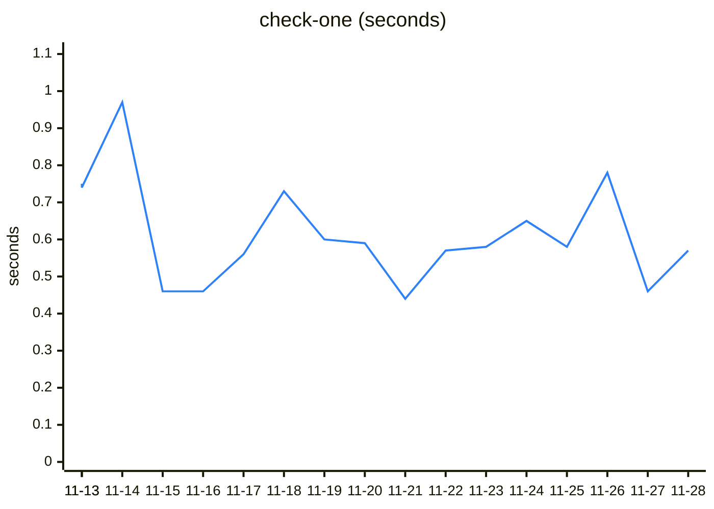
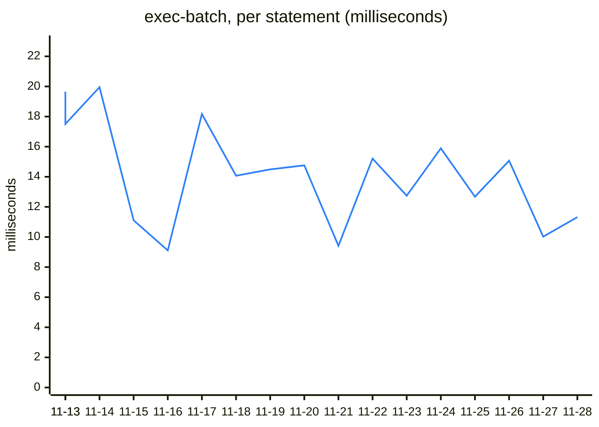
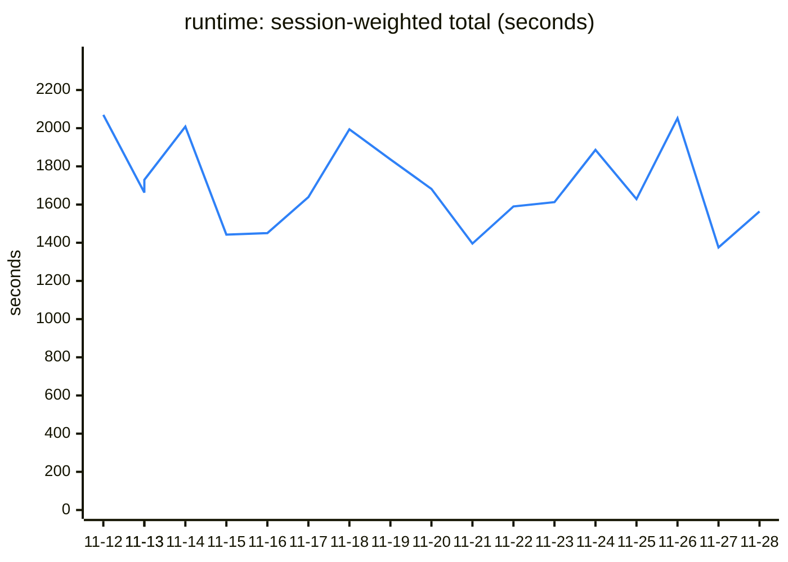

# Agent dev-loop benchmark — trend

18 runs, 2026-11-12 to 2026-11-28. Latest: `mxcli version 9d07df0 (2026-11-28T09:50:16Z)` against `mxcli version nightly-20261127-3b8ba4a27 (2026-11-27T11:34:01Z)`.

Generated by `scripts/agentbench/trend` after each run; do not edit. Times are the candidate's median wall time on that night's runner, so two nights differ by the machine as well as by the code: read a level that stays, not one night's step. How to read it: `docs-site/src/internals/agent-benchmark.md` on `main`.

## Alerts

None.

## small project — 370 units

| step | latest | run before | median of the 7 before | against that median | against its baseline, latest | last runs |
|---|---:|---:|---:|---:|---:|---|
| (session-weighted total) | 104.4 s | 92.4 s | 106.6 s | × 0.98 | × 1.01 | ▁▁▄▇▅▄▁▅▄▆▄█▂▃ |
| open-cold | 195 ms | 156 ms | 188 ms | × 1.04 | × 1.07 | ▃▁▅▆▇▆▃▅▅█▆▆▃▆ |
| open | 56 ms | 50 ms | 57 ms | × 0.98 | × 0.98 | ▂▁▄▇▆▃▁▃▄▆▅█▂▄ |
| domain | 663 ms | 582 ms | 691 ms | × 0.96 | × 1.00 | ▁▁▃▇▆▄▁▄▄▇▄█▁▃ |
| microflows | 497 ms | 443 ms | 532 ms | × 0.93 | × 0.99 | ▃▁▅▇▆█▄▆▄█▄█▂▃ |
| pages | 1.62 s | 1.37 s | 1.75 s | × 0.93 | × 1.02 | ▂▁▅▇▆▃▁▇▅▇▄█▁▃ |
| describe | 124 ms | 111 ms | 124 ms | × 0.99 | × 0.99 | ▁▁▃▇▅▃▁▃▃▆▃█▁▃ |
| catalog | 222 ms | 181 ms | 225 ms | × 0.98 | × 0.98 | ▂▁▄▇▅▄▁▄▄▅▄█▁▄ |
| catalog-full | 1.04 s | 878 ms | 1.07 s | × 0.97 | × 1.00 | ▁▁▄█▅▄▁▄▃▆▃█▁▃ |
| query | 81 ms | 70 ms | 81 ms | × 0.99 | × 1.01 | ▁▁▃▆▅▃▁▃▃▅▃█▁▃ |
| check | 331 ms | 295 ms | 336 ms | × 0.98 | × 0.99 | ▁▁▄▇▅▃▁▃▄▆▄█▂▃ |
| single-edit | 351 ms | 309 ms | 359 ms | × 0.98 | × 1.01 | ▁▁▄▇▅▄▁▇▄▆▄█▂▄ |
| catalog-after-edit | 233 ms | 206 ms | 235 ms | × 0.99 | × 1.03 | ▁▁▄▆▅▅▂▅▄▇▅█▃▄ |
| bulk-alter | 1.16 s | 1.09 s | 1.30 s | × 0.89 | × 0.99 | ▂▁▇▆▆█▁▅▅▇▄█▃▃ |
| re-exec | 597 ms | 529 ms | 588 ms | × 1.01 | × 1.03 | ▁▁▄▇▆▄▁▄▄▆▄█▂▄ |
| rename | 476 ms | 410 ms | 492 ms | × 0.97 | × 1.01 | ▁▁▃▇▅▄▁█▃▆▃▇▁▃ |

## large project — 910 units

| step | latest | run before | median of the 7 before | against that median | against its baseline, latest | last runs |
|---|---:|---:|---:|---:|---:|---|
| (session-weighted total) | 156.0 s | 134.0 s | 157.4 s | × 0.99 | × 1.00 | ▁▁▄▇▅▄▁▄▄▆▄█▂▄ |
| open-cold | 361 ms | 326 ms | 369 ms | × 0.98 | × 1.04 | ▂▁█▄▅▄▂▄▄▆▄▄▃▄ |
| open | 73 ms | 62 ms | 71 ms | × 1.02 | × 1.03 | ▁▁▃▆▅▃▁▃▄▆▄█▂▄ |
| domain | 806 ms | 700 ms | 837 ms | × 0.96 | × 1.00 | ▁▁▃▇▆▄▁▄▄▇▄█▂▄ |
| microflows | 1.20 s | 1.07 s | 1.28 s | × 0.94 | × 0.99 | ▁▁▄▇▄▄▁▆▄▅▄█▂▃ |
| pages | 1.98 s | 1.78 s | 2.09 s | × 0.95 | × 1.00 | ▁▁▃▆▅▃▁█▃▆▃▆▁▃ |
| describe | 148 ms | 135 ms | 155 ms | × 0.95 | × 0.99 | ▁▁▃▇▅▄▁▄▃▆▄█▂▃ |
| catalog | 339 ms | 283 ms | 336 ms | × 1.01 | × 1.00 | ▁▁▃█▅▄▁▄▄▆▄█▂▄ |
| catalog-full | 3.25 s | 2.80 s | 3.36 s | × 0.97 | × 1.00 | ▁▁▃█▆▃▁▃▃▆▃█▁▃ |
| query | 82 ms | 73 ms | 81 ms | × 1.01 | × 0.99 | ▂▁▃▇▅▃▁▄▃▆▃█▂▄ |
| check | 522 ms | 440 ms | 519 ms | × 1.00 | × 1.00 | ▁▁▄█▅▄▁▄▄▆▄█▁▄ |
| single-edit | 521 ms | 448 ms | 525 ms | × 0.99 | × 1.01 | ▁▁▄▇▅▄▁▅▄▆▄█▂▄ |
| catalog-after-edit | 365 ms | 321 ms | 368 ms | × 0.99 | × 1.02 | ▃▁▄▆▅█▂▆▅▇▆█▄▆ |
| bulk-alter | 1.37 s | 1.22 s | 1.53 s | × 0.89 | × 1.00 | ▁▁▅▇▆▆▁█▄▇▅█▁▃ |
| re-exec | 811 ms | 699 ms | 827 ms | × 0.98 | × 1.00 | ▁▁▃█▆▄▁▅▄▇▄█▂▄ |
| rename | 925 ms | 777 ms | 950 ms | × 0.97 | × 1.00 | ▁▁▆█▆▃▁▄▃▆▃█▁▃ |

## scale project — 4374 units

| step | latest | run before | median of the 7 before | against that median | against its baseline, latest | last runs |
|---|---:|---:|---:|---:|---:|---|
| (session-weighted total) | 5.77 s | 4.84 s | 6.15 s | × 0.94 | × 1.00 | ▂▁▇█▆▆▁▆▅▇▅█▁▄ |
| check-cold | 1.68 s | 1.37 s | 1.73 s | × 0.97 | × 1.01 | ▂▁██▆▆▂▅▆▇▆█▂▅ |
| check-one | 567 ms | 456 ms | 578 ms | × 0.98 | × 1.01 | ▁▁▃▇▄▄▁▄▄▅▄█▁▄ |
| check-batch | 1.00 s | 796 ms | 1.02 s | × 0.98 | × 1.00 | ▁▂▃█▅▄▁▄▄▆▄█▁▃ |
| exec-batch | 1.13 s | 1.00 s | 1.27 s | × 0.89 | × 0.95 | ▂▁█▅▅▅▁▆▄▆▄▆▁▂ |
| re-exec-batch | 621 ms | 527 ms | 638 ms | × 0.97 | × 1.01 | ▁▁▄█▆▅▁▄▄▆▄█▁▄ |
| new-batch | 776 ms | 691 ms | 928 ms | × 0.84 | × 1.00 | ▃▁█▆▆▆▂▆▆▇▄▇▂▃ |

## running app — 476 units

| step | latest | run before | median of the 7 before | against that median | against its baseline, latest | last runs |
|---|---:|---:|---:|---:|---:|---|
| (session-weighted total) | 1563.8 s | 1375.4 s | 1612.5 s | × 0.97 | × 1.00 | ▁▁▄█▆▄▁▃▃▇▃█▁▃ |
| mx-check | 5.84 s | 4.72 s | 5.99 s | × 0.98 | × 1.00 | ▁▂▃▇▆▃▁▃▃▆▄█▁▃ |
| build | 48.6 s | 42.2 s | 50.0 s | × 0.97 | × 1.00 | ▂▁▅██▅▁▄▄█▅█▁▄ |
| boot | 23.1 s | 21.6 s | 24.1 s | × 0.96 | × 1.01 | ▁▂▃▇▅▃▂▃▄▇▃█▁▂ |
| page-check | 2.63 s | 2.46 s | 2.84 s | × 0.92 | × 1.03 | ▁▃▄██▅▁▂▄█▆█▁▂ |
| hot-apply | 4.42 s | 4.34 s | 4.67 s | × 0.95 | × 1.00 | ▂▁▄█▄▅▁▂▂▄▂▇▁▁ |
| test-attach | 111 ms | 111 ms | 115 ms | × 0.96 | × 1.04 | ▃▁▃█▅▄▃▂▄▅▄▇▃▃ |
| apply-entity | 15.8 s | 13.4 s | 15.4 s | × 1.03 | × 1.00 | ▂▁▅█▆▆▂▃▄▇▃█▁▄ |
| stop | 738 ms | 731 ms | 736 ms | × 1.00 | × 1.00 | ▄▁▅▇▅▇▃█▅▅▅▇▄▅ |
| test-cold | 19.4 s | 16.9 s | 20.5 s | × 0.95 | × 1.00 | ▂▂▄█▆▅▁▄▄█▄█▁▃ |
