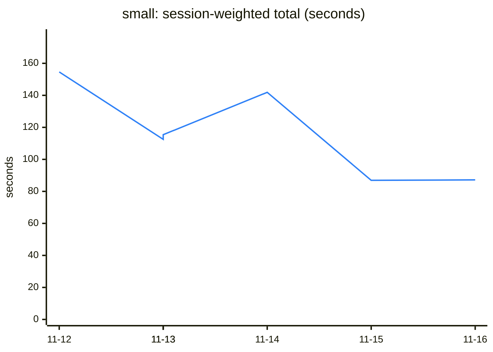
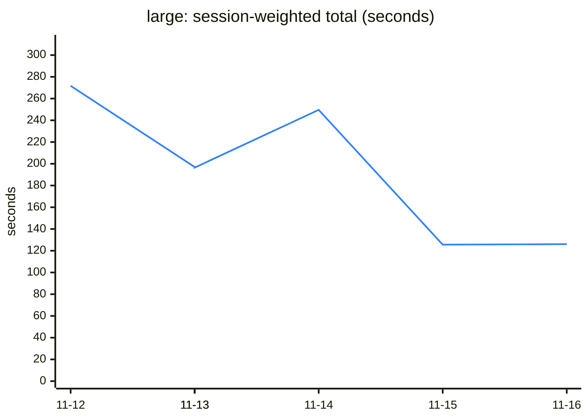
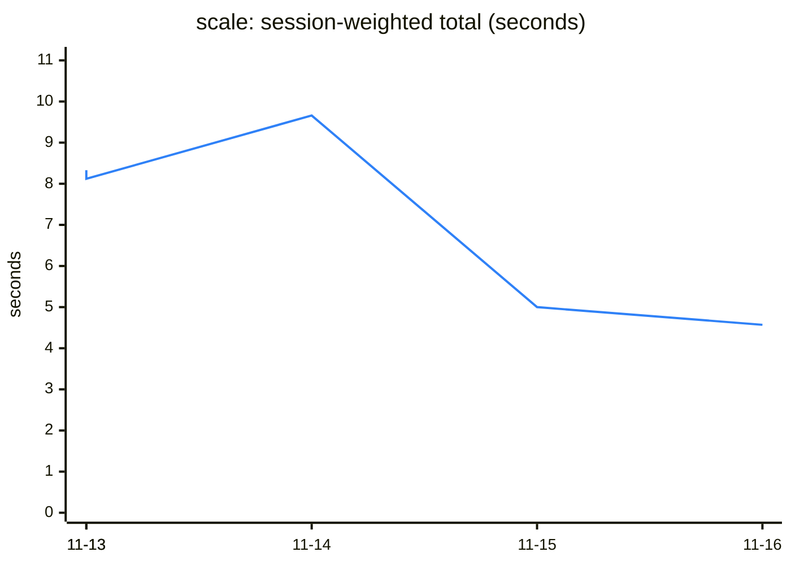
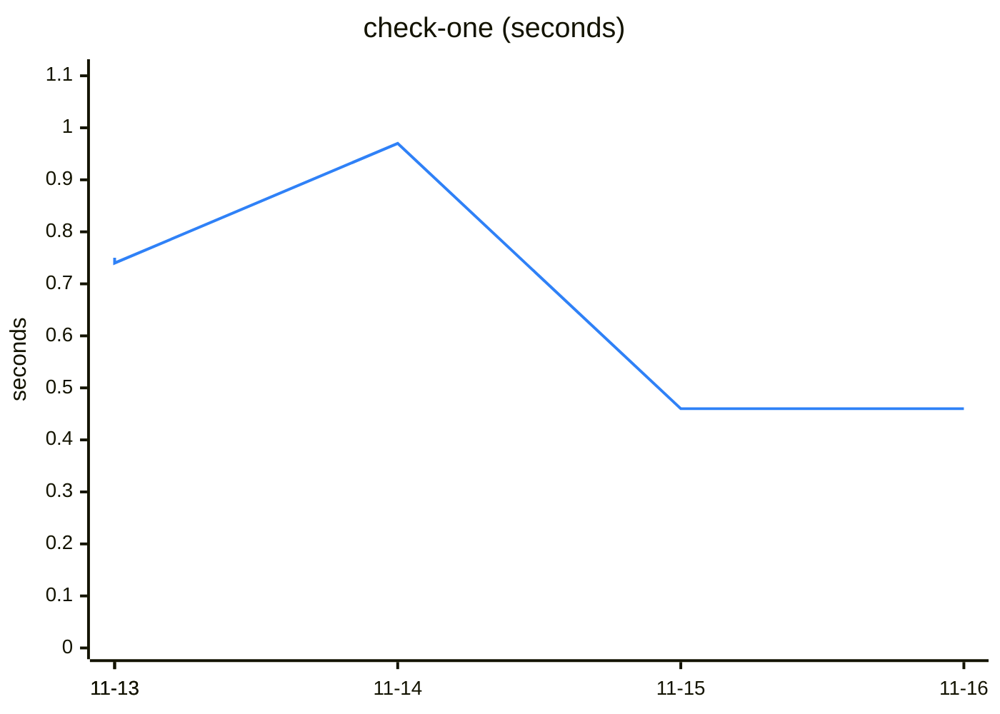
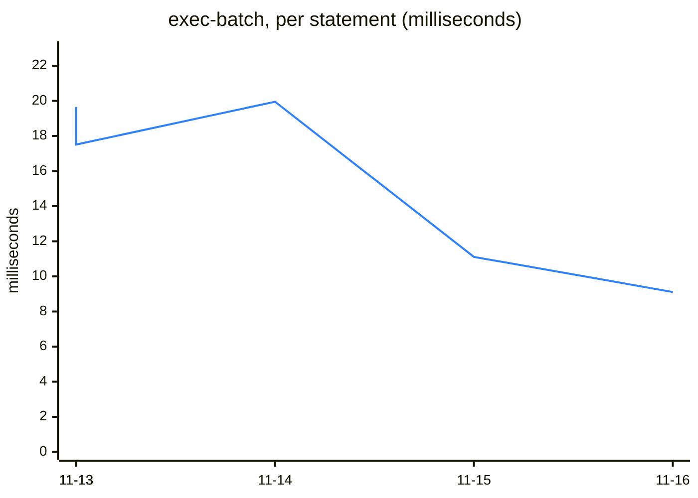
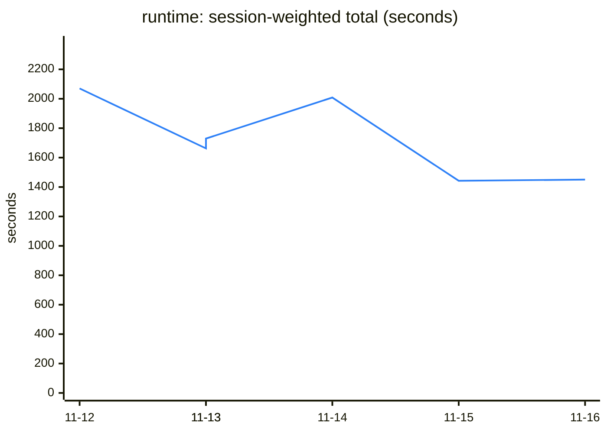

# Agent dev-loop benchmark — trend

6 runs, 2026-11-12 to 2026-11-16. Latest: `mxcli version d9d1093 (2026-11-16T09:02:58Z)` against `mxcli version nightly-20261113-df9084d41 (2026-11-13T10:08:50Z)`.

Generated by `scripts/agentbench/trend` after each run; do not edit. Times are the candidate's median wall time on that night's runner, so two nights differ by the machine as well as by the code: read a level that stays, not one night's step. How to read it: `docs-site/src/internals/agent-benchmark.md` on `main`.

## Alerts

None.

## small project — 370 units

| step | latest | run before | median of the 7 before | against that median | against its baseline, latest | last runs |
|---|---:|---:|---:|---:|---:|---|
| (session-weighted total) | 87.2 s | 86.9 s | 115.4 s | × 0.76 | × 0.91 | █▄▄▇▁▁ |
| open-cold | 133 ms | 166 ms | 190 ms | × 0.70 | × 1.02 | ▆▆█▇▄▁ |
| open | 45 ms | 48 ms | 56 ms | × 0.79 | × 1.02 | █▃▅█▂▁ |
| domain | 583 ms | 560 ms | 691 ms | × 0.84 | × 1.01 | █▁▁▂▁▁ |
| microflows | 391 ms | 499 ms | 609 ms | × 0.64 | × 0.99 | █▃▅▄▂▁ |
| pages | 1.35 s | 1.50 s | 1.95 s | × 0.69 | × 1.00 | █▂▄▄▁▁ |
| describe | 105 ms | 106 ms | 128 ms | × 0.82 | × 0.97 | █▃▃▆▁▁ |
| catalog | 171 ms | 189 ms | 223 ms | × 0.77 | × 1.00 | █▄▄█▂▁ |
| catalog-full | 920 ms | 932 ms | 1.09 s | × 0.84 | × 1.00 | █▃▃█▁▁ |
| query | 64 ms | 69 ms | 79 ms | × 0.82 | × 1.08 | █▄▃█▁▁ |
| check | 278 ms | 274 ms | 447 ms | × 0.62 | × 0.73 | █▄▅█▁▁ |
| single-edit | 294 ms | 289 ms | 347 ms | × 0.85 | × 1.02 | █▃▄█▁▁ |
| catalog-after-edit | 167 ms | 179 ms | 225 ms | × 0.74 | × 0.99 | █▄▅█▁▁ |
| bulk-alter | 964 ms | 997 ms | 1.25 s | × 0.77 | × 1.01 | █▁▂▂▁▁ |
| re-exec | 503 ms | 474 ms | 610 ms | × 0.83 | × 1.02 | █▁▁▂▁▁ |
| rename | 403 ms | 388 ms | 475 ms | × 0.85 | × 0.99 | █▃▃▆▁▁ |

## large project — 910 units

| step | latest | run before | median of the 7 before | against that median | against its baseline, latest | last runs |
|---|---:|---:|---:|---:|---:|---|
| (session-weighted total) | 126.1 s | 125.6 s | 197.0 s | × 0.64 | × 0.78 | █▄▄▇▁▁ |
| open-cold | 255 ms | 306 ms | 361 ms | × 0.70 | × 1.00 | ▆█▆▅▃▁ |
| open | 58 ms | 55 ms | 73 ms | × 0.80 | × 1.08 | █▄▃█▁▁ |
| domain | 676 ms | 623 ms | 811 ms | × 0.83 | × 1.00 | █▁▁▂▁▁ |
| microflows | 897 ms | 991 ms | 1.29 s | × 0.69 | × 0.98 | █▃▃▅▁▁ |
| pages | 1.64 s | 1.61 s | 2.09 s | × 0.78 | × 0.99 | █▂▂▄▁▁ |
| describe | 124 ms | 125 ms | 154 ms | × 0.81 | × 1.01 | █▃▃▆▁▁ |
| catalog | 257 ms | 274 ms | 340 ms | × 0.76 | × 1.00 | █▄▄█▁▁ |
| catalog-full | 2.90 s | 2.73 s | 3.36 s | × 0.86 | × 1.00 | █▃▃█▁▁ |
| query | 67 ms | 72 ms | 81 ms | × 0.82 | × 1.00 | █▃▄█▂▁ |
| check | 425 ms | 418 ms | 979 ms | × 0.43 | × 0.52 | █▅▅▇▁▁ |
| single-edit | 419 ms | 417 ms | 521 ms | × 0.80 | × 1.00 | █▄▄█▁▁ |
| catalog-after-edit | 246 ms | 299 ms | 359 ms | × 0.68 | × 1.00 | █▇▅█▃▁ |
| bulk-alter | 1.17 s | 1.17 s | 1.45 s | × 0.81 | × 1.00 | █▁▁▂▁▁ |
| re-exec | 682 ms | 650 ms | 804 ms | × 0.85 | × 0.99 | █▁▁▂▁▁ |
| rename | 808 ms | 756 ms | 969 ms | × 0.83 | × 0.99 | █▄▄▇▁▁ |

## scale project — 4374 units

| step | latest | run before | median of the 7 before | against that median | against its baseline, latest | last runs |
|---|---:|---:|---:|---:|---:|---|
| (session-weighted total) | 4.57 s | 5.00 s | 8.22 s | × 0.56 | × 0.74 | ▆▆█▁▁ |
| check-cold | 1.25 s | 1.39 s | 2.06 s | × 0.61 | × 0.83 | ▆▆█▁▁ |
| check-one | 456 ms | 456 ms | 742 ms | × 0.62 | × 0.78 | ▅▅█▁▁ |
| check-batch | 865 ms | 800 ms | 1.31 s | × 0.66 | × 0.78 | ▅▅█▁▁ |
| exec-batch | 911 ms | 1.11 s | 1.86 s | × 0.49 | × 0.71 | █▇█▂▁ |
| re-exec-batch | 505 ms | 513 ms | 1.03 s | × 0.49 | × 0.59 | ▆▆█▁▁ |
| new-batch | 583 ms | 729 ms | 1.23 s | × 0.48 | × 0.70 | ███▂▁ |

## running app — 476 units

| step | latest | run before | median of the 7 before | against that median | against its baseline, latest | last runs |
|---|---:|---:|---:|---:|---:|---|
| (session-weighted total) | 1450.5 s | 1442.5 s | 1729.5 s | × 0.84 | × 1.00 | █▃▄█▁▁ |
| mx-check | 5.37 s | 5.03 s | 6.36 s | × 0.84 | × 0.99 | █▄▄█▁▁ |
| build | 41.3 s | 44.2 s | 52.7 s | × 0.78 | × 0.99 | █▅▅█▂▁ |
| boot | 22.3 s | 20.8 s | 26.6 s | × 0.84 | × 1.02 | █▃▅▇▁▂ |
| page-check | 2.71 s | 2.46 s | 2.96 s | × 0.91 | × 1.10 | █▄▅█▁▃ |
| hot-apply | 4.33 s | 4.61 s | 5.23 s | × 0.83 | × 1.00 | █▄▅▇▂▁ |
| test-attach | 92 ms | 109 ms | 117 ms | × 0.79 | × 0.96 | █▃▄▇▃▁ |
| apply-entity | 13.8 s | 14.5 s | 16.6 s | × 0.83 | × 1.00 | █▃▄▇▂▁ |
| stop | 528 ms | 729 ms | 736 ms | × 0.72 | × 0.84 | █▆▆█▆▁ |
| test-cold | 18.1 s | 18.4 s | 20.7 s | × 0.88 | × 0.91 | █▃▃█▁▁ |
