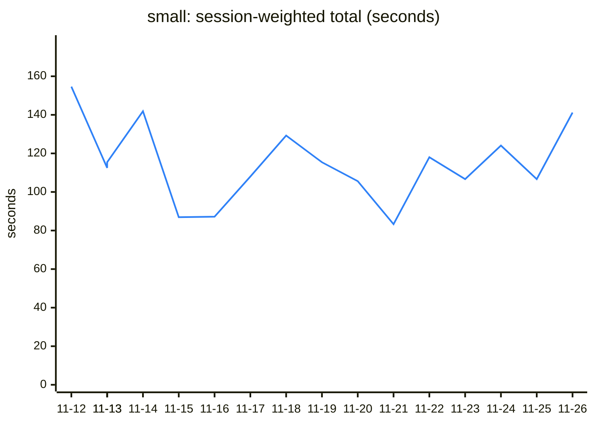
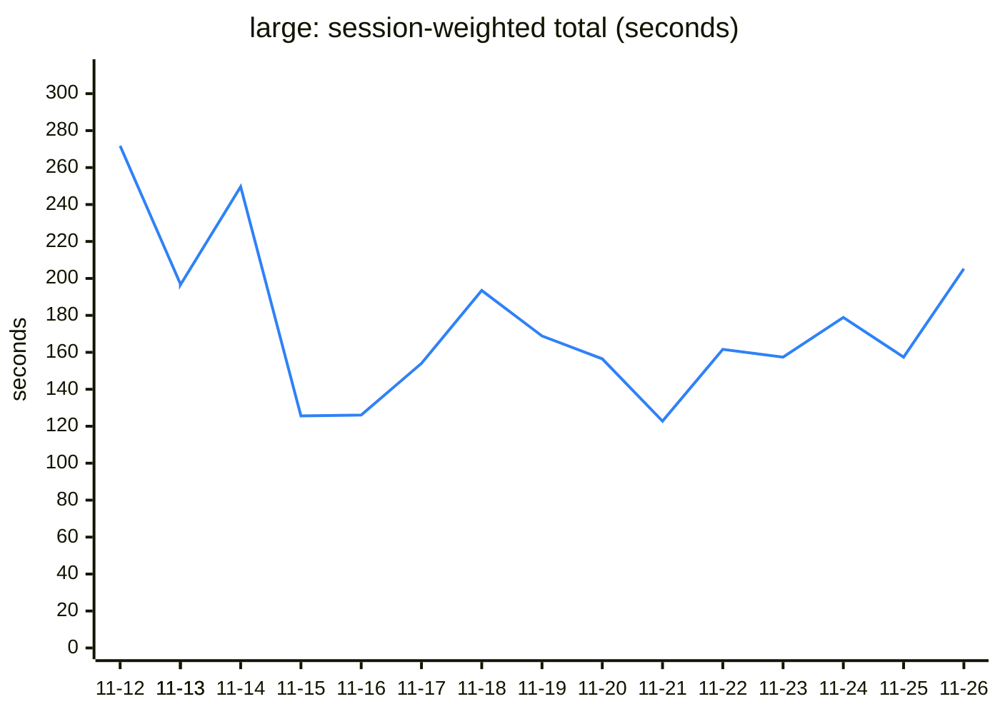
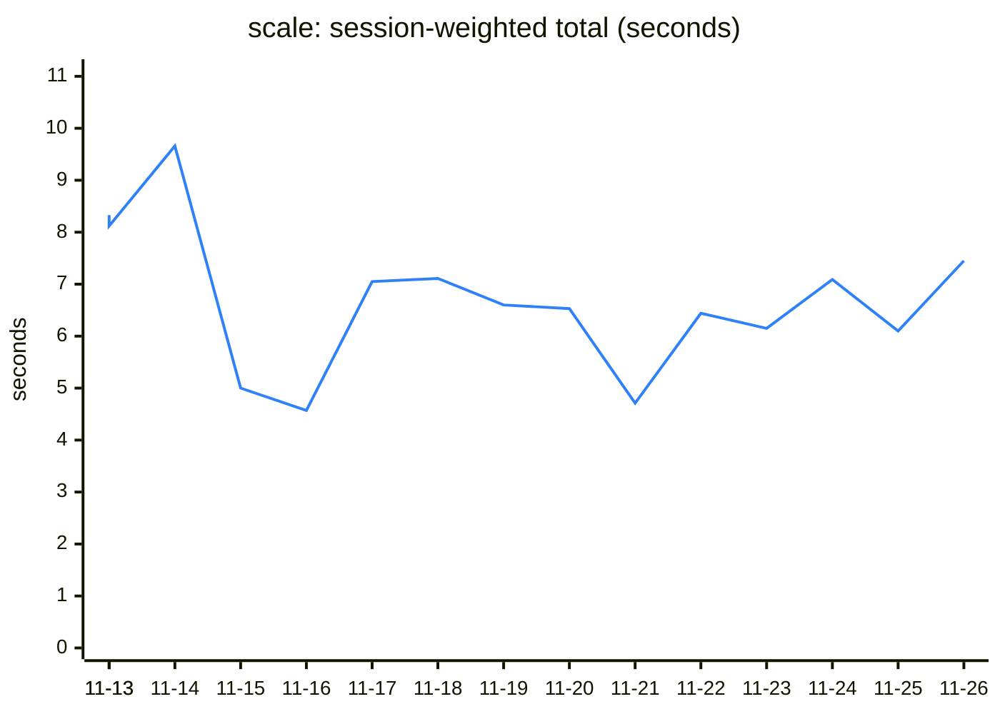
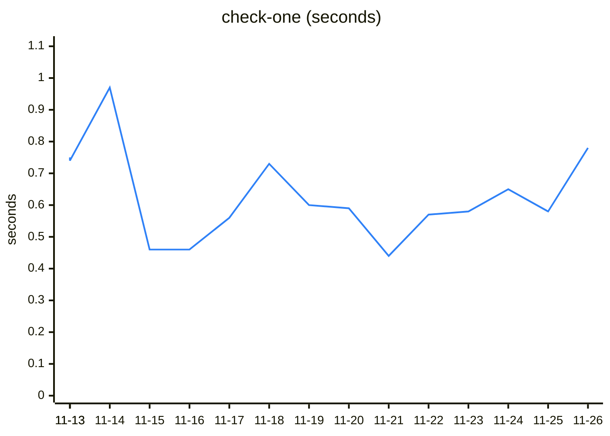
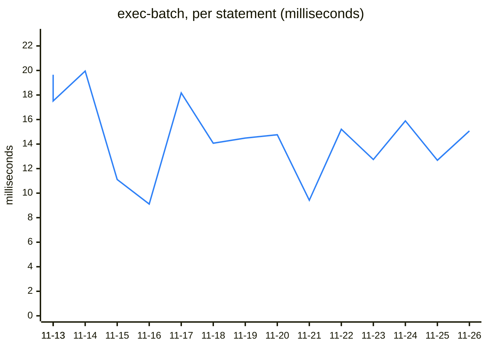
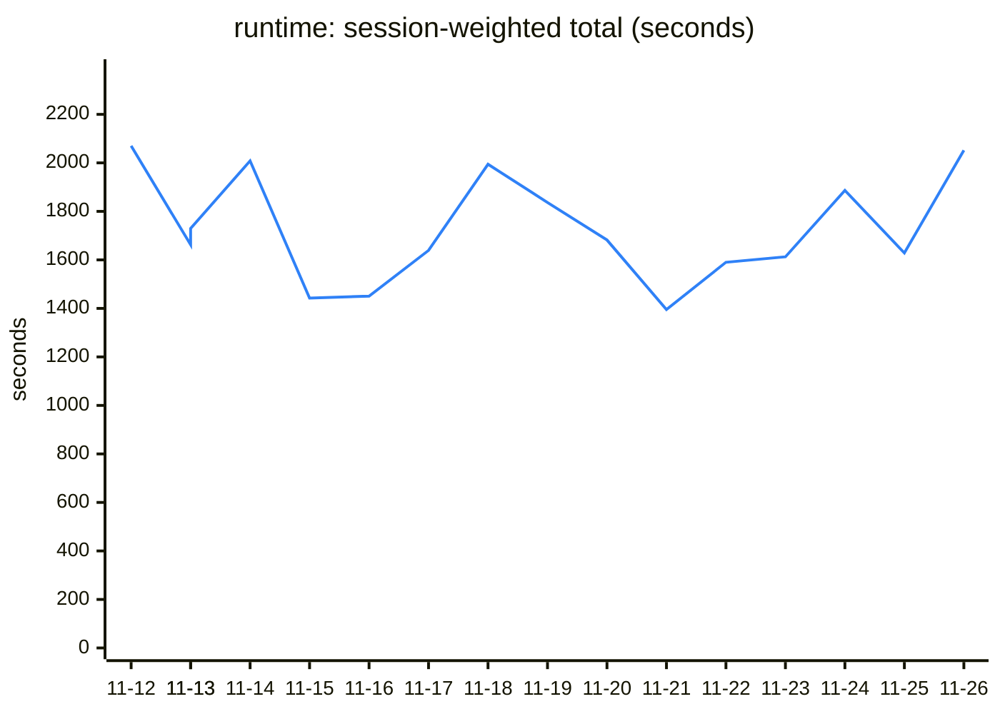

# Agent dev-loop benchmark — trend

16 runs, 2026-11-12 to 2026-11-26. Latest: `mxcli version a360cfa (2026-11-26T10:29:46Z)` against `mxcli version nightly-20261125-0ecca5cbd (2026-11-25T11:50:36Z)`.

Generated by `scripts/agentbench/trend` after each run; do not edit. Times are the candidate's median wall time on that night's runner, so two nights differ by the machine as well as by the code: read a level that stays, not one night's step. How to read it: `docs-site/src/internals/agent-benchmark.md` on `main`.

## Alerts

None.

## small project — 370 units

| step | latest | run before | median of the 7 before | against that median | against its baseline, latest | last runs |
|---|---:|---:|---:|---:|---:|---|
| (session-weighted total) | 141.2 s | 106.6 s | 106.6 s | × 1.32 | × 1.00 | ▅█▁▁▄▇▅▄▁▅▄▆▄█ |
| open-cold | 197 ms | 199 ms | 193 ms | × 1.02 | × 0.99 | ▇▆▃▁▅▆▇▆▃▅▅█▆▆ |
| open | 73 ms | 59 ms | 57 ms | × 1.28 | × 1.04 | ▄▇▂▁▄▇▆▃▁▃▄▆▅█ |
| domain | 938 ms | 691 ms | 697 ms | × 1.35 | × 1.01 | ▄▇▁▁▃▇▆▄▁▄▄▇▄█ |
| microflows | 689 ms | 532 ms | 598 ms | × 1.15 | × 1.01 | █▆▃▁▅▇▆▇▄▆▄▇▄█ |
| pages | 2.17 s | 1.68 s | 1.75 s | × 1.24 | × 1.00 | ▇▇▂▁▅▇▆▃▁▇▅▇▄█ |
| describe | 169 ms | 125 ms | 125 ms | × 1.36 | × 1.02 | ▃▇▁▁▃▇▅▃▁▃▃▆▃█ |
| catalog | 300 ms | 230 ms | 225 ms | × 1.33 | × 1.00 | ▄▇▂▁▄▇▅▄▁▄▄▅▄█ |
| catalog-full | 1.49 s | 1.06 s | 1.11 s | × 1.35 | × 1.01 | ▃█▁▁▄█▅▄▁▄▃▆▃█ |
| query | 111 ms | 82 ms | 82 ms | × 1.36 | × 1.01 | ▃▆▁▁▃▆▅▃▁▃▃▅▃█ |
| check | 451 ms | 339 ms | 336 ms | × 1.34 | × 0.99 | ▅█▁▁▃▄▃▂▁▂▂▄▂▅ |
| single-edit | 472 ms | 356 ms | 359 ms | × 1.31 | × 1.01 | ▃▆▁▁▄▇▅▄▁▇▄▆▄█ |
| catalog-after-edit | 301 ms | 235 ms | 244 ms | × 1.23 | × 1.02 | ▄▆▁▁▄▆▅▅▂▅▄▇▅█ |
| bulk-alter | 1.55 s | 1.24 s | 1.33 s | × 1.16 | × 1.02 | ▄▆▂▁▇▆▆█▁▅▅▇▄█ |
| re-exec | 791 ms | 599 ms | 592 ms | × 1.34 | × 1.02 | ▄▆▁▁▄▇▆▄▁▄▄▆▄█ |
| rename | 662 ms | 492 ms | 509 ms | × 1.30 | × 0.99 | ▃▆▁▁▃▇▅▄▁█▃▆▃▇ |

## large project — 910 units

| step | latest | run before | median of the 7 before | against that median | against its baseline, latest | last runs |
|---|---:|---:|---:|---:|---:|---|
| (session-weighted total) | 205.2 s | 157.4 s | 157.4 s | × 1.30 | × 1.01 | ▅█▁▁▂▅▃▃▁▃▃▄▃▆ |
| open-cold | 369 ms | 370 ms | 370 ms | × 1.00 | × 1.03 | ▄▄▂▁█▄▅▄▂▄▄▆▄▄ |
| open | 96 ms | 73 ms | 71 ms | × 1.35 | × 1.01 | ▃▇▁▁▃▆▅▃▁▃▄▆▄█ |
| domain | 1.09 s | 836 ms | 837 ms | × 1.30 | × 1.01 | ▄▇▁▁▃▇▆▄▁▄▄▇▄█ |
| microflows | 1.72 s | 1.28 s | 1.28 s | × 1.34 | × 1.01 | ▄▇▁▁▄▇▄▄▁▆▄▅▄█ |
| pages | 2.60 s | 2.08 s | 2.09 s | × 1.24 | × 0.99 | ▃▅▁▁▃▆▅▃▁█▃▆▃▆ |
| describe | 204 ms | 155 ms | 155 ms | × 1.32 | × 1.01 | ▄▇▁▁▃▇▅▄▁▄▃▆▄█ |
| catalog | 451 ms | 345 ms | 342 ms | × 1.32 | × 1.02 | ▄█▁▁▃█▅▄▁▄▄▆▄█ |
| catalog-full | 4.61 s | 3.28 s | 3.36 s | × 1.37 | × 1.01 | ▃█▁▁▃█▆▃▁▃▃▆▃█ |
| query | 108 ms | 81 ms | 82 ms | × 1.32 | × 0.99 | ▃▇▂▁▃▇▅▃▁▄▃▆▃█ |
| check | 689 ms | 519 ms | 521 ms | × 1.32 | × 1.01 | ▆█▁▁▁▃▂▂▁▂▂▂▂▃ |
| single-edit | 679 ms | 525 ms | 525 ms | × 1.29 | × 1.00 | ▄▇▁▁▄▇▅▄▁▅▄▆▄█ |
| catalog-after-edit | 434 ms | 368 ms | 368 ms | × 1.18 | × 1.02 | ▄▆▃▁▄▆▅█▂▆▅▇▆█ |
| bulk-alter | 1.88 s | 1.53 s | 1.65 s | × 1.14 | × 1.00 | ▃▇▁▁▅▇▆▆▁█▄▇▅█ |
| re-exec | 1.06 s | 827 ms | 827 ms | × 1.28 | × 1.00 | ▄▇▁▁▃█▆▄▁▅▄▇▄█ |
| rename | 1.29 s | 936 ms | 950 ms | × 1.36 | × 1.01 | ▄█▁▁▆█▆▃▁▄▃▆▃█ |

## scale project — 4374 units

| step | latest | run before | median of the 7 before | against that median | against its baseline, latest | last runs |
|---|---:|---:|---:|---:|---:|---|
| (session-weighted total) | 7.45 s | 6.10 s | 6.44 s | × 1.16 | × 1.00 | ▆█▁▁▄▄▄▄▁▃▃▄▃▅ |
| check-cold | 1.99 s | 1.74 s | 1.74 s | × 1.15 | × 1.00 | ▆█▁▁▅▅▄▄▁▄▄▅▄▆ |
| check-one | 777 ms | 578 ms | 583 ms | × 1.33 | × 1.00 | ▅█▁▁▂▅▃▃▁▃▃▄▃▆ |
| check-batch | 1.38 s | 1.03 s | 1.03 s | × 1.34 | × 1.00 | ▅█▁▁▂▅▄▃▁▃▃▄▃▆ |
| exec-batch | 1.51 s | 1.27 s | 1.45 s | × 1.04 | × 0.99 | ▇█▂▁▇▄▄▅▁▅▃▆▃▅ |
| re-exec-batch | 790 ms | 639 ms | 639 ms | × 1.24 | × 1.00 | ▆█▁▁▂▃▂▂▁▂▂▃▂▄ |
| new-batch | 1.00 s | 848 ms | 940 ms | × 1.07 | × 1.02 | ██▂▁▇▅▄▅▂▅▄▆▃▅ |

## running app — 476 units

| step | latest | run before | median of the 7 before | against that median | against its baseline, latest | last runs |
|---|---:|---:|---:|---:|---:|---|
| (session-weighted total) | 2052.0 s | 1628.5 s | 1628.5 s | × 1.26 | × 1.00 | ▅█▁▁▃█▆▄▁▃▃▆▃█ |
| mx-check | 8.65 s | 6.19 s | 6.09 s | × 1.42 | × 1.01 | ▄▇▁▂▃▇▆▃▁▃▃▆▄█ |
| build | 58.8 s | 50.5 s | 50.5 s | × 1.16 | × 1.00 | ▆█▂▁▅██▅▁▄▄█▅█ |
| boot | 30.1 s | 24.1 s | 24.1 s | × 1.25 | × 1.02 | ▅█▁▂▃▇▅▃▂▃▄▇▃█ |
| page-check | 3.23 s | 3.01 s | 2.92 s | × 1.11 | × 1.01 | ▅█▁▃▄██▅▁▂▄█▆█ |
| hot-apply | 5.55 s | 4.68 s | 4.68 s | × 1.18 | × 0.99 | ▆█▂▁▄█▄▅▁▂▂▄▂▇ |
| test-attach | 140 ms | 116 ms | 116 ms | × 1.20 | × 0.97 | ▄▇▃▁▃█▅▄▃▂▄▅▄▇ |
| apply-entity | 18.7 s | 15.4 s | 15.6 s | × 1.20 | × 1.03 | ▅█▂▁▅█▆▅▂▃▃▇▃█ |
| stop | 845 ms | 736 ms | 737 ms | × 1.15 | × 1.00 | ▅▇▄▁▅▇▅▇▃█▅▅▅▇ |
| test-cold | 24.9 s | 20.5 s | 20.5 s | × 1.22 | × 0.99 | ▄█▂▁▄█▆▄▁▃▃█▄█ |
