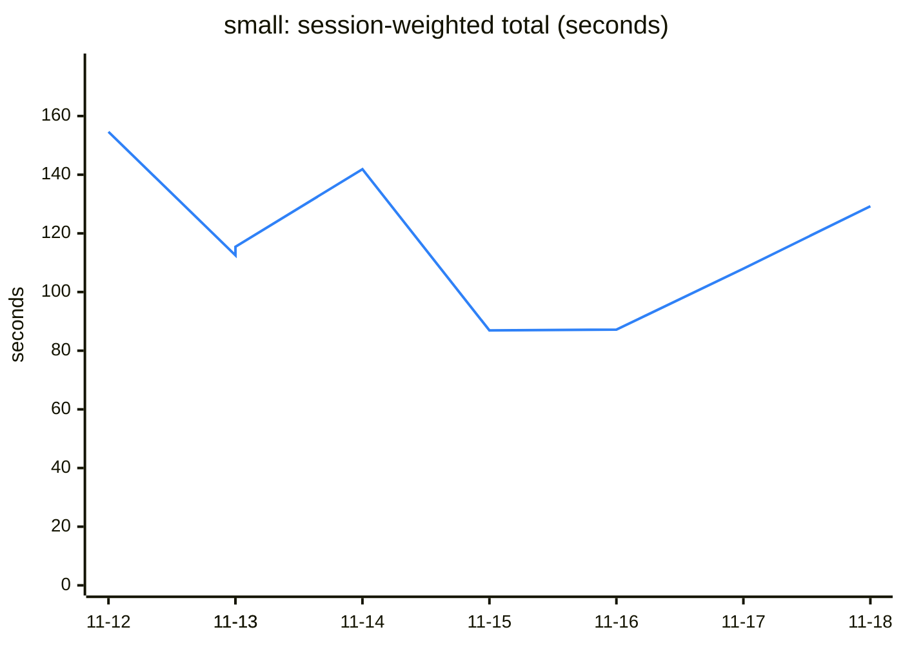
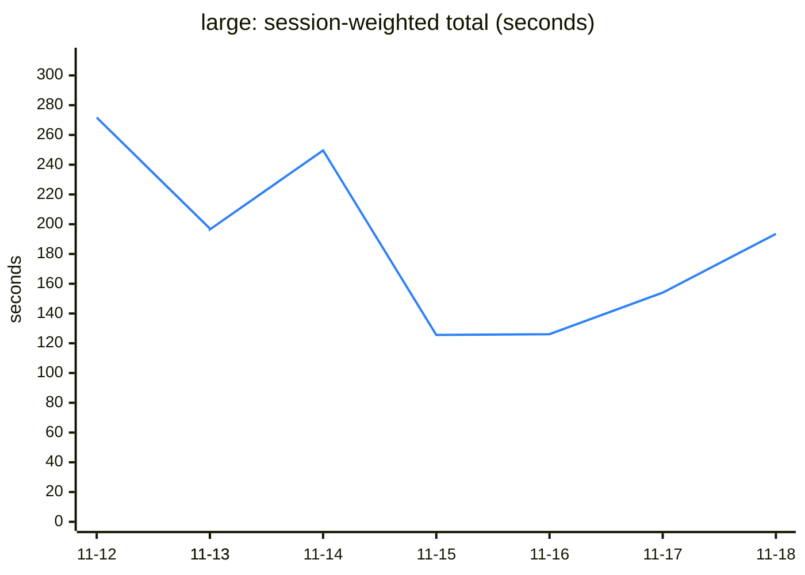
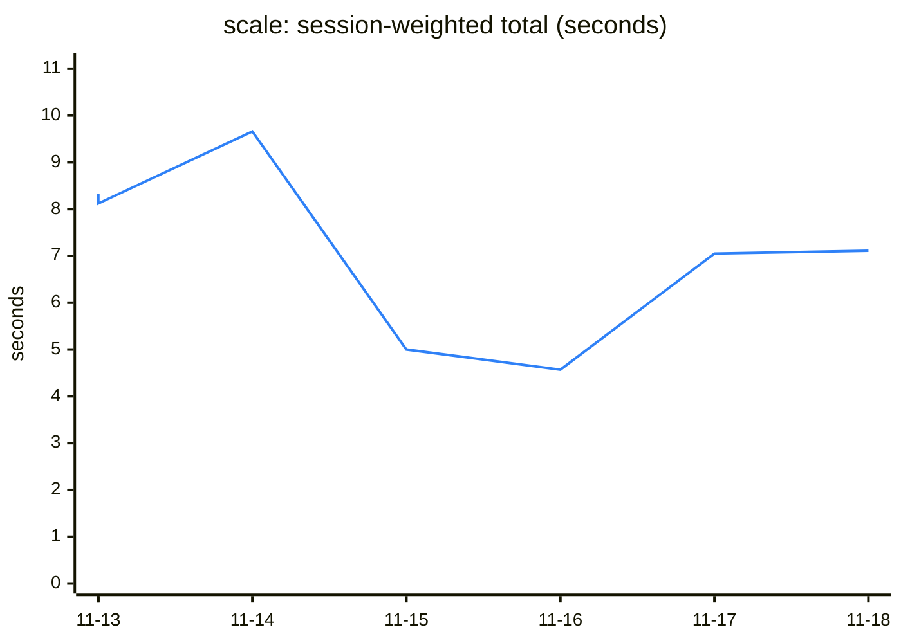
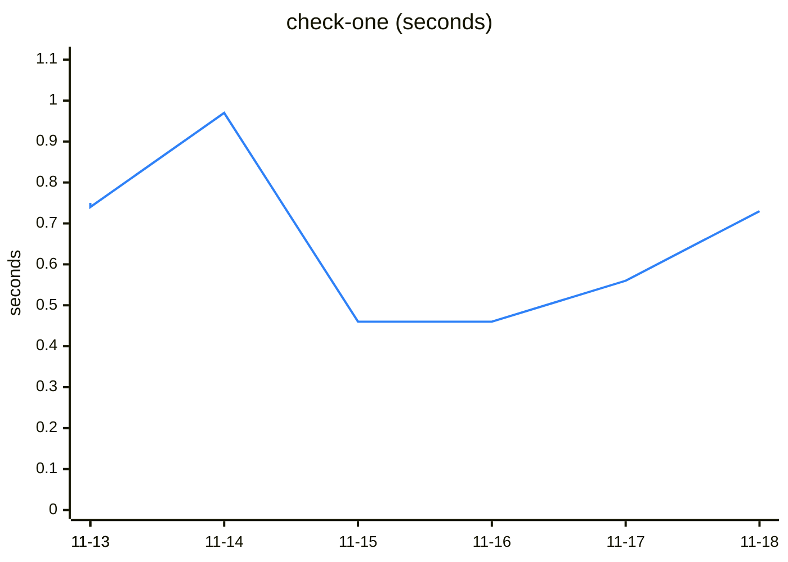
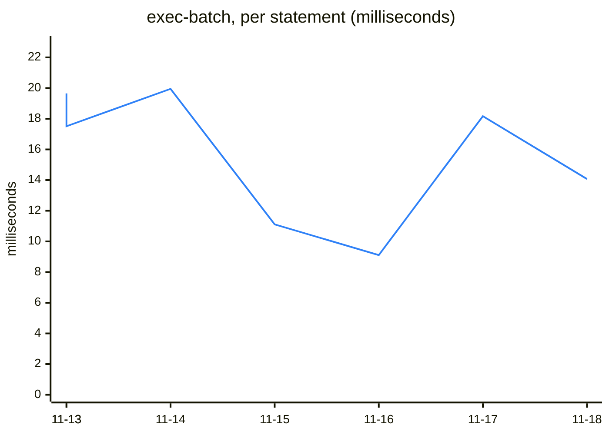
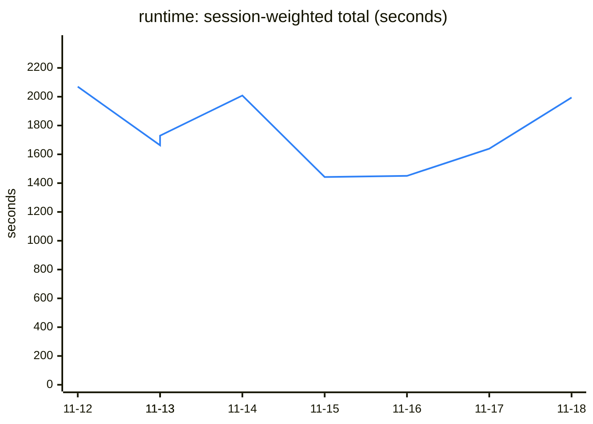

# Agent dev-loop benchmark — trend

8 runs, 2026-11-12 to 2026-11-18. Latest: `mxcli version 43b997f (2026-11-18T09:46:41Z)` against `mxcli version nightly-20261117-ec45c7b16 (2026-11-17T11:08:35Z)`.

Generated by `scripts/agentbench/trend` after each run; do not edit. Times are the candidate's median wall time on that night's runner, so two nights differ by the machine as well as by the code: read a level that stays, not one night's step. How to read it: `docs-site/src/internals/agent-benchmark.md` on `main`.

## Alerts

None.

## small project — 370 units

| step | latest | run before | median of the 7 before | against that median | against its baseline, latest | last runs |
|---|---:|---:|---:|---:|---:|---|
| (session-weighted total) | 129.3 s | 108.0 s | 112.5 s | × 1.15 | × 0.99 | █▄▄▇▁▁▃▆ |
| open-cold | 189 ms | 187 ms | 188 ms | × 1.01 | × 1.03 | ▆▆█▇▄▁▆▆ |
| open | 67 ms | 58 ms | 56 ms | × 1.19 | × 0.99 | █▃▅█▂▁▅█ |
| domain | 856 ms | 678 ms | 678 ms | × 1.26 | × 1.00 | █▁▁▂▁▁▁▂ |
| microflows | 638 ms | 573 ms | 573 ms | × 1.11 | × 1.02 | █▃▅▄▂▁▃▄ |
| pages | 2.00 s | 1.73 s | 1.73 s | × 1.15 | × 1.01 | █▂▄▄▁▁▂▄ |
| describe | 159 ms | 123 ms | 126 ms | × 1.26 | × 0.98 | █▃▃▆▁▁▂▆ |
| catalog | 278 ms | 223 ms | 223 ms | × 1.25 | × 0.98 | █▄▄█▂▁▄█ |
| catalog-full | 1.43 s | 1.11 s | 1.09 s | × 1.31 | × 0.99 | █▃▃█▁▁▃█ |
| query | 96 ms | 82 ms | 79 ms | × 1.23 | × 0.98 | █▄▃█▁▁▄▇ |
| check | 418 ms | 343 ms | 439 ms | × 0.95 | × 1.01 | █▄▅█▁▁▂▄ |
| single-edit | 428 ms | 363 ms | 347 ms | × 1.23 | × 0.99 | █▃▄█▁▁▄█ |
| catalog-after-edit | 267 ms | 226 ms | 225 ms | × 1.19 | × 1.00 | █▄▅█▁▁▅█ |
| bulk-alter | 1.40 s | 1.48 s | 1.25 s | × 1.12 | × 1.00 | █▁▂▂▁▁▃▂ |
| re-exec | 732 ms | 589 ms | 589 ms | × 1.24 | × 1.01 | █▁▁▂▁▁▁▂ |
| rename | 639 ms | 497 ms | 475 ms | × 1.34 | × 1.00 | █▃▃▆▁▁▃▇ |

## large project — 910 units

| step | latest | run before | median of the 7 before | against that median | against its baseline, latest | last runs |
|---|---:|---:|---:|---:|---:|---|
| (session-weighted total) | 193.5 s | 154.0 s | 196.5 s | × 0.98 | × 1.00 | █▄▄▇▁▁▂▄ |
| open-cold | 362 ms | 510 ms | 361 ms | × 1.00 | × 1.03 | ▄▆▄▄▂▁█▄ |
| open | 85 ms | 68 ms | 68 ms | × 1.24 | × 1.00 | █▄▃█▁▁▃▇ |
| domain | 1.02 s | 785 ms | 807 ms | × 1.26 | × 1.01 | █▁▁▂▁▁▁▂ |
| microflows | 1.55 s | 1.24 s | 1.24 s | × 1.25 | × 1.00 | █▃▃▅▁▁▃▅ |
| pages | 2.46 s | 2.06 s | 2.06 s | × 1.19 | × 1.00 | █▂▂▄▁▁▂▄ |
| describe | 192 ms | 148 ms | 153 ms | × 1.26 | × 1.02 | █▃▃▆▁▁▃▆ |
| catalog | 429 ms | 325 ms | 327 ms | × 1.31 | × 1.01 | █▄▄█▁▁▄█ |
| catalog-full | 4.49 s | 3.31 s | 3.32 s | × 1.35 | × 1.00 | █▃▃█▁▁▃█ |
| query | 102 ms | 79 ms | 79 ms | × 1.29 | × 0.96 | █▃▄█▂▁▃█ |
| check | 655 ms | 514 ms | 972 ms | × 0.67 | × 1.00 | █▅▅▇▁▁▁▂ |
| single-edit | 640 ms | 512 ms | 515 ms | × 1.24 | × 1.01 | █▄▄█▁▁▄█ |
| catalog-after-edit | 386 ms | 333 ms | 333 ms | × 1.16 | × 0.99 | █▇▅█▃▁▅█ |
| bulk-alter | 1.75 s | 1.59 s | 1.45 s | × 1.20 | × 1.00 | █▁▁▂▁▁▂▃ |
| re-exec | 1.01 s | 789 ms | 796 ms | × 1.27 | × 0.99 | █▁▁▂▁▁▁▂ |
| rename | 1.26 s | 1.11 s | 969 ms | × 1.30 | × 0.99 | █▄▄▇▁▁▆█ |

## scale project — 4374 units

| step | latest | run before | median of the 7 before | against that median | against its baseline, latest | last runs |
|---|---:|---:|---:|---:|---:|---|
| (session-weighted total) | 7.11 s | 7.05 s | 7.58 s | × 0.94 | × 1.00 | ▆▆█▁▁▄▄ |
| check-cold | 1.94 s | 1.94 s | 1.99 s | × 0.97 | × 1.01 | ▆▆█▁▁▅▅ |
| check-one | 731 ms | 559 ms | 648 ms | × 1.13 | × 1.01 | ▅▅█▁▁▂▅ |
| check-batch | 1.31 s | 983 ms | 1.14 s | × 1.15 | × 1.00 | ▅▅█▁▁▂▅ |
| exec-batch | 1.41 s | 1.82 s | 1.78 s | × 0.79 | × 1.00 | █▇█▂▁▇▄ |
| re-exec-batch | 768 ms | 626 ms | 822 ms | × 0.93 | × 0.99 | ▆▆█▁▁▂▃ |
| new-batch | 959 ms | 1.12 s | 1.17 s | × 0.82 | × 1.01 | ███▂▁▇▅ |

## running app — 476 units

| step | latest | run before | median of the 7 before | against that median | against its baseline, latest | last runs |
|---|---:|---:|---:|---:|---:|---|
| (session-weighted total) | 1994.3 s | 1639.0 s | 1662.7 s | × 1.20 | × 0.99 | █▃▄█▁▁▃█ |
| mx-check | 7.96 s | 6.04 s | 6.27 s | × 1.27 | × 0.98 | █▄▄█▁▁▃█ |
| build | 57.4 s | 50.2 s | 51.1 s | × 1.12 | × 0.99 | █▅▅█▂▁▄█ |
| boot | 28.6 s | 23.3 s | 23.6 s | × 1.21 | × 1.01 | █▃▅▇▁▂▂▇ |
| page-check | 3.31 s | 2.83 s | 2.86 s | × 1.16 | × 0.99 | █▄▅█▁▃▄█ |
| hot-apply | 5.75 s | 4.91 s | 5.15 s | × 1.12 | × 0.96 | █▄▅▇▂▁▃▇ |
| test-attach | 150 ms | 112 ms | 112 ms | × 1.34 | × 1.15 | █▃▄▇▃▁▃█ |
| apply-entity | 18.7 s | 16.3 s | 16.3 s | × 1.14 | × 1.00 | █▃▄▇▂▁▄▇ |
| stop | 842 ms | 734 ms | 735 ms | × 1.15 | × 1.00 | █▆▆█▆▁▆█ |
| test-cold | 25.1 s | 21.1 s | 20.7 s | × 1.21 | × 0.96 | █▃▃█▁▁▄█ |
